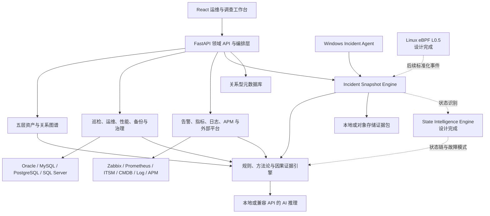
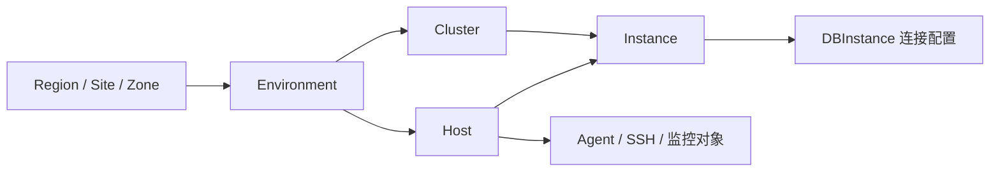

# TraceMind AI 项目总览

文档基线：2026-08-13

## 1. 产品定位

TraceMind AI 是数据库智能运维与企业故障调查平台。它不只展示指标，而是把资产、拓扑、数据库、主机、监控、日志、调用链、巡检、变更和现场快照组织成可验证的证据，再由规则、因果分析和 AI 共同形成诊断结论。

目标闭环：

```text
发现异常 -> 关联资产 -> 冻结现场 -> 识别状态变化 -> 构建证据链
        -> 定位根因 -> 生成处置方案 -> 审批执行 -> 验证恢复 -> 沉淀知识
```

支持的数据库类型：

- Oracle
- MySQL
- PostgreSQL
- SQL Server
- DomesticDB 作为统一扩展类型，具体产品通过适配器接入

系统不再通过单一数据库版本开关裁剪功能。一个部署可以同时管理不同数据库类型，前端运维能力按当前选中的实例自动适配。

## 2. 当前总体架构



### 2.1 当前已运行的主链路

```text
资产/实例配置
  -> 连接测试或人工触发自动识别
  -> 四引擎采集器和外部观测适配器
  -> 结构化指标、SQL 结果、告警、日志和 Trace
  -> 规则与方法论诊断
  -> 可选 AI 证据归纳
  -> 报告、通知、工单或审批方案
```

```text
Agent 连续采集
  -> 本地分段环形缓存
  -> 人工或规则触发
  -> 冻结故障前后窗口
  -> 分片上传与完整性校验
  -> 时间线、证据卡、因果图和重分析
```

### 2.2 下一阶段主链路

```text
指标/事件/eBPF/ETW/线程/数据库状态
  -> 状态识别
  -> 状态转换时间线
  -> 故障模式匹配
  -> 内存、线程、动态探针和 Dump 深度采集
  -> Scene Context Pack
  -> 证据约束的 RCA 与 AI 解释
```

## 3. 五层资产模型

资产中心使用明确的层级和关系，不再把主机、集群和实例混在同一平铺模型中。



核心约束：

- 每个实例有 `db_type`、`host_id`、`cluster_id`、区域和环境归属。
- 单机实例也进入 `single` 或 `standalone` 集群，避免出现无拓扑孤儿。
- 支持 `single`、`primary_replica`、`mgr`、`rac`、`adg`、`alwayson`、`streaming_replication` 和 `sharding`。
- 实例角色使用标准枚举，自动识别结果可以人工校正并锁定字段。
- 自动发现记录批次、冲突、建议集群和待确认实例；人工修改记录修改前后值、操作人、时间和原因。
- 外部 CMDB 是可选数据源，TraceMind 自身也维护规范化资产和关系。

## 4. 数据与证据分层

| 层级 | 保存内容 | 保存策略 | 用途 |
| --- | --- | --- | --- |
| L1 状态层 | 状态码、状态转换、故障模式 | 长期 | 趋势、回放、模式学习 |
| L2 结构化证据层 | 指标、告警、SQL、日志摘要、Trace、事件 | 中期 | 规则、相关性、报告和 AI 上下文 |
| L3 原始现场层 | Snapshot bundle、原始日志、线程栈、Dump、动态探针输出 | 短期或 legal hold | 深度调查和复盘 |

当前 L2 已覆盖数据库、主机、监控、日志和 APM，Incident Snapshot 已覆盖部分 L3。L1 状态引擎、深度 Dump 和 eBPF 仍处于设计与计划阶段。

## 5. 目录结构

```text
mesdbtools/
├── run.py                         # 本地前后端启动器
├── backend/
│   ├── app/main.py                # FastAPI 应用与生命周期
│   ├── app/api/v1/registry.py     # 领域路由注册
│   ├── app/cmdb/                  # 资产与拓扑
│   ├── app/incident_snapshot/     # 现场快照
│   ├── app/automation/            # 审批执行
│   ├── app/identity/              # 企业认证
│   ├── app/notify/                # 通知
│   ├── app/itsm/                  # 工单
│   ├── app/services/              # 业务服务和适配器
│   └── tests/                     # 后端测试
├── frontend/
│   ├── src/menuConfig.jsx         # 菜单信息架构
│   ├── src/AppPageRouter.jsx      # 页面路由
│   ├── src/pages/                 # 页面实现
│   └── tests/                     # 前端测试
├── agent/                         # Go Windows Incident Agent
├── scripts/                       # 构建、静态检查和冒烟
├── docs/                          # 当前产品与研发文档
└── work/                          # 历史路线资料
```

## 6. 本地运行

### 6.1 完整启动

```bash
cd /Users/zhaolongjie/codex/mesdbtools
FRONTEND_DEV=true python3 run.py
```

默认地址：

| 服务 | 地址 |
| --- | --- |
| 前端 | `http://127.0.0.1:3300` |
| 后端 | `http://127.0.0.1:8800` |
| 健康检查 | `http://127.0.0.1:8800/health` |
| OpenAPI | `http://127.0.0.1:8800/docs` |

`run.py` 默认使用已构建的静态前端；设置 `FRONTEND_DEV=true` 后使用 Vite。`UVICORN_RELOAD=true` 可开启后端热重载。

### 6.2 核心环境变量

| 变量 | 默认值 | 说明 |
| --- | --- | --- |
| `BACKEND_PORT` | `8800` | 后端端口 |
| `FRONTEND_PORT` | `3300` | 前端端口 |
| `DATABASE_URL` | 开发态本地 SQLite | 平台元数据库连接串 |
| `DB_TYPE` | `sqlite` | 元数据库类型标识 |
| `SECRET_KEY` | 首次启动本地生成 | 平台密钥，生产环境应使用外部安全注入 |
| `CORS_ORIGINS` | 本地 3300 地址 | 允许的前端来源 |
| `INCIDENT_SNAPSHOT_ENABLED` | `true` | 现场快照功能开关 |
| `INCIDENT_SNAPSHOT_STORAGE_DIR` | 运行目录下数据目录 | 原始快照存储位置 |
| `AUTOMATION_EXECUTION_ENABLED` | `false` | 自动化真实执行总开关 |

任何示例都不得提交真实 `DATABASE_URL`、数据库密码、SSH 密码、AI Key、LDAP 密码或第三方 Token。

## 7. 部署形态

| 形态 | 说明 |
| --- | --- |
| 开发模式 | Vite 3300 + Uvicorn 8800 |
| 单机静态模式 | Node 静态服务 3300 + Uvicorn 8800 |
| 桌面免安装包 | PyInstaller 打包后由 `exe_launcher` 同进程拉起后端并提供静态资源 |
| Agent | Windows 单 exe，可注册为服务，也支持本地 `status/doctor/capture` |
| 企业部署目标 | API、调度、对象存储、关系型元数据库和 Agent 网关分离部署，后续增加 HA 与容量门禁 |

## 8. 产品边界

1. 自动发现不是持续覆盖人工数据。人工锁定字段优先，刷新必须显式触发。
2. 巡检成功必须表示连接和检查实际执行成功；连接失败不得生成健康结论。
3. 外部平台“已配置”不等于“当前连接正常”，页面必须显示最近测试、同步和错误信息。
4. AI 不是事实来源。AI 只解释被引用的结构化证据，并保留规则引擎降级路径。
5. 动态探针、Dump、恢复、归档删除和自动化脚本属于高风险能力，必须经过权限、审批、资源预算和审计。
6. eBPF 不能替代数据库采集器、运行时探针或 Dump，它负责高频内核事件和跨层关联锚点。

## 9. 下一步

开发顺序记录在 TraceMind 2026-08-13 开发计划（**已归档冻结，不代表当前计划**）：先稳定现有主链路和 Incident Snapshot MVP，再实现状态智能、深度现场重建、Linux eBPF 和证据约束的 RCA 评测体系。
