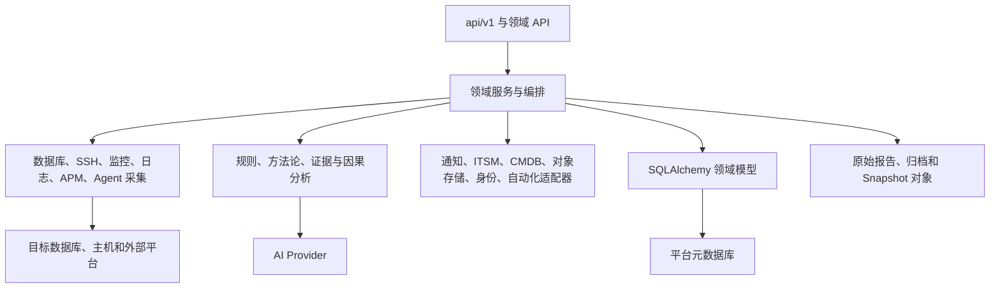

# TraceMind AI 后端架构

文档基线：2026-08-13

## 1. 技术栈与入口

| 项目 | 实现 |
| --- | --- |
| Web 框架 | FastAPI |
| ORM | SQLAlchemy 2.x |
| 数据契约 | Pydantic |
| 默认元数据库 | 开发态 SQLite，可通过 `DATABASE_URL` 切换 |
| 数据库驱动 | `python-oracledb`、PyMySQL、PostgreSQL 和 SQL Server 对应驱动 |
| 后端入口 | `backend/app/main.py` |
| 本地启动 | `backend/run.py` 或根目录 `run.py` |
| 默认端口 | `8800` |
| API 前缀 | `/api/v1` |

`app.main` 在生命周期启动阶段完成表结构兼容、默认配置初始化、资产内置发现源初始化、Incident Snapshot 默认值初始化和主调度器启动。所有业务路由由 `app/api/v1/registry.py` 统一注册，禁止在入口文件分散注册。

## 2. 分层结构



后端遵循以下边界：

- Route 只负责鉴权、参数、错误映射和响应。
- Service 负责事务、幂等、业务状态和跨域编排。
- Collector/Adapter 负责目标系统协议，不在路由中拼接业务逻辑。
- Analyzer 只接收结构化输入，不直接读取前端状态。
- 原始证据与结构化索引分开保存，结构化记录必须能够回指来源。

## 3. 路由分组

`API_MODULE_GROUPS` 是后端路由目录的唯一入口。

| 分组 | 主要前缀 | 能力 |
| --- | --- | --- |
| 启动与认证 | `/setup`、`/auth`、`/system/init` | 初始化、登录、令牌和启动检查 |
| 资产与系统 | `/instances`、`/assets`、`/cmdb`、`/system`、`/users`、`/settings`、`/ssh`、`/identity` | 实例、五层资产、外部 CMDB、用户、SSH 和企业认证 |
| 数据库运维 | `/operations`、`/oracle`、`/mysql`、`/mysql-ops`、`/operations/postgresql`、`/operations/sqlserver` | 四类数据库运维能力 |
| 巡检报告 | `/inspection`、`/postgresql`、`/sqlserver`、`/reports` | 模板、策略、执行、结果和报告 |
| 备份与治理 | `/backup-center`、`/data-governance`、`/recovery`、`/automation` | 备份、恢复、归档、数据治理和审批执行 |
| 性能诊断 | `/oracle`、`/slow-sql`、`/performance`、`/sql-profiles`、`/scheduler` | AWR、SQL、等待、基线、容量和调度 |
| 监控与集成 | `/alert-events`、`/capacity`、`/zabbix`、`/prometheus`、`/observability`、`/notify`、`/itsm` | 告警、指标、日志、Trace、通知和工单 |
| AI 智能诊断 | `/ai`、`/diagnosis`、`/diagnosis-center`、`/incident-*`、`/ai-config` | 规则、方法论、事故、现场快照和模型配置 |

完整关键路径见 [API 参考](03-api-reference.md)。运行服务后以 `/openapi.json` 为最终接口事实。

## 4. 核心领域模型

### 4.1 实例连接与凭据

`DBInstance` 保存目标数据库连接、SSH 关联、架构提示和运行配置。密码通过平台加密能力保存，不在 API 响应中回传明文。

连接测试与自动识别是两个不同动作：

```text
保存配置 -> 只保存
点击测试 -> 验证当前凭据与服务
点击自动识别 -> 连接目标并刷新版本、主机、角色和集群拓扑
```

自动刷新不得在普通保存后隐式执行。实时连接失败时，接口必须返回失败；缓存架构只能作为历史事实展示，并明确标注时间和新鲜度。

### 4.2 五层资产与关系

`app/cmdb/models.py` 已包含：

- `AssetRegion`
- `AssetSite`
- `AssetZone`
- `AssetEnvironment`
- `AssetHost`
- `AssetCluster`
- `AssetInstance`
- `AssetRelation`
- `AssetDiscoveryBatch`
- `AssetCorrectionAudit`
- 外部 CMDB Source、Asset、Relation、Binding、Override 和 Change Event

资产规范化服务负责把数据库连接配置、SSH 主机、发现结果和外部 CMDB 数据合并到统一模型。人工字段通过 `manual_fields` 或 Override 锁定，后续自动发现不能静默覆盖。

### 4.3 巡检

巡检领域包括：

- 四类数据库默认模板与主机模板。
- 自定义检查项和自定义指标测试。
- 模板别名与稳定 ID。
- 单模板单文件导出，多模板 ZIP 打包。
- 导入预览、ID 冲突默认跳过并提醒。
- 内置模板不可删除、不可直接导入导出，需先复制成自定义模板。
- 手动、工作日、按周、按月、按季度和自定义时间调度。
- SQL、脚本行号、执行状态、返回字段、返回行、截断信息和原始结果证据。
- 连接失败、权限不足、语法失败和被安全策略跳过的明确状态。

报告健康分不得把“未执行”“未采集”“连接失败”计为正常。模板运行时按当前数据库类型、版本、账号能力和检查项声明决定可执行范围。

### 4.4 可观测与外部集成

当前服务覆盖：

| 能力 | 实现 |
| --- | --- |
| Zabbix | 配置、测试、主机/问题/指标同步、平台状态推送 |
| Prometheus | 配置、即时/区间查询、标准指标同步 |
| Alertmanager | Webhook 接收和告警归一化 |
| 日志 | Elasticsearch、OpenSearch、Loki、Graylog 查询适配和故障时间线 |
| Grafana | 版本化模板和 JSON 导出，不直接写入 Grafana |
| APM | Jaeger、Zipkin Trace 查询、标准化和 SQL 指纹证据 |
| 通知 | 企业微信、钉钉、飞书、SMTP、短信、Webhook，含重试和审计 |
| ITSM | ServiceNow、Jira、禅道和通用 Webhook，含状态同步 |
| 备份平台 | Veeam、Commvault、NetBackup 字段映射和通用 REST |
| 对象存储 | S3 兼容与 NAS 适配，制品校验和生命周期策略 |

外部平台连接状态由最近一次真实测试或同步决定，不能仅根据“存在配置”显示正常。

### 4.5 自动化与企业身份

`app/automation` 提供计划、提交、审批、拒绝、执行、运行记录和回滚。执行器支持 SSH 和 Ansible 边界，但真实执行受 `AUTOMATION_EXECUTION_ENABLED` 控制，默认关闭。

`app/identity` 提供 LDAP/AD Provider、OIDC Provider、组映射、认证和登录审计。本地管理员保留为外部身份系统故障时的受控兜底。

### 4.6 Incident Snapshot Engine

`app/incident_snapshot` 已实现平台侧 MVP：

- Agent 一次性令牌注册、心跳、配置和吊销。
- 带 nonce、TTL 和签名的命令队列及 ACK。
- 人工触发和本地规则触发。
- Snapshot 合法状态迁移与乐观版本控制。
- 流式分片上传、幂等、配额、哈希和 manifest 校验。
- 指标、事件、进程、服务、证据、时间线和因果图查询。
- 原始区段读取、证据包下载、重分析、注释、保留和审计。
- 与诊断事故、资产 Host 和触发规则的关联。

Windows Go Agent 已实现分段磁盘缓存、窗口 pin、采集、触发、打包、上传、重试、签名校验、脱敏和本地 CLI。当前生产缺口包括完整 mTLS/CA、S3 生产适配、数据库快照插件矩阵、真实故障注入和规模压测。

## 5. 采集与识别

### 5.1 数据库采集

四引擎使用各自连接器和 SQL 能力，不共享数据库特有 SQL：

- Oracle：实例、CDB/PDB、表空间、ASM、FRA、AWR、等待、会话、锁、Data Guard、RAC 等。
- MySQL：变量、状态、InnoDB、事务、锁、表索引、Binlog、复制与 Group Replication 等。
- PostgreSQL：版本、活动、等待、WAL、复制插槽、流复制、空间和对象等。
- SQL Server：版本、数据库、会话、等待、文件、事务日志、Always On 和作业等。

架构识别结果必须区分“实时连接结果”和“历史已识别结果”。例如当前凭据失效时，可以继续显示历史拓扑，但整体状态必须是“架构已识别，本次连接验证失败”。

### 5.2 主机硬件画像

SSH 或 Agent 采集的基础事实包括：

- CPU 核数与型号。
- 内存总量和当前压力。
- 磁盘挂载、文件系统、容量和 IO await。
- RAID、LVM、ASM 等存储关系。
- 网卡速率、错误和丢包。
- 虚拟化类型。
- 操作系统类型、版本和主机名。

画像进入资产 Host 与诊断上下文，AI 不得自行猜测缺失硬件信息。

## 6. 规则、RCA 与 AI

诊断顺序：

```text
结构化事实
  -> 数据质量与时间对齐
  -> 规则/方法论命中
  -> 支持证据与反证
  -> 因果候选和置信度
  -> AI 归纳、解释和处置建议
```

AI Provider 可以配置本地模型或兼容 API 的服务，包括本地 Qwen 部署。AI 请求必须带最小必要上下文，输出必须引用 `evidence_id` 或来源引用。模型不可访问明文凭据，不得直接执行 SQL、SSH 或恢复命令。

State Intelligence、深度现场重建和 eBPF 的后端设计见：

- [State Intelligence 与现场重建](architecture/state-intelligence-and-scene-reconstruction.md)
- [eBPF 内核动态观测](architecture/ebpf-kernel-observability.md)

## 7. 数据库与存储

平台元数据库保存配置、资产、任务、结构化结果、证据索引和审计。大体积 Snapshot bundle、报告制品、归档文件和 Dump 使用本地文件或对象存储抽象。

原则：

1. 元数据库不保存无限增长的原始流。
2. 每个对象保存 SHA-256、大小、MIME、来源、留存类型和审计引用。
3. 所有写入先落临时文件，校验后原子提交。
4. 历史 Snapshot 保存资产副本，避免资产修改后历史证据漂移。
5. 结构兼容逻辑必须支持旧库重复升级，不依赖手工删表。

## 8. 错误与安全

- API 使用标准 HTTP 状态码和可读 `detail`。
- 连接错误保留目标类型、地址和驱动错误，但日志与响应必须脱敏。
- 只读检查优先。需要 DBA 字典、AWR 或系统权限时，报告明确列出缺失能力。
- 上传限制包括单快照、单 Agent 活跃会话、总活跃字节和 manifest 大小。
- 原始证据下载要求管理员或专用权限并写审计。
- 自动化、Dump、动态探针和恢复动作使用独立权限与审批，不复用普通巡检权限。
- CORS 仅允许明确配置的来源。

## 9. 测试基线

后端测试已覆盖以下关键域：

- 资产中心、CMDB 同步、数据库架构识别和人工校正。
- 巡检模板交换、运行时、调度、自定义指标、任务和报告证据。
- Oracle 能力、实例连接测试、日志和安全加固。
- Zabbix/Prometheus、日志时间线、Grafana、APM 与 SQL 证据。
- 通知、ITSM、备份平台、对象存储、自动化审批和企业身份。
- Incident Snapshot 状态机、规则、上传、安全、查询和 Agent 契约。

常用命令：

```bash
python3 scripts/check_backend_routes.py
python3 scripts/check_backend_static.py
python3 scripts/check_all.py --fast
DATABASE_URL=sqlite:// DB_TYPE=sqlite APP_MODE=quality_test python3 -m pytest -q
cd agent && go test ./...
```

外部数据库、监控平台、目录服务和对象存储仍需环境级集成测试。单元测试通过不能替代目标环境的连接、权限、输出准确性和性能验证。

2026-09-11 文件整理：后端测试统一放在 `backend/tests/`，根 `pytest.ini` 配置发现与导入路径；Windows 主机巡检测试已经迁入该目录。Oracle 连接预算、缓存/并发及慢 SQL 降级等散落检查已并入对应测试文件，不再维护独立脚本。旧 `services/inspection.py` 与未使用的 `inspection/rules` 已删除，正式入口是 `services/inspection/` 包。删除依据、验证边界及打包遗留问题见文件精简记录。
