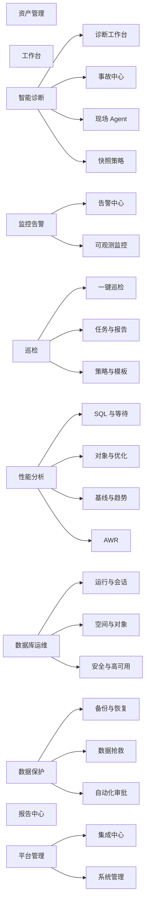

# TraceMind AI 前端架构

文档基线：2026-08-13

## 1. 技术栈

| 项目 | 实现 |
| --- | --- |
| UI | React 18 |
| 组件库 | Ant Design 5 |
| 构建 | Vite 8 |
| 图拓扑 | `@xyflow/react` |
| API | `src/api.js` 与分域 Client |
| 页面分发 | `src/AppPageRouter.jsx` |
| 菜单 | `src/menuConfig.jsx` |
| 默认端口 | `3300` |

前端不是 URL 多页面应用。菜单 key、标签页和 `AppPageRouter` 共同维护当前工作空间，登录 hash 与一次性 token 是例外。新增菜单叶子必须有对应页面分发和静态测试。

## 2. 当前信息架构



顺序和名称以 `menuConfig.jsx` 为准。资产管理是第一个业务入口，工作台和智能诊断随后。原“生态适配”页不再出现在菜单中。

## 3. 页面分发约定

菜单项使用命名空间 key：

```text
<domain>.<module>[.<page>]
```

`data` 字段声明页面所需上下文：

| 类型 | 注入内容 | 用途 |
| --- | --- | --- |
| `static` | 当前 key 和导航 | 不依赖实例的管理页 |
| `list` | 实例列表 | 可跨实例筛选的页面 |
| `instanceId` | 当前实例和实例列表 | 单实例页面 |
| `selected` | 当前实例、列表和导航 | 需要顶部实例上下文的页面 |
| `special` | 路由专用属性 | 复杂聚合页面 |
| `opsCapability` | 当前实例和引擎能力 | 四引擎自适应运维页 |

旧 key 通过 `LEGACY_KEY_MAP` 归一，保证已有收藏、智能导航和历史代码仍可进入当前页面。模块开关仍兼容旧 key，但新代码不得继续新增旧命名。

## 4. 主要页面

### 4.1 资产管理

资产中心使用六个 Tab：

1. 总览
2. 集群拓扑
3. 实例清单
4. 主机清单
5. 发现与同步
6. 校正与审计

页面必须清楚区分 Host、Cluster 和 Instance。集群拓扑展示数据库类型、架构、角色、IP:Port、版本、主机、操作系统、区域和环境；自动发现和人工校正是不同操作。

交互约束：

- “刷新”只重新读取平台数据。
- “测试”只验证实例当前连接。
- “自动识别”才执行目标数据库和主机探测并更新拓扑。
- 保存连接配置后不自动识别。
- 实例未自定义名称时优先显示已采集主机名，其次显示稳定地址。
- 版本显示统一为数据库实际版本短格式，例如 `8.0.44`、`19.3`、`16.7`，完整构建信息放详情中。
- 详情、编辑、校正、删除和测试结果均使用居中自适应 Modal。

### 4.2 智能诊断与事故中心

诊断工作台把规则诊断和 AI 诊断合并为一个入口。请求可以使用数据库、主机硬件、操作系统、Zabbix/Prometheus、日志、APM、巡检、AWR 和历史基线作为证据。

事故中心和现场快照页面包括：

- 事故列表和影响范围。
- Snapshot 状态、完整度、质量和进度。
- 时间线、指标、证据卡、反证、因果图和原始区段。
- Agent 在线、版本、缓存、采集器和上传积压。
- 触发规则编辑、测试、shadow 和发布审计。
- 重新分析、注释、留存和受控下载。

深度内存、线程、动态探针和 eBPF 页面在接口进入开发后再开放，不展示无后端能力的空入口。

### 4.3 巡检

一键巡检支持当前实例或从智能助手直接发起多实例任务。多实例执行使用居中进度 Modal，显示总数、运行中、成功、失败、健康分、模板和任务号。

模板页面显示：

- 模板名称、稳定 ID、别名、数据库类型、内置/自定义状态。
- 分类、检查项数量、动作和调度摘要。
- 折叠的字段说明表格。
- 检查项 SQL/脚本来源、阈值、级别、状态和查询入口。
- 复制、编辑、删除、单文件导出、批量 ZIP 导出、导入预览和冲突提示。

报告使用居中 Modal，SQL 与结果页面必须展示实际 SQL/命令、执行状态、行号、返回字段、返回行数、截断信息、结果摘要和可分页原始结果。被安全策略跳过的 HTML/JavaScript 生成 SQL 不能作为健康检查项计分。

### 4.4 可观测与集成

可观测页面按工作流组织：

- 总览：数据源、绑定、指标、告警和采集任务健康。
- 日志关联：故障时间窗、来源和事件时间线。
- Grafana 模板：模板选择、数据源 UID、刷新频率、生成和预览。
- APM 链路：Trace、Span、服务、SQL 指纹和诊断证据。
- 集成中心：Zabbix、Prometheus、通知和 ITSM。

配置页必须区分“已配置”“测试成功”“同步成功”和“当前健康”，不能用一个绿色状态替代不同事实。

### 4.5 数据库运维

四类数据库共用能力导航，`AppPageRouter` 根据当前实例 `db_type` 分发到对应实现。页面只显示所选引擎支持的能力，避免出现可点击但不可运行的占位按钮。

### 4.6 数据保护与自动化

备份与恢复收敛为总览、备份方案、恢复方案、报告与告警和备份平台接入。数据抢救包括远程 Agent、任务、报告和风险审批。自动化审批展示计划、审批、执行、回滚、操作者和脱敏输出。

真实执行关闭时，页面必须明确显示“仅方案/不可执行”，而不是提供看似可运行的按钮。

## 5. 全局交互规范

### 5.1 Modal

所有详情、编辑、结果、报告和进度层使用居中弹窗：

- 宽度使用 `min()` 或断点配置，不超过可视区域。
- 最大高度不超过视口，Header/Footer 固定，Body 独立滚动。
- 窄屏自动变为接近全屏，但保留关闭入口和安全边距。
- 弹窗内不得再嵌套 Drawer 形成双重侧滑。
- 高危确认使用独立 Confirm，不与详情 Modal 混用。

### 5.2 稳定布局

- 页面根容器使用稳定高度和 `min-width: 0`，避免内容变化引起整体抖动。
- 表格列定义固定或最小宽度，标签和按钮不得互相覆盖。
- 页面出现和消失纵向滚动条时，主内容宽度不应跳变。
- 图、画布和拓扑使用固定或响应式约束尺寸，不由节点文字撑高。
- 常见 1 至 3 节点拓扑应在固定画布内完整居中显示，不产生无意义的内层纵向滚动。
- 大数据表使用分页、虚拟化或局部滚动，不让整个页面无限拉长。

### 5.3 视觉语言

- 使用克制的中性色、语义色和清晰层级，保持现有苹果式轻量风格。
- 页面区域不包装成多层卡片，卡片只用于单个重复对象或真正需要边界的工具。
- 命令按钮使用图标加短标签，状态使用圆点或 Tag。
- 紧凑工作台使用紧凑标题，不使用营销页字号。
- 不在页面中放大段“功能介绍”文字，说明进入 Tooltip、Popover 或帮助表格。

## 6. API 与状态

所有请求通过统一 API 封装，页面组件不得直接散落 `fetch`。请求状态至少区分：

```text
idle / loading / success / empty / partial / stale / error
```

对于耗时任务，后端返回任务或 Snapshot ID，前端轮询进度并设置最大间隔和退出条件。页面卸载、任务完成或失败后必须停止轮询，避免 CPU 占用和无限请求。

缓存数据必须显示采集时间。实时请求失败时，可以展示缓存，但必须使用 `stale` 或“历史结果”标识。

## 7. 构建与测试

```bash
cd frontend
npm test
npm run check:static
npm run build
```

现有测试覆盖：

- 菜单顺序、命名、旧 key 兼容和叶子路由。
- 诊断入口合并。
- 可观测和领域集成导航。
- 页面设计契约、运维布局、系统入口和二元控件。
- 资产中心和 Incident Snapshot 相关静态/行为契约。

发布前还应使用浏览器进行桌面和窄屏 E2E，重点验证：无文字重叠、无页面抖动、Modal 居中、表格可读、拓扑不空白、任务轮询结束、真实输出与后端一致。

## 8. 新页面接入清单

1. 在 `menuConfig.jsx` 增加命名空间 key 和数据契约。
2. 在 `AppPageRouter.jsx` 增加唯一分发。
3. 通过统一 API Client 接入后端。
4. 实现 loading、empty、partial、stale 和 error。
5. 为固定画布、表格和 Modal 定义响应式尺寸。
6. 添加菜单、路由、设计和关键行为测试。
7. 更新 [文档首页](README.md)、[API 参考](03-api-reference.md) 和 [开发计划](archive/plans/2026-08-13-tracemind-development-plan.md)。
