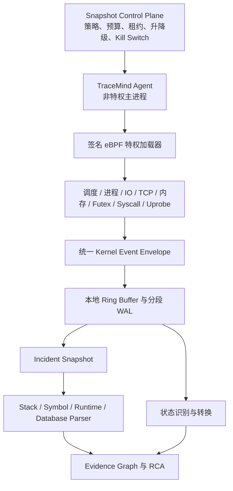

# TraceMind eBPF 内核动态观测设计

文档状态：实现基线
文档基线：2026-08-24
实现状态：控制面、Agent、动态 eBPF、五类 CO-RE、回退、自保护和证据链已进入运行链路；目标内核矩阵验收待完成

## 1. 定位

eBPF 在 TraceMind 中是 `L0.5` 内核动态观测层，负责捕获普通秒级轮询无法看到的短时内核事件，并提供跨主机、进程、线程、存储、网络和运行时的关联锚点。

```text
eBPF = 高频内核事件雷达
Dump = 现场实体保存
Parser = 原始制品解析
状态机 = 行为归纳
Evidence Graph = 因果关联
AI = 有证据边界的解释
```

eBPF 不替代数据库采集器、日志、APM、Process/Heap/Kernel Dump 或长期证据存储。

## 2. 架构位置



Agent 主进程不长期持有加载任意 BPF 程序所需的高权限。特权加载器只接受签名、版本固定、Attach Point 白名单和资源预算完整的探针包。

## 3. 操作系统策略

| 环境 | 生产主路径 | 回退 |
| --- | --- | --- |
| Linux | libbpf CO-RE + BTF + eBPF | perf、ftrace、procfs、netlink |
| 容器/Kubernetes | eBPF + cgroup、namespace 和容器元数据 | kubelet/cAdvisor/运行时接口 |
| Windows | ETW、WCT、WFP、Perf Counter、DbgHelp | WMI/CIM 和事件日志 |
| eBPF for Windows | 可选实验扩展 | 不作为当前生产主路径 |

能力探测先于传感器加载。探测结果写入 Agent capability，并决定 `ebpf_core`、`ebpf_core_hybrid`、`ebpf_legacy` 或 `fallback` 模式。CO-RE 对象在运行时按传感器裁剪，每类使用独立 collection 完成 verifier 和附着，只共享事件 Ring Buffer；单类不兼容不会让其余传感器整体失效。

## 4. Linux 传感器

### 4.1 调度与线程

- `sched_switch`、`sched_wakeup`、`sched_process_exit`。
- Run queue 延迟、off-CPU 时间、抢占、迁核和线程饥饿。
- PID/TID、cgroup、namespace、CPU 和栈 ID。

### 4.2 进程生命周期

- fork、exec、exit、信号和 OOM kill。
- 进程启动时间、父进程、可执行文件、容器和服务关联。
- PID 复用通过 `pid + process_start_time` 消除歧义。

### 4.3 Block IO 与文件系统

- 请求下发/完成、设备、主次设备号、字节、操作和延迟。
- 队列等待、服务时间、错误和超时。
- 设备到挂载、LVM、RAID、ASM 和数据库文件的关系由资产与 Parser 补全。

### 4.4 TCP 与 Socket

- connect、accept、close、reset、retransmit、drop 和状态变化。
- 源/目标地址、端口、netns、cgroup、PID/TID 和 socket cookie。
- 与 APM Trace、应用服务和数据库实例通过时间与连接五元组关联。

### 4.5 内存压力

- 缺页、直接回收、kswapd、compaction、OOM、内存映射和分配延迟摘要。
- eBPF 只识别压力和目标进程，不替代 Heap 或完整内存 Dump。

### 4.6 锁与 Futex

- Futex wait/wake、等待时长、目标地址哈希、PID/TID 和栈。
- 只记录必要标识，不上传原始内存地址可推导的敏感内容。

### 4.7 系统调用

- 对白名单 syscall 进行延迟、错误码和调用栈聚合。
- 默认不采集参数正文，不启用全系统逐次事件流。

### 4.8 Uprobe/USDT

- 用于数据库客户端、运行时和关键库的受控用户态探针。
- 探针必须绑定二进制 build ID 和符号版本，版本不匹配时拒绝加载。

## 5. 统一事件协议

```json
{
  "schema_version": "1.0",
  "event_type": "block_io_latency",
  "wall_time": "2026-08-13T02:01:02.123456Z",
  "monotonic_ns": 928310221009,
  "agent_id": "AGT-001",
  "host_id": 12,
  "boot_id": "...",
  "pid": 8821,
  "process_start_time": 1755049000,
  "tid": 8834,
  "cgroup_id": 991,
  "namespace_id": 18,
  "container_id": "...",
  "trace_id": "...",
  "stack_id": 41,
  "labels": {"device": "8:16"},
  "value": 218.4,
  "unit": "ms",
  "collection_level": "E1",
  "quality": "complete"
}
```

`wall_time` 用于跨系统展示，`monotonic_ns` 用于本机精确排序。Agent 上报时同时提供时钟偏移和质量，防止 NTP 跳变破坏事故顺序。

## 6. E0-E4 采集等级

| 等级 | 目标 | 典型能力 | 退出条件 |
| --- | --- | --- | --- |
| E0 常态 | 低成本基线 | 内核侧聚合、低频 Top、错误计数 | 持续异常进入 E1 |
| E1 可疑 | 定位异常域 | 目标设备/连接/PID 高频摘要、栈采样 | 恢复后冷却回 E0，或升级 E2 |
| E2 故障 | 冻结故障窗口 | 细粒度 IO/TCP/线程事件、关联锚点 | Snapshot 完成或预算到期 |
| E3 取证 | 深度目标采集 | 目标 PID/TID 栈、Socket/IO 关系、触发 Dump | 租约到期或人工终止 |
| E4 灾难 | 保住最后证据 | 最小事件流、Last Will、停止非核心传感器 | Agent 恢复或离线 |

升降级由状态机、告警、人工操作和 Agent 自保护共同决定。任何级别都有最大 TTL，不能无限保持高开销模式。

## 7. 生产安全与自保护

### 7.1 固定预算

每个探针包声明：

```text
最大 CPU 百分比
最大 map 字节
最大 ring buffer 字节
最大事件/秒
最大上传字节/秒
最大栈深度
最大运行 TTL
目标 PID/cgroup/设备/端口范围
```

### 7.2 熔断

以下任一条件触发卸载或降级：

- 事件率、丢失率、CPU、内存或 map 使用超过预算。
- Ring Buffer 连续拥塞。
- Agent 心跳中断或控制平面下发 Kill Switch。
- 目标进程退出、build ID 变化或附着点失效。
- 探针签名、schema、版本或租约不合法。

### 7.3 丢失语义

Ring Buffer 丢失不能静默忽略。Agent 上报：

```text
lost_events_total
lost_events_by_sensor
loss_start / loss_end
reason
estimated_loss_pct
```

Snapshot 和 RCA 将对应时间段标记为 `partial`，并降低状态和根因置信度。

### 7.4 供应链

- 生产环境禁止远程编译或加载任意 BPF 源码。
- 探针对象、配置和加载器均签名并固定哈希；对象构建同时生成 SHA-256 清单。
- Agent 上报对象哈希和实际 CO-RE 传感器覆盖，平台使用发布白名单校验；未知或缺少哈希时降级为兼容/回退模式并标记采集健康异常。
- 允许的 program type、helper、attach point、map 类型和大小使用白名单。
- 更新支持灰度、回滚和版本审计。
- 特权加载器与网络上传、AI、数据库凭据逻辑隔离。

## 8. 符号与运行时解析

```text
Kernel/User Stack ID
  -> build ID / kernel version / module mapping
  -> 离线符号服务
  -> 标准化 Stack Frame
  -> Java JFR / .NET EventPipe / Native / Database Parser 合并
  -> Evidence Graph
```

符号文件不要求常驻 Agent。平台按 build ID 管理符号索引，解析器版本和符号质量进入证据元数据。

## 9. 与资产、状态和快照的融合

- `host_id`、`agent_id`、`boot_id` 绑定五层资产 Host。
- PID/TID、cgroup、namespace 和容器 ID 绑定进程与应用。
- Socket 五元组关联 APM Span 和数据库连接。
- 设备号、挂载和文件路径关联数据库文件、ASM/LVM/RAID。
- 标准事件进入 State Recognizer，生成长期状态转换。
- E2/E3 原始事件进入 Incident Snapshot，和指标、日志、SQL、Trace 一起形成 Scene Context Pack。

## 10. 目标模块和 API

当前代码边界：

```text
agent/internal/kernelobs
agent/cmd/tracemind-ebpf-loader
agent/cmd/tracemind-ebpf-loader/bpf/tracemind_core.bpf.c
agent/internal/application
backend/app/kernel_observability/*
backend/app/state_engine/*
```

已注册 API：

```text
GET  /api/v1/kernel-observability/capabilities
GET  /api/v1/kernel-observability/agents/{agent_id}/health
GET  /api/v1/kernel-observability/sensors
POST /api/v1/kernel-observability/policies
POST /api/v1/kernel-observability/policies/{policy_id}/test
POST /api/v1/kernel-observability/agents/{agent_id}/level
POST /api/v1/kernel-observability/kill-switch
GET  /api/v1/incident-snapshots/{snapshot_id}/kernel-events
GET  /api/v1/incident-snapshots/{snapshot_id}/stacks
```

这些接口已经进入后端路由和调查工作台。平台显示实际 `core_sensors` 覆盖、对象校验状态、预算健康和回退原因，不以 BTF 存在推断 CO-RE 已成功附着。

## 10.1 当前原生覆盖

| 路径 | 传感器 | 当前状态 |
| --- | --- | --- |
| CO-RE | 调度、进程生命周期、Block IO、TCP、内存压力 | 12 个 raw tracepoint 程序已预编译，具备 BTF 与 CO-RE 重定位；目标内核 attach 待验收 |
| 动态 tracepoint | 调度、进程、Block IO、文件系统、TCP、内存、Futex、Syscall | RHEL 8 / Linux 4.18 已完成 22 个 hook 实机验证 |
| Uprobe | 受控运行时/数据库客户端符号 | 动态附着、目标/符号/TTL/预算受控，不声明为内核 CO-RE |
| 基础回退 | procfs、netlink、perf/ftrace | eBPF 不可用时保持 Agent 主链路，并明确标记质量降级 |

## 11. 验收标准

1. 支持内核具备 BTF 且对象哈希可信、verifier/attach 成功时使用 CO-RE；否则自动选择兼容或回退路径。
2. Agent 主进程无能力加载任意未签名程序。
3. E0 资源开销达到开发计划的灰度预算，E1-E3 均受 TTL 和速率限制。
4. 调度、Block IO、TCP、内存和进程传感器各有真实故障注入测试。
5. 事件丢失、时钟偏移和符号缺失明确影响质量分。
6. 目标 PID/TID、Socket 和设备可以与资产、Trace、SQL 和 Snapshot 关联。
7. Kill Switch 在控制面不可用时仍能由 Agent 本地策略触发。
8. 不支持 eBPF 的 Linux 主机不影响基础 Agent 和数据库主链路。

当前已通过对象结构、哈希契约、逐传感器裁剪测试、独立 collection/verifier 隔离、多架构构建、后端模式判定和前端状态展示。R4 最终 Gate 仍要求在目标 Linux 内核执行 verifier/attach、五类故障注入和连续三轮资源预算测试；没有该证据时不得宣称生产 CO-RE 验收完成。

详细任务见 TraceMind 2026-08-13 开发计划。
