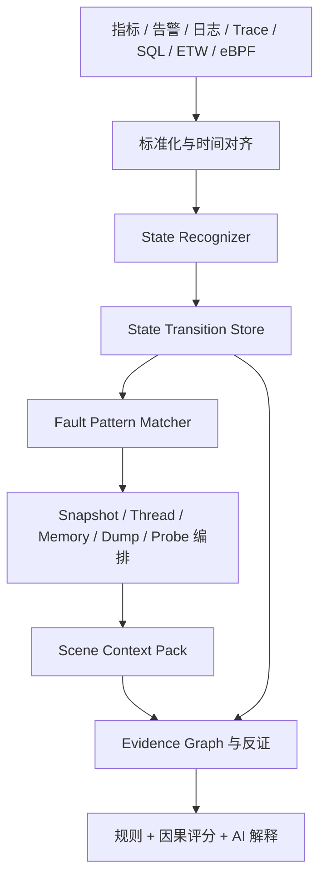
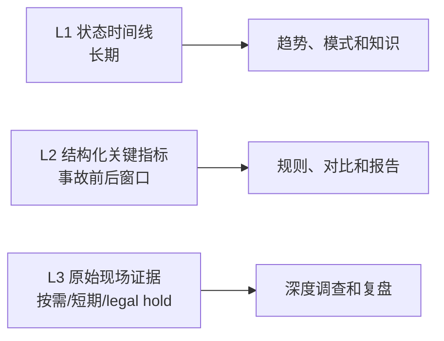

# State Intelligence 与故障现场重建设计

文档状态：设计完成
文档基线：2026-08-13
实现状态：状态引擎、深度内存/线程/动态探针尚未进入生产代码；Incident Snapshot MVP 已提供承载基础

## 1. 目标

TraceMind 当前能够收集指标、告警、SQL、日志、Trace 和主机现场，但这些数据仍以“观测记录”为主。State Intelligence Engine 将连续数据抽象为状态和状态转换，再通过现场重建补足故障窗口中的线程、内存、调用栈和运行时证据。

最终输出不是一段脱离证据的 AI 文本，而是一条可以回放和核验的故障链：

```text
存储延迟升高
  -> 数据库 IO 等待
  -> 连接池线程阻塞
  -> API 超时
  -> 业务失败
```

每个节点都必须带时间、资产、状态码、置信度、数据质量和原始证据引用。

## 2. 架构位置



State Engine 不替代采集。它降低长期数据量、沉淀专家模式并为深度采集选择目标；原始数据仍在事故窗口按需保留。

## 3. 状态域与编码

状态码使用四位整数，首位表示实体域：

| 范围 | 实体域 | 示例 |
| --- | --- | --- |
| `1xxx` | Host / CPU / OS | `1010` CPU 压力 |
| `2xxx` | Process / Runtime | `2030` 线程数量异常增长 |
| `3xxx` | Thread / Wait | `3030` IO 等待 |
| `4xxx` | Memory | `4090` OOM 风险 |
| `5xxx` | Database | `5030` 锁竞争 |
| `6xxx` | Network | `6020` TCP 重传异常 |
| `7xxx` | Storage | `7030` Block IO 延迟 |
| `8xxx` | Application | `8040` 请求超时 |
| `9xxx` | Incident / Root Cause | `9100` 业务故障 |

状态定义建议结构：

```json
{
  "state_code": 7030,
  "key": "storage.io_latency",
  "entity_type": "device",
  "severity": "warning",
  "meaning": "块设备延迟持续超过基线",
  "entry_rule_version": 3,
  "exit_rule_version": 2,
  "minimum_duration_seconds": 30
}
```

状态码一旦发布不得改变语义。阈值和识别规则通过版本更新，历史转换保留所用版本。

## 4. 核心数据模型

### 4.1 StateDefinition

保存状态码、实体类型、严重度、含义、进入/退出规则、版本和生命周期。

### 4.2 StateObservation

保存某个时间点的识别结果：

```text
entity_type / entity_id / state_code / observed_at
confidence / quality_score / rule_version / evidence_refs
```

### 4.3 StateTransition

只在状态发生变化时写入：

```json
{
  "entity_type": "process",
  "entity_id": "host-12:pid-8821",
  "old_state": 2010,
  "new_state": 2030,
  "reason_code": 301,
  "transition_time": "2026-08-13T02:01:02Z",
  "confidence": 0.94,
  "evidence_refs": ["metric:991", "event:183"]
}
```

### 4.4 FaultPattern

定义跨实体、跨时间的状态序列：

```yaml
key: storage_to_database_timeout
version: 1
within_seconds: 60
sequence:
  - state: 7030
    entity: storage
  - state: 5035
    entity: database
  - state: 3030
    entity: thread
  - state: 8040
    entity: application
root_cause: storage
minimum_confidence: 0.85
```

### 4.5 PatternMatch

保存模式版本、命中状态、时间窗口、资产链、支持证据、反证、置信度和触发的深度采集任务。

## 5. 状态识别原则

1. 使用进入和退出双阈值，避免边界抖动。
2. 支持持续时间、样本数、变化率、同比基线和多条件组合。
3. 数据缺失时输出 `unknown` 或降低质量，不能默认 `normal`。
4. 状态必须绑定 Region/Environment/Host/Cluster/Instance 或 PID/TID 等稳定实体。
5. 所有识别保留规则版本和原始证据引用。
6. 状态恢复同样记录转换，不能只记录异常进入。
7. AI 不生成状态事实，只能解释状态和证据。

## 6. 三层保存策略



建议初始保留：

| 数据 | 默认保留 | 说明 |
| --- | --- | --- |
| 状态转换 | 365 天 | 小体积，可用于模式学习 |
| 结构化事故指标 | 90 天 | 可按严重度延长 |
| 普通 Snapshot 原始包 | 30 天 | 可归档 |
| 事故 Snapshot 原始包 | 180 天 | 受权限控制 |
| Dump/Heap | 7 至 30 天 | 高敏感、大体积，默认最短 |
| legal hold | 无自动删除 | 必须显式解除并审计 |

## 7. 现场重建采集

### 7.1 内存快照

内存采集按风险分级，不能默认执行完整内存 Dump：

| 级别 | 内容 | 风险 |
| --- | --- | --- |
| M0 | 总量、提交、缺页、Swap、Top 进程 | 低 |
| M1 | 目标进程工作集、私有内存、映射、句柄和分配趋势 | 低至中 |
| M2 | .NET GC/Heap 摘要、JVM JFR/类直方图、Native allocator 摘要 | 中 |
| M3 | Process MiniDump/Core、Heap Dump | 高 |
| M4 | Full Memory/Kernel Dump | 极高，仅应急取证 |

触发必须指定目标进程、最大大小、超时、最小剩余磁盘、脱敏策略和保留策略。M3/M4 需要独立权限和审批。

### 7.2 连续线程追踪

线程不是只在故障后抓一次 Dump，而是形成故障前后的状态序列：

```text
RUNNING -> CPU_BUSY -> WAIT_IO -> WAIT_LOCK -> TIMEOUT
```

线程事件至少包含：

- Host、PID、TID、进程启动时间。
- 线程状态、等待类型、等待对象和持续时间。
- 栈哈希与符号化栈引用。
- CPU、IO、锁、Socket、Trace ID 和数据库会话关联。
- 丢样、采样率和数据质量。

正常模式只保留聚合和栈哈希；异常升级后提高目标 PID/TID 频率，并在预算到期后自动降级。

### 7.3 受控动态打印与探针

“动态打印”是对目标函数参数、返回值、异常或局部状态的临时观测，不允许下发任意代码。

安全模型：

1. 探针由预编译、签名模板组成。
2. 附着点、进程、模块和字段在白名单内。
3. 每次下发带租约 TTL、事件上限、字节上限和 CPU 预算。
4. 默认只读取，不修改进程状态。
5. 敏感字段在 Agent 端脱敏。
6. 超限、目标退出、版本不匹配或租约到期立即卸载。
7. 创建、审批、加载、命中、卸载和输出下载全部审计。

运行时路径：

| 运行时 | 首选能力 |
| --- | --- |
| Java | JFR、JMX、jcmd、受控 BTrace/Byte Buddy 模板 |
| .NET | EventPipe、Diagnostics IPC、CLRMD、受控 profiler 模板 |
| Native Linux | uprobe/USDT、perf、gdb batch 受控模板 |
| Windows Native | ETW、WCT、DbgHelp、受控调试器命令模板 |
| Database | 只读诊断 SQL、Oracle systemstate、MySQL P_S、PG activity、SQL Server XE/DMV |

### 7.4 Dump 编排

Dump Orchestrator 负责：

```text
资格判断 -> 审批 -> 资源预检 -> 目标确认 -> 采集 -> 完整性校验
        -> 加密上传 -> Parser -> 证据索引 -> 保留/删除
```

Dump 任务必须使用 PID 加进程启动时间防止 PID 复用，采集前再次验证目标身份。

## 8. Scene Context Pack

Scene Context Pack 是提供给调查工作台和 AI 的最小完整现场包：

```json
{
  "incident": {},
  "asset_snapshot": {},
  "time_alignment": {},
  "state_timeline": [],
  "metric_windows": [],
  "events": [],
  "thread_evidence": [],
  "memory_evidence": [],
  "database_evidence": [],
  "log_and_trace_evidence": [],
  "changes": [],
  "supporting_evidence": [],
  "counter_evidence": [],
  "missing_data": [],
  "raw_artifact_refs": []
}
```

每一项包含 `source_ref`、采集时间、质量、敏感级别和解析器版本。AI 只接收经过权限过滤和大小预算裁剪的 Context Pack。

## 9. AI 分析契约

AI 输出必须满足：

```json
{
  "summary": "...",
  "root_cause_candidates": [
    {
      "cause": "storage_latency",
      "confidence": 0.91,
      "supporting_evidence_ids": [101, 108],
      "counter_evidence_ids": [115]
    }
  ],
  "unknowns": ["缺少目标进程 Heap 摘要"],
  "recommended_actions": [],
  "verification_steps": []
}
```

- 无证据引用的根因候选拒绝入库。
- 证据质量低于门槛时降低置信度。
- AI 不得把相关性描述为已证明因果。
- 处置建议与执行计划分离，执行仍经过审批。
- 模型不可直接读取原始敏感 Dump，需先由 Parser 产生受控摘要。

## 10. 目标 API 与 UI

以下为规划接口，当前未进入公开 OpenAPI：

```text
GET  /api/v1/states/definitions
GET  /api/v1/states/timeline
GET  /api/v1/states/entities/{entity_type}/{entity_id}
GET  /api/v1/fault-patterns
POST /api/v1/fault-patterns/test
GET  /api/v1/incidents/{incident_id}/scene-context
POST /api/v1/incidents/{incident_id}/captures/thread-trace
POST /api/v1/incidents/{incident_id}/captures/memory
POST /api/v1/incidents/{incident_id}/captures/dump
POST /api/v1/incidents/{incident_id}/probes
DELETE /api/v1/incidents/{incident_id}/probes/{probe_id}
```

调查工作台增加：状态时间线、故障演化链、线程视图、内存视图、动态探针租约、Dump 制品、缺失数据和证据质量。所有详情使用居中自适应 Modal。

## 11. 验收标准

1. 状态进入、保持、恢复和数据缺失均有确定语义。
2. 同一输入重放产生相同状态转换和模式命中。
3. 状态链能回指原始指标、事件、SQL、线程或 Snapshot 区段。
4. 线程追踪在目标异常窗口内可关联 PID/TID、IO、锁、Socket 和数据库会话。
5. 内存和 Dump 任务在磁盘、CPU、大小或权限不满足时安全拒绝。
6. 动态探针到期自动卸载，任意代码、任意附着点和无限输出不可执行。
7. AI 根因、反证、未知项和处置建议均可核验。
8. 四类故障注入连续三轮输出稳定，且数据缺失不产生虚假健康结论。

开发任务与顺序见 [TraceMind 2026-08-13 开发计划](../archive/plans/2026-08-13-tracemind-development-plan.md)。
