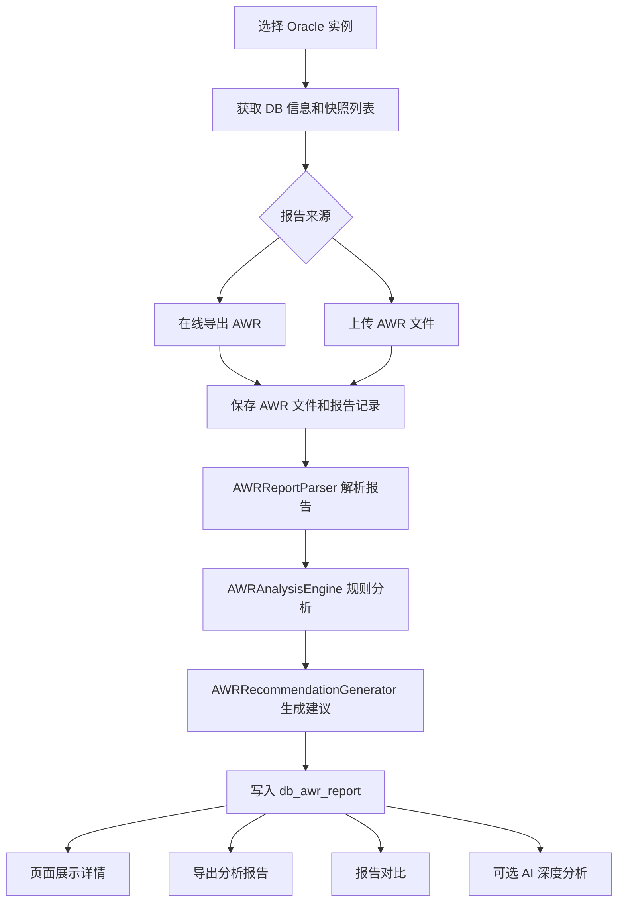

# AWR 报告分析模块说明

本文档说明 TraceMind AI 智能运维平台中 Oracle AWR 报告分析模块的处理过程，包括报告获取、解析、规则分析、建议生成、AI 分析、导出、对比和自动采集链路。

## 模块定位

AWR 模块用于把 Oracle AWR 报告从“原始 HTML/TXT 文件”转换为平台可消费的结构化性能结论：

- 在线从 Oracle 数据库导出 AWR 报告。
- 上传已有 AWR HTML/TXT 报告。
- 解析报告中的数据库、快照、负载、等待事件、SQL、CPU、内存和 IO 信息。
- 基于内置规则计算性能评分和风险项。
- 生成优化建议。
- 可选调用 AI 生成面向运维处置的诊断结论。
- 支持报告详情、分析导出、双报告对比和自动采集。

目标不是简单展示 AWR 文件，而是形成：

```text
AWR 原始报告
  -> 结构化指标
  -> 性能评分
  -> 风险识别
  -> 优化建议
  -> 诊断结论 / 处置建议 / 报告归档
```

## 主要代码位置

| 类型 | 文件 | 说明 |
| --- | --- | --- |
| API 路由 | `backend/app/api/v1/oracle_awr.py` | AWR 页面调用的接口入口 |
| AWR 服务 | `backend/app/services/oracle_awr.py` | 在线导出、列表、详情、对比、导出分析报告 |
| 自动采集 | `backend/app/services/awr_collect.py` | 按策略定时采集 AWR |
| 环境分析 | `backend/app/services/awr_environment_analyzer.py` | 采集主机/实例环境上下文，辅助 AI 判断 |
| 解析器 | `backend/app/services/awr/awr_parser.py` | HTML/TXT AWR 报告解析 |
| 分析器 | `backend/app/services/awr/awr_analyzer.py` | 规则分析、风险识别、评分 |
| 建议生成 | `backend/app/services/awr/awr_recommender.py` | 根据分析结果生成优化建议 |
| 报告导出 | `backend/app/services/awr/awr_exporter.py` | 导出 Markdown/PDF/TXT/DOC 分析报告 |
| 数据模型 | `backend/app/models/db_instance.py` | `AwrReport`、`DBAwrCollectPolicy` |
| 前端页面 | `frontend/src/OracleAwrReportPage.jsx` | AWR 报告导出、上传、分析、详情 |
| 前端页面 | `frontend/src/PerformanceAwrPages.jsx` | AWR 历史、对比、自动采集等性能页面 |

## 数据表

### `db_awr_report`

保存 AWR 报告文件和分析结果，核心字段包括：

| 字段 | 说明 |
| --- | --- |
| `instance_id` | 数据库实例 ID |
| `db_name`、`dbid` | Oracle 数据库信息 |
| `instance_number`、`instance_name`、`host_name` | Oracle 实例信息 |
| `report_type` | `INSTANCE` 或 `RAC_GLOBAL` |
| `report_format` | `html` 或 `text` |
| `begin_snap`、`end_snap` | AWR 快照范围 |
| `begin_time`、`end_time` | 快照时间范围 |
| `file_name`、`file_path`、`file_size` | AWR 文件信息 |
| `status` | `exporting`、`success`、`failed` |
| `performance_score` | 总体性能分 |
| `cpu_score`、`memory_score`、`io_score` | 分项评分 |
| `analysis_results` | 结构化分析结果 JSON |
| `recommendations` | 优化建议 JSON |

### `db_awr_collect_policy`

保存自动采集策略，核心字段包括：

| 字段 | 说明 |
| --- | --- |
| `instance_id` | 数据库实例 ID |
| `enabled` | 是否启用自动采集 |
| `interval_hours` | 采集间隔 |
| `days_window` | 快照查询窗口 |
| `report_format` | 默认报告格式 |
| `report_type` | 默认报告类型 |
| `auto_analyze` | 采集后是否自动执行本地分析 |
| `last_run_time`、`next_run_time` | 上次/下次执行时间 |
| `last_status`、`last_message` | 最近执行结果 |

## 总体流程



## 入口一：在线导出 AWR 报告

### 1. 获取数据库和实例信息

接口：

```http
GET /api/v1/oracle/{instance_id}/awr/db-info
```

后端调用 `get_awr_db_info()`，通过 Oracle 连接查询：

- `v$database`：获取 `dbid`、数据库名、唯一名、角色、打开模式。
- `gv$instance`：获取实例号、实例名、主机名、版本、状态。

返回结果用于页面选择 DBID、实例号和报告范围。

### 2. 获取 AWR 快照

接口：

```http
GET /api/v1/oracle/{instance_id}/awr/snapshots?days=7
```

后端调用 `list_awr_snapshots()` 查询：

```sql
dba_hist_snapshot
```

按最近 N 天返回：

- `snap_id`
- `dbid`
- `instance_number`
- `begin_interval_time`
- `end_interval_time`

页面使用这些快照选择 `begin_snap` 和 `end_snap`。

### 3. 导出报告

接口：

```http
POST /api/v1/oracle/{instance_id}/awr/export
```

核心参数：

| 参数 | 说明 |
| --- | --- |
| `begin_snap` | 起始快照 |
| `end_snap` | 结束快照 |
| `dbid` | 数据库 DBID |
| `instance_number` | Oracle 实例号 |
| `report_format` | `html` 或 `text` |
| `report_type` | `INSTANCE` 或 `RAC_GLOBAL` |

后端执行前会校验：

- 实例必须存在。
- `begin_snap < end_snap`。
- `report_type` 仅允许 `INSTANCE`、`RAC_GLOBAL`。
- `report_format` 仅允许 `html`、`text`。

根据类型调用 Oracle 内置包：

| 类型 | Oracle 函数 |
| --- | --- |
| 单实例 HTML | `DBMS_WORKLOAD_REPOSITORY.AWR_REPORT_HTML` |
| 单实例 TXT | `DBMS_WORKLOAD_REPOSITORY.AWR_REPORT_TEXT` |
| RAC 全局 HTML | `DBMS_WORKLOAD_REPOSITORY.AWR_GLOBAL_REPORT_HTML` |
| RAC 全局 TXT | `DBMS_WORKLOAD_REPOSITORY.AWR_GLOBAL_REPORT_TEXT` |

处理过程：

1. 创建 `AwrReport` 记录，状态为 `exporting`。
2. 执行 Oracle AWR 报告生成函数。
3. 将 CLOB 内容写入本地文件。
4. 更新报告记录为 `success`，写入文件路径、大小、实例信息。
5. 如果失败，更新状态为 `failed` 并保存错误信息。

在线导出的默认目录为：

```text
reports/awr
```

## 入口二：上传已有 AWR 报告

接口：

```http
POST /api/v1/oracle/{instance_id}/awr/upload
```

支持文件类型：

- `.html`
- `.htm`
- `.txt`

处理过程：

1. 校验实例存在。
2. 校验文件扩展名。
3. 保存上传文件。
4. 创建 `AwrReport` 记录。
5. 自动执行本地解析、分析和建议生成。
6. 将评分、分析结果和建议写入 `db_awr_report`。

上传文件当前保存在应用目录下的：

```text
backend/app/reports/awr
```

注意：在线导出和上传保存目录在当前实现中不完全一致，部署时应确认文件归档和备份策略。

## 入口三：本地规则分析

接口：

```http
POST /api/v1/oracle/{instance_id}/awr/reports/{report_id}/local-analysis
```

本地分析不依赖 AI，完整链路为：

```text
AWR 文件
  -> AWRReportParser.parse()
  -> AWRAnalysisEngine.analyze()
  -> AWRRecommendationGenerator.generate_recommendations()
  -> 写入 AwrReport.analysis_results / recommendations / score
```

### 1. 解析阶段

解析器：`AWRReportParser`

支持 HTML 和 TXT 两种格式：

- HTML 使用 BeautifulSoup 解析表格和文本。
- TXT 使用正则表达式解析关键章节。

解析结果统一写入结构化字典，主要包括：

| 解析区域 | 说明 |
| --- | --- |
| `database_info` | 数据库名、DBID、实例、版本等 |
| `snapshot_info` | 快照起止时间、快照号、持续时间 |
| `load_profile` | DB Time、逻辑读、物理读、事务、解析等负载指标 |
| `instance_efficiency` | Buffer Hit、Library Hit、Execute to Parse 等效率指标 |
| `top_timed_events` | Top 等待事件 |
| `host_cpu` | 主机 CPU 信息 |
| `instance_cpu` | 实例 CPU 信息 |
| `memory_stats` | SGA、PGA、Buffer Cache、Shared Pool 等内存信息 |
| `io_profile` | IO 读写、请求量、等待等指标 |
| `sql_stats` | Top SQL、SQL ID、执行次数、耗时、读写等 |
| `wait_events` | 等待事件明细 |
| `advisory_stats` | Oracle Advisor 相关信息 |
| `execution_plans` | SQL 执行计划信息 |

### 2. 分析阶段

分析器：`AWRAnalysisEngine`

执行顺序：

```text
1. 总览分析
2. CPU 分析
3. 内存分析
4. IO 分析
5. 等待事件分析
6. SQL 分析
7. 执行计划分析
8. 实例效率分析
9. 潜在问题识别
10. 性能评分计算
```

输出结构包括：

| 字段 | 说明 |
| --- | --- |
| `summary` | 总体结论 |
| `cpu_analysis` | CPU 使用、风险和建议依据 |
| `memory_analysis` | 内存命中率、PGA/SGA 等分析 |
| `io_analysis` | IO 读写、等待、吞吐风险 |
| `wait_analysis` | 等待事件瓶颈分析 |
| `sql_analysis` | Top SQL 风险分析 |
| `execution_plan_analysis` | 执行计划风险分析 |
| `instance_efficiency_analysis` | 实例效率指标分析 |
| `potential_issues` | 识别出的潜在问题列表 |
| `performance_score` | 总体性能评分 |

评分会同步写入：

- `performance_score`
- `cpu_score`
- `memory_score`
- `io_score`

### 3. 建议生成阶段

建议生成器：`AWRRecommendationGenerator`

根据分析结果生成：

| 字段 | 说明 |
| --- | --- |
| `summary` | 建议摘要 |
| `cpu_recommendations` | CPU 优化建议 |
| `memory_recommendations` | 内存优化建议 |
| `io_recommendations` | IO 优化建议 |
| `wait_recommendations` | 等待事件优化建议 |
| `sql_recommendations` | SQL 优化建议 |
| `instance_efficiency_recommendations` | 实例效率优化建议 |
| `general_recommendations` | 通用建议 |
| `priority_recommendations` | 按优先级排序后的建议 |

页面上的“本地分析”“报告详情”“导出分析报告”都基于这套结构化结果。

## 入口四：AI 深度分析

接口：

```http
POST /api/v1/oracle/{instance_id}/awr/analyze
```

AI 分析用于在本地规则分析之外，生成更接近人工 DBA 诊断报告的结论。

处理过程：

1. 根据实例和快照范围收集环境信息。
2. 查找对应 AWR 文件。
3. 读取 AWR 内容，截取前 30000 字符作为输入。
4. 拼接环境上下文和 AWR 内容。
5. 调用已配置的默认 AI Provider。
6. 返回 AI 诊断文本和环境分析结果。

AI Prompt 要求输出：

- 总体结论。
- 主要瓶颈。
- Top SQL 分析。
- 等待事件分析。
- IO 分析。
- 内存分析。
- 对业务的影响。
- 按优先级排序的优化建议。
- 人工处理风险点。
- 回退方案。

如果未配置 AI，则接口会返回 `ai_error`，但环境分析仍可返回。

## 环境上下文分析

环境分析器：`awr_environment_analyzer.py`

接口：

```http
GET /api/v1/oracle/{instance_id}/awr/environment?begin_snap=&end_snap=
```

收集内容：

| 来源 | 信息 |
| --- | --- |
| `v$osstat` | CPU 数量、内存、系统运行时间 |
| `v$instance` | 实例名、主机名、版本、启动时间 |
| `v$database` | 数据库名、DBID |
| `dba_hist_snapshot` | 快照开始、结束、持续时间 |
| `dba_hist_sysstat` | DB Time、DB CPU 等快照区间指标 |
| SSH | 虚拟化/物理机识别 |

计算指标：

- AAS。
- AAS / CPU。
- DB CPU / CPU。
- 快照持续时间。
- 快照质量。
- 实例运行时间可靠性。
- CPU 风险等级。

快照质量规则：

| 时长 | 质量 |
| --- | --- |
| 小于 15 分钟 | `TOO_SHORT` |
| 15 到 120 分钟 | `GOOD` |
| 120 到 360 分钟 | `ACCEPTABLE` |
| 超过 360 分钟 | `TOO_LONG` |

该上下文主要用于 AI 分析，避免只看 AWR 文件而忽略主机类型、CPU 核数、运行时间和快照窗口。

## 自动采集流程

策略接口：

```http
GET /api/v1/oracle/awr/collect-policies
PUT /api/v1/oracle/{instance_id}/awr/collect-policy
POST /api/v1/oracle/{instance_id}/awr/collect-now
```

自动采集由 `awr_collect.py` 执行。

核心流程：

```text
采集策略
  -> 获取数据库信息
  -> 获取最近快照
  -> 选择最近两个快照
  -> 调用 export_awr_report()
  -> 可选自动本地分析
  -> 重建优化建议
  -> 更新策略执行状态
```

执行成功后会更新：

- `last_run_time`
- `next_run_time`
- `last_status = success`
- `last_message`

执行失败会更新：

- `last_status = failed`
- `last_message = 错误信息`

## 报告详情

接口：

```http
GET /api/v1/oracle/{instance_id}/awr/reports/{report_id}/detail
```

返回内容：

- 报告基础信息。
- 总体性能分。
- CPU、内存、IO 分项评分。
- `analysis_results`。
- `recommendations`。

如果报告尚未执行本地分析，详情中不会自动重新解析文件；需要调用本地分析接口或通过导出/对比等会触发 `_ensure_analysis()` 的流程生成分析结果。

## 分析报告导出

接口：

```http
GET /api/v1/oracle/{instance_id}/awr/reports/{report_id}/export?format=md
```

支持格式：

- `md`
- `pdf`
- `txt`
- `doc`

处理过程：

1. 调用 `_ensure_analysis()`。
2. 如果数据库中已有分析结果，直接复用。
3. 如果没有分析结果，重新解析 AWR 文件并生成分析和建议。
4. 调用 `AWRReportExporter` 生成目标格式文件。
5. 返回导出文件。

导出目录：

```text
reports/awr_exports
```

## AWR 报告对比

接口：

```http
GET /api/v1/oracle/{instance_id}/awr/compare?base_id=1&target_id=2
```

对比流程：

1. 校验两份报告属于同一个实例。
2. 分别调用 `_ensure_analysis()` 确保两份报告都有分析结果。
3. 提取核心指标。
4. 计算分数和指标变化。
5. 对比等待事件和 SQL ID 变化。

对比内容包括：

- 总体性能分变化。
- CPU 评分和利用率变化。
- 内存评分、Buffer Hit、逻辑读变化。
- IO 评分、物理读、IO 请求变化。
- DB Time、AAS 变化。
- 等待事件变化。
- SQL ID 新增和消失情况。

## AWR 看板

接口：

```http
GET /api/v1/oracle/{instance_id}/awr/dashboard
```

返回内容：

- 报告总数。
- 已分析报告数。
- 平均性能分。
- 低分报告数量。
- 最近 30 天趋势。
- 最近低分报告。

看板只使用已经保存到 `db_awr_report` 的分数和报告记录，不重新分析原始 AWR 文件。

## API 汇总

| 方法 | 路径 | 说明 |
| --- | --- | --- |
| `GET` | `/api/v1/oracle/{instance_id}/awr/db-info` | 获取数据库和实例信息 |
| `GET` | `/api/v1/oracle/{instance_id}/awr/snapshots` | 获取 AWR 快照列表 |
| `POST` | `/api/v1/oracle/{instance_id}/awr/export` | 在线导出 AWR 报告 |
| `GET` | `/api/v1/oracle/{instance_id}/awr/reports` | 查询报告列表 |
| `GET` | `/api/v1/oracle/{instance_id}/awr/reports/{report_id}/download` | 下载原始 AWR 文件 |
| `GET` | `/api/v1/oracle/{instance_id}/awr/reports/{report_id}/detail` | 查看结构化分析详情 |
| `POST` | `/api/v1/oracle/{instance_id}/awr/reports/{report_id}/local-analysis` | 执行本地规则分析 |
| `GET` | `/api/v1/oracle/{instance_id}/awr/reports/{report_id}/export` | 导出分析报告 |
| `DELETE` | `/api/v1/oracle/{instance_id}/awr/reports/{report_id}` | 删除 AWR 报告记录和文件 |
| `GET` | `/api/v1/oracle/{instance_id}/awr/compare` | 对比两份 AWR 报告 |
| `GET` | `/api/v1/oracle/awr/collect-policies` | 查询采集策略 |
| `PUT` | `/api/v1/oracle/{instance_id}/awr/collect-policy` | 更新采集策略 |
| `POST` | `/api/v1/oracle/{instance_id}/awr/collect-now` | 立即采集一次 |
| `GET` | `/api/v1/oracle/{instance_id}/awr/environment` | 获取环境上下文 |
| `POST` | `/api/v1/oracle/{instance_id}/awr/analyze` | 执行 AI 深度分析 |
| `POST` | `/api/v1/oracle/{instance_id}/awr/upload` | 上传 AWR 文件 |
| `GET` | `/api/v1/oracle/{instance_id}/awr/dashboard` | 获取 AWR 看板数据 |

## 权限要求

目标 Oracle 账号需要具备读取 AWR 和动态性能视图的权限，至少涉及：

- `v$database`
- `gv$instance`
- `dba_hist_snapshot`
- `v$osstat`
- `dba_hist_sysstat`
- `DBMS_WORKLOAD_REPOSITORY`

如果需要环境识别，还需要实例配置中具备可用 SSH 信息，否则虚拟化/物理机识别会降级为未知，不影响 AWR 本地解析。

使用 Oracle AWR 前应确认目标库具备相应授权和许可。

## 常见问题

### 1. 快照列表为空

可能原因：

- 数据库没有生成 AWR 快照。
- 查询时间窗口太小。
- 当前账号没有 `dba_hist_snapshot` 访问权限。
- 实例连接信息错误或数据库不可达。

### 2. 在线导出失败

可能原因：

- `begin_snap >= end_snap`。
- DBID 或实例号选择错误。
- 当前账号没有执行 `DBMS_WORKLOAD_REPOSITORY` 的权限。
- AWR 快照区间不完整。
- RAC 全局报告参数不适配当前数据库。

### 3. 报告有文件但没有分析结果

可能原因：

- 报告刚导出，只保存了原始文件，尚未执行本地分析。
- 解析器无法识别该版本 AWR 的章节格式。
- 文件为空或不是标准 AWR HTML/TXT。

处理方式：

```text
进入报告详情 -> 执行本地分析
```

或调用：

```http
POST /api/v1/oracle/{instance_id}/awr/reports/{report_id}/local-analysis
```

### 4. AI 分析失败

可能原因：

- 未配置默认 AI Provider。
- AI 服务不可达。
- AWR 文本过长导致输入被截断后上下文不足。
- 环境采集失败。

AI 分析失败不会影响本地规则分析。

### 5. 对比结果不完整

可能原因：

- 两份报告未完成本地分析。
- 两份报告不是同一个实例。
- 原始报告缺少 SQL、等待事件或 IO 章节。
- 解析器未能识别某些 AWR 章节。

对比接口会尝试通过 `_ensure_analysis()` 自动补齐分析结果。

## 当前实现注意事项

- AWR 在线导出主要是只读目标数据库，并在平台本地写入报告文件和分析结果。
- 上传和在线导出的文件目录当前存在差异，生产部署时建议统一归档目录。
- 本地规则分析依赖解析器识别 AWR 章节，非标准格式或特殊版本报告可能需要扩展解析规则。
- AI 分析是增强能力，不是基础链路必需项。
- 看板和历史页使用已入库结果，不会每次重新解析原始报告。

