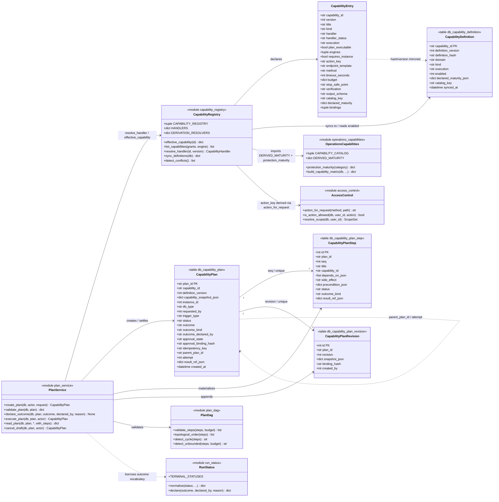
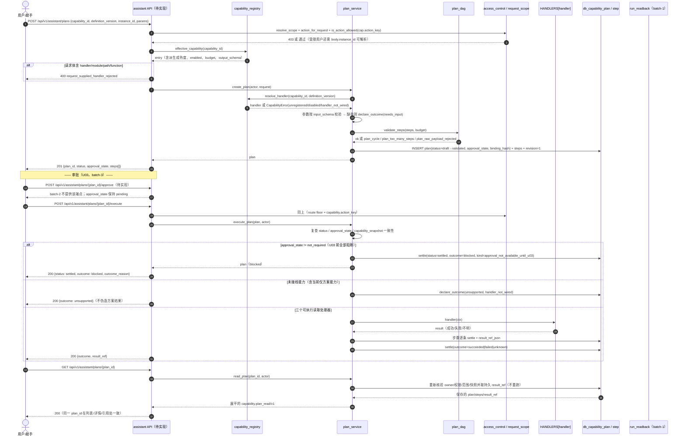

# batch-2 详细设计（2026-10-20）：U01 能力登记 + U02 类型化计划

本文件是增量设计，不是重做架构。上游：[实施计划](implementation-plan-2026-10-20.md) §3.2（batch-2 范围）、
[详细待开发清单](pending-development-backlog.md) U01/U02（对应 C02/C03）、
[卡片编排任务清单](capability-card-task-plan.md) §1-§2（执行链与清单字段）、
[已知问题台账](../known-issues.md)（ISS-xx 唯一权威）、[对齐计划](alignment-plan.md)。

写于分支 `codex/menu-optimization`，HEAD `7905947`，工作区含 224 项他人未提交改动。
**本轮只读**：除本文件外没有修改任何已有文件。

### 2026-10-20 实施接续（不覆盖上述初稿时点）

| 任务 | 当前状态 | 边界 |
| --- | --- | --- |
| T01 | 用户已有实现：`413fb34`、`b231a72`，保留四表与迁移 | 本次不改模型、迁移或契约基线，不代表客户库已升级 |
| T02 | 已补 77 条声明、静态处理器、同步/停用与权限范围校验；源码及隔离验证 | 3 条服务端读取接线、70 条已有客户端分支、4 条未接处理器；不是 77 条均可由服务端执行 |
| T03 | 首批读取工作流源码与隔离定向复核通过 | 显式计划/DAG/幂等/结果落库与回读；仅三个读取处理器，真实审批/采集/写动作未放行。全量检查具体状态见执行记录，不作现场结论 |
| T04 | 六条 API 已接源码；验证状态见执行记录 | 能力发现、清单创建/摘要列表/详情/执行；不是新采集或写执行器，未部署 |
| T05 | 首批前端接线与隔离验收已补 | 通用动作门禁、三个读取清单确认/历史/结果；不增加真实审批/采集/写执行或现场完成声明 |

实现与证据见 [T02 执行记录](../archive/acceptance/2026-10-20-capability-registry-t02.md)。
三个已确认决定：稳定能力 ID 可进入对外合同；轻量读取（包括服务端读取）不建计划行，但保留鉴权、范围与必要安全日志；真实会话终止不批准，维持 `unsupported`。
声明拆在 `backend/app/services/capability_declarations.py`，注册、同步与解析在 `backend/app/services/capability_registry.py`；不替换旧目录。
本节之后的“现状/待核”保留初稿语境，下列端点核对与约束更正以本次补记为准。

T03 接续见 [显式读取任务计划执行记录](../archive/acceptance/2026-10-20-capability-plan-t03.md)。普通读取不建计划；显式创建清单才持久化。单个清单当前冻结一个目标，不在步骤里隐式扩大范围；字段引用仅消费三个处理器的白名单输出，结果总预算 1 MiB。没有参数编辑/审批 API，不伪造仅方案执行器或现场停止能力。

T04 接续见 [API 执行记录](../archive/acceptance/2026-10-20-capability-api-t04.md)。本稿曾写“5 条接口”，表中实际列六条，现按六条落地。路由底线只匹配六组 method/template，不对整个助手前缀授予权限。请求不接受身份、审批或处理器注入；列表按当前权限/范围过滤且不加载内联结果。以下设计中的历史现状不替代该记录。

T05 接续见 [前端与隔离浏览器记录](../archive/acceptance/2026-10-20-capability-frontend-t05.md)。目录不是动态 URL 执行器，前端仍用静态已有代码；当前只消费已支持的 v1 定义，升级定义需显式适配。服务端读取先进入确认清单，不静默把所有普通 GET 建成计划；现有独立巡检执行与专业页面保留，U05 旁路统一仍待后续。

同日并行提交 `c0b7c12` 已加入启动期尽力同步，替代初稿“启动不自动同步”的安排：以进程身份记审计、保留停用、跳过版本冲突；无公开同步 HTTP，GET 仍不写登记。六项 lifespan 隔离验证通过，尚未迁移/启动真实平台，发布前须确认同步结果而非只检查进程存活。

---

## 0. 证据边界与本文的写作约束

### 0.1 判读口径

- 初稿的所有"现状"结论都是**读当时工作区源码**得到的可达路径，不是实测。后续隔离测试以各 T02/T03/T04 执行记录为准；均不代表真实引擎、Agent 或部署验收。
- 引用的每个符号（函数名、类名、表名、路由、API 模块）都打开文件确认过。**未打开确认的一律不写**；
  确实需要但没核对的写"待核"并给出核对方式（见 §0.3）。
- 可交付性沿用[实施计划](implementation-plan-2026-10-20.md) §0 的定义：**A** = 本机代码+隔离测试即可收口；
  **B** = 需真实 MySQL/Oracle/SQL Server/Agent/现场；**C** = 需产品决定，先写实现等于替产品拍板。

### 0.2 文档门禁对本文的硬约束（三条，都是实测规则，不是建议）

这一节必须放在最前面，因为本文的写法是被门禁倒推出来的，不是风格选择。

| 门禁 | 实际规则（读源码确认） | 对本文的影响 |
| --- | --- | --- |
| `scripts/check_doc_routes.py` | 扫描所有 `*.md`（`docs/archive/` 除外）里的 `/api/v1/...` 串；该串必须是已注册路由或其前缀，**否则退出码 1**。唯一豁免：**同一行**含 `未实现`/`历史路径`/`已废弃`/`待实现`/`planned`/`TODO` | 六条 T04 路由已注册，去除待实现标记；其他未实现接口仍须明确标注 |
| `scripts/check_doc_paths.py` | 扫描 `backend/`、`frontend/` 等顶层目录开头且以 `.py/.js/.jsx/.json/...` 结尾的路径串，**文件不存在即退出码 1** | **待新建**文件一律用包相对路径书写（`app/services/...`、`src/modules/...`），不写 `backend/`、`frontend/` 前缀。这是[实施计划](implementation-plan-2026-10-20.md) 已采用的写法（该文件 §3.1 同样写 `app/services/run_status.py`） |
| `scripts/check_capability_consistency.py` | 用 **AST** 解析 `backend/app/services/operations_capabilities.py` 的 `CAPABILITY_CATALOG`，取 `key`/`route_key`/`domain` 三个常量字段，与 `module_config.DEFAULT_MODULES`（实测 73 个 `module_key`）和 `AppPageRouter.jsx` 的页面 key 做三方比对 | **`CAPABILITY_CATALOG` 的元组结构与三个字段名不能动**。U01 只能"在旁边加"，不能把它搬进数据库或改成生成式（见 §1.10） |

这三条直接决定了 §1.10 的"保留 `CAPABILITY_CATALOG`"不是保守，而是门禁要求；也决定了 U01 **不能**把注册表做成"删除旧目录、只留新目录"的替换式改造。

### 0.3 初稿待核清单与 T02 核对结果

T02 已从前端 API 调用与后端路由核对 151 个不同的 method/path、反向覆盖全部 70 个页面 key，并用源码 AST 断言固定。
权限按实际引擎分支计算；同一复合调用仍要求全部端点权限。唯一无 action 映射的 GET `/auth/current-user` 是经过认证的本人信息读取，显式豁免该端点的 action，不豁免身份或同组其他端点权限，不设通用 override。
这些是离线源码匹配，不是 151 条真实 HTTP 验收；下表保留初稿核对方法，当前不再作为阻塞项。

| 项 | 为什么没核 | 核对方式 |
| --- | --- | --- |
| 每个能力绑定的**具体 `endpoint_template`**（如 `/oracle/{instance_id}/basic-info`） | 需逐个打开 `frontend/src/modules/*.js` 读 30+ 个 URL 常量；本文只核到"前端 API 模块函数存在且被 `assistantActions.js` 调用"这一层 | 工程师在 T02 逐条从 `src/modules/*.js` 抄录，**不得由本文推断**。抄错的后果由 §1.4 的导入期断言拦住（`action_for_request` 返回 `None` 即导入失败） |
| 77 条绑定里哪几条的 `endpoint` 落在 `action_for_request` 未覆盖的路径上 | 需要先有 `endpoint_template` 才能算 | T02 的导入期断言会一次列出全部，届时用 `action_key_override` 逐条处理（每条例外必须写理由） |
| `settingsApi.list` / `aiConfigApi.list` / `identityApi` 的实际方法名与路径 | 只核到调用点（`assistantActions.js:899`/`:901`/`:895`），未读 `apiClients.js` 与 `identityApi.js` 内部 | T02 打开 `frontend/src/apiClients.js`、`frontend/src/modules/identityApi.js` |

---

## 1. U01 实现方案：能力登记表

### 1.1 现状（三条都是读代码得到的，不是印象）

1. **分派在前端，且按页面 key 而非动作分派。** `frontend/src/modules/assistantActions.js` 的 `TARGET_TITLES`
   实测 **70 个 key**（脚本计数），`executeAssistantActionRequest`（:720）用 `startsWith("ops.")`/`startsWith("perf.")`/
   `startsWith("integration.")` + 一个 60 分支的 `switch` 把它映射到后端调用。**同一个 key 会因指令关键词走不同动作**：
   `ops.overview` 在 Oracle 上命中「启动」就调 `oracleOpsApi.startupScript`、命中「关闭」就调 `shutdownScript`、
   否则调 `basicInfo`（:573-588）。也就是说"一个页面 key"实际覆盖 1-3 个语义完全不同的能力，
   其中还包括 `plan_only` 与 `read_only` 的差别——这正是"页面能打开 ≠ 动作可执行"的源码级原因。
2. **后端目录只声明引擎成熟度，不声明动作。** `backend/app/services/operations_capabilities.py` 的 `CAPABILITY_CATALOG`
   是 **15 条**引擎能力条目（`runtime.overview` … `governance.archive`），字段是 `domain/name/route_key/modes/maturity`，
   没有处理器、没有输入输出类型、没有超时预算。它与前端 70 个 key 是两套互不相干的词表。
3. **默认分支会造出"假成功"。** `executeAssistantActionRequest` 的 `default`（:914）对任何未命中 key 返回
   `instanceApi.list(...)` + `notice="该功能需要补充业务参数"`，`runAssistantActionProgress`（:452）随后把它算成
   `state.status = "success"`（batch-1 已把带运行身份的回包改成 `unknown`，但这条纯只读的 `default` 分支仍在）。

### 1.2 决定 D1：代码是"语义声明"，数据库是"运行状态"

**问题**：注册表落库，谁是真值？如果 DB 行能声明"处理器是哪个"，那就等于让一个可写表决定执行哪个函数——这是 RCE 面。

**决定**：

| 内容 | 真值位置 | 理由 |
| --- | --- | --- |
| 能力 ID、版本、kind、处理器键、支持引擎、风险、action_key、超时/预算/停止安全点/校验方式、绑定 | **代码**（`app/services/capability_registry.py` 的 `CAPABILITY_REGISTRY` 元组） | 处理器只能是 Python 里的静态函数，DB 行指不到它；代码可评审、可 grep、随 git 版本化 |
| 启用/停用、定义哈希与同步时间、上次声明的成熟度、冲突审计 | **数据库**（`db_capability_definition`） | 运维需要在不重新发版的前提下停用一个能力；这是开关，不是声明 |

**两条不可交换的不变量**：

- **DB 只能关，不能开**：`enabled=0` 让能力不可用；`enabled=1` 不能让一个代码里不存在的能力出现。
  `effective_capability(id)` 对 DB 里有、代码里没有的行直接拒绝（错误码 `unregistered_capability`），
  并按批记录冲突（`conflict_kind="db_row_without_declaration"`）。
- **同步方向单向**：`sync_definitions(db)` 只做 code → DB（插入新 ID、更新 `definition_hash`/`definition_version`、
  保留 `enabled`），永不 DB → code。初稿仅显式调用服务层 `sync_definitions`；当前并行实现另在启动期以进程自身身份尽力同步并记录审计，跳过版本冲突，保留停用，不提供公开同步 HTTP 入口。
  测试夹具同步只验证隔离库，不代表平台运行库已同步。

### 1.3 决定 D2：能力 ID 命名规则与稳定性

**规则（正则即合同）**：

```text
^[a-z][a-z0-9_]*(\.[a-z][a-z0-9_]*){2}$
长度 ≤ 64；恰好三段：<domain>.<subject>.<verb>
```

- `<domain>` 闭集：`platform` `asset` `diagnosis` `monitor` `inspection` `performance` `operations`
  `governance` `protection` `rescue` `report` `integration`。
- `<subject>`：被作用对象，小写 snake，单数。允许两级语义合写（`snapshot_agent`、`sql_profile`），但**不许**出现
  `page`/`view`/`tab`/`detail` 这类 UI 结构词。
- `<verb>` 闭集：`read` `query` `collect` `scan` `refresh` `sync` `bind` `plan` `execute` `cancel` `retry`。
  `read`=纯读取，`collect`/`scan`/`refresh`/`sync`/`bind`=会触发后端采集或外部写入，`plan`=只产方案，`execute`=真实副作用。

**稳定性规则（违反即打回）**：

| 会变的东西 | 变的时候改什么 | 绝不改什么 |
| --- | --- | --- |
| 菜单名称、页面标题、`TARGET_TITLES` 文案 | `title` 字段、绑定关系 | `capability_id` |
| 路由路径、页面组件、`AppPageRouter.jsx` 的 key | `bindings`（`target_key` → ID 的映射） | `capability_id` |
| 能力语义变化（如从只读变成有副作用） | **同 ID 的 `version` 递增**（整数），旧版本行保留 | `capability_id` |
| 引擎支持范围变化 | `engines` 元组 | `capability_id` |

**为什么不用版本号进 ID**（`inspection.run.query.v2`）：ID 会出现在审计、审批绑定、计划步骤、前端缓存与对外响应里；
带版本段意味着每次升级都要改所有引用点，而改漏一处就是"运行期静默未登记"。版本是 ID 的**属性**，不是 ID 的**组成**。
这也正是[实施计划](implementation-plan-2026-10-20.md) §10.6 提请确认的那一条（见 §10 P2）。

**为什么不复用 `target_key` 当 ID**：`target_key` 是页面 key（`ops.session`、`perf.sql`），它随菜单/路由改动；
而且一个 `target_key` 对应多个能力（见 §1.1 第 1 条），一对一复用会在第一次分支时就崩掉。
两者关系用**绑定表**表达：`bindings: tuple[{target_key, branch, intent_gap?}]`，多对多。

**"恰好三段"是容易自己违反的一条，先写在这里**：本设计初稿把 Oracle 启动/关闭方案写成
`operations.instance.start.plan`（四段），已改名为 `operations.startup.plan`；把会话终止写成
`operations.session.terminate.execute`（四段），已改名为 `operations.termination.execute`。
**复合概念必须压进 `<subject>` 一个段里**（用 `_` 连接，如 `snapshot_agent`、`sql_profile`），
不允许用"再多一层点"来表达。词表外的动词也不允许（`kill`/`promote`/`failover` 都要落到 `execute`/`plan` 上，
具体动作由 `<subject>` 表达）。T02 的单测会逐条跑正则，四段 ID 立刻红。

### 1.4 决定 D3：处理器只按登记 ID 解析

```python
# 设计伪码；最终签名、数据库状态及鉴权以 app/services/capability_registry.py 为准
def resolve_handler(capability_id: str, definition_version: int) -> CapabilityHandler:
    entry = _BY_ID.get(capability_id)
    if entry is None:
        raise CapabilityError("unregistered_capability", capability_id)
    if not _db_enabled(capability_id):
        raise CapabilityError("capability_disabled", capability_id)
    if entry["version"] != definition_version:
        raise CapabilityError("stale_definition_version", capability_id)
    handler = HANDLERS.get(entry["handler"])
    if handler is None:
        raise CapabilityError("handler_not_wired", capability_id)
    return handler
```

- `HANDLERS: dict[str, Callable]` 是**模块级静态字典**，键是 `handler` 字符串常量（如 `"inspection.list_jobs"`），
  值是直接 import 进来的函数对象。**全仓不出现 `importlib`、`getattr(__import__…)`、`eval`、点号拆分模块名**。
  护栏：单测断言 `capability_registry` 与 `assistant` API 两个模块的源码 AST 里没有 `importlib`/`__import__`/`eval`/`exec` 调用。
- **请求体只接受 `capability_id` + `definition_version` + `params`**。请求里出现 `handler`/`module`/`path`/`function`/
  `handler_ref` 任一字段一律 400 `request_supplied_handler_rejected`——不是"忽略"，是拒绝并记审计
  （静默忽略会让攻击者以为成功了却没留下痕迹）。
- `stale_definition_version` 存在的意义：让"客户端拿着旧能力清单执行"变成显式冲突，而不是按新语义静默执行。

### 1.5 决定 D4：派生字段 > 登记字段（本批最容易犯的错）

**背景**：ISS-20 的 S1 缺陷是能力目录把备份/恢复声明为四引擎 `ready`，而 `backup_center` 对 SQL Server 返回
`executable=False`、对 MySQL/PostgreSQL 的 restore 返回 `blocked`。上一轮把这两条改成从
`operations_capabilities.protection_maturity(category)` 派生（`DERIVED_MATURITY`，:38-41），
并在 `build_capability_matrix`（:322）里让派生值覆盖登记的 `maturity=None`。

**如果扩成注册表时允许手工登记覆盖派生值，就等于把"真实执行能力"换回"声称的能力"。所以规则写死为三层**：

| 层 | 内容 | 优先级 |
| --- | --- | --- |
| 1 | 派生解析器（`DERIVATION_RESOLVERS: dict[str, Callable[[], dict[str,str]]]`，目前只有 `"backup"` / `"restore"` → `protection_maturity`） | **最高，永远覆盖** |
| 2 | 代码登记 `declared_maturity` | 仅在无派生解析器时生效 |
| 3 | DB 行 `declared_maturity_json` | **不参与对外输出**，只作为"上次声明值"用于冲突比对 |

**冲突处置（三个问题都要回答）**：

1. **对外返回什么** → **派生值**。`effective_maturity(capability_id)` 的签名里没有"声明值"参数，
   结构上无法被声明值影响。
2. **是否记录冲突** → **记录，且必须可见**。`declared_maturity` 与派生值在任一引擎上不等时，
   `GET /api/v1/assistant/capabilities` 的响应顶层带 `conflicts: [{capability_id, engine, declared, derived}]`，
   同时 `logger.warning` 一条含 capability_id/engine 的结构化日志。理由：静默以派生值为准会让"登记的人以为登记生效了"，
   而这正是 ISS-20 的复发方式——下次有人为了"让页面好看"改登记值，必须立刻被看见。
3. **能否登记** → **不能**。对 `DERIVED_MATURITY` 里的能力，`sync_definitions` 拒绝写入 `declared_maturity_json`
   （错误码 `derived_maturity_is_not_declarable`），单测断言该写入被拒。
   `operations_capabilities.DERIVED_MATURITY` **保留为唯一声明处**，注册表 import 它，不复制一份。

**派生只作用于"执行类"能力，不作用于"方案类"**（容易做错的地方）：`protection.backup`（对应 catalog 键
`protection.backup`）是执行类，成熟度必须与现有 `protection_maturity("backup")` 一致；当前 SQL Server 是 `partial`，不能为迎合设计硬改为 `blocked` 或 `ready`。登记能力是否能调用另由 handler/同步/停用状态决定；
但 `protection.backup.plan`（`backup.plan` 动作生成的方案）**不是执行**，方案生成对 SQL Server 是能做的，
如果把派生值套上去会把它错标成 `blocked`。所以派生解析器只在 `catalog_key` 命中
`{"protection.backup","protection.restore"}` **且** `kind in {"execute"}` 时生效。单测断言
`effective_maturity("protection.backup.plan")["sqlserver"] != "blocked"`。

### 1.6 决定 D5：`execution=client|server` 两段式，与"注册表是权威"如何同时成立

**问题**：70 个动作的处理器今天全在浏览器里（调 REST）。把它们全搬服务端是本批做不完的改写，而只搬 3 条又会让
另外 67 条"未登记"。两个极端都错。

**决定**：

- `execution="client"`：处理器在浏览器；注册表提供 **`endpoint_template` + `method` + `action_key` + `output_schema`**，
  由 `GET /api/v1/assistant/capabilities` 下发；T05 已接通用动作门禁，独立巡检等专业入口另由原有业务权限守护。目标是前端通用助手**只能执行注册表列出的能力**，
  不允许再出现"命不中就走 `default`"。
- `execution="server"`：实际存在静态 `HANDLERS` 条目且校验通过后 `plan_executable=true`，可被 `POST /api/v1/assistant/plans` 驱动；仅声明 execution 不构成执行许可。

**这为什么不是把安全责任推给前端**：浏览器本来就能直接调那些端点，注册表没有引入新通道。
注册表的作用是**把"平台声称能做什么"从 70 处 if/else 收敛到一处，并让它可被服务端拒绝**。
真正的越权防护仍在 `access_control.action_for_request`（路由级）+ `request_scope`（资产级），两条都不动。

**由此得到的诚实产物**：`handler_status="declared_not_wired"` 的能力会出现在清单里但**不可执行**，
`execute` 返回 `blocked`（`reason="handler_not_wired"`，`next_action="open_page"`）。
这比"注册了就等于能跑"诚实，也直接满足清单 U01 的验收句"初期只放行实际接入且验收的能力"。

**首批 `execution="server"` 只有 3 条**，选它们的理由是三种不同形态各覆盖一次、且都不需要审批：

| capability_id | 形态 | 为什么选它 |
| --- | --- | --- |
| `inspection.run.query` | 作业表读模型 | batch-1 刚建好 `jobs.list_jobs` + `run_readback`，是唯一"已有真值读回"的域 |
| `inspection.template.read` | 模板列表 | 纯列表，能验证 `output_schema` 与分页参数校验 |
| `operations.capability_matrix.read` | 进程内派生 | 直接把 §1.5 的派生规则跑通，不需要 HTTP 往返 |

### 1.7 数据结构（classDiagram）



### 1.8 调用链（U01）

```text
GET /api/v1/assistant/capabilities
  └ resolve_scope + effective_action_keys            # access_control 既有
  └ capability_registry.list_capabilities(grants, engine)
      ├ 过滤：action_key 未被 grants 命中的能力不返回   # 权限过滤在服务端
      ├ 逐条：effective_maturity()  ← 派生优先（§1.5）
      ├ 逐条：enabled ← db_capability_definition（只能关）
      └ 汇总 conflicts[]

POST /api/v1/assistant/plans
  └ capability_registry.effective_capability(capability_id)
  └ 拒绝：request 里带 handler/module/path/function  → 400
  └ 拒绝：action_key 不在 grants                     → 403
  └ plan_service.create_plan(...)                    → 见 §2
```

### 1.9 初始能力 ID 清单（77 条，逐条从代码核出）

**怎么核的**：`TARGET_TITLES`（`assistantActions.js:185-256`）70 个 key × `executeOps`/`executePerformance`/
`executeIntegration`/主 `switch` 里的分支条件 + `CAPABILITY_CATALOG` 15 条里无前端入口的条目。
**一个 key 因关键词/引擎分成多个能力时逐条拆开**——这是本次登记的核心工作量，也是"if/else 散落"的量化证据。

列含义：`exec` = 处理器位置（`client`/`server`，§1.6）；`plan` = 是否可被服务端类型化计划驱动（★ = batch-2 首批 true）；
`kind` 见 §1.3 动词表；`依据` = 现有实现符号（已打开确认）。

**platform / asset**

| # | capability_id | 绑定 target_key（分支） | kind | exec | plan | 依据 |
| --- | --- | --- | --- | --- | --- | --- |
| 1 | `platform.dashboard.read` | `home.dashboard` | read | client | false | `systemApi.dashboardStats`（:736）→ `/api/v1/system/dashboard-stats` |
| 2 | `platform.user.read` | `system.user` | read | client | false | `getUserManagementBundle`（:892） |
| 3 | `platform.identity.read` | `system.identity` | read | client | false | `listIdentityProviders`+`listIdentityLoginAudit`（:895） |
| 4 | `platform.settings.read` | `system.params` | read | client | false | `settingsApi.list`（:899，路径待核 §0.3） |
| 5 | `platform.ai_config.read` | `system.ai` | read | client | false | `aiConfigApi.list`（:901，路径待核） |
| 6 | `platform.ai_evaluation.read` | `system.aiEvaluation` | read | client | false | `diagnosisEvaluationApi.summary`（:903） |
| 7 | `platform.scheduler.read` | `system.schedule` | read | client | false | `getSchedulerStatus`+`getSchedulerTasks`+`getAwrCollectPolicies`（:906） |
| 8 | `asset.inventory.read` | `asset.center`（无识别词） | read | client | false | `getAssetOverview`+`getAssetTree`+`listCmdbSources`（:751） |
| 9 | `asset.discovery.execute` | `asset.center`（识别/发现/同步/刷新拓扑） | collect | client | false | `applyAssetDiscovery({probe_live:true})`（:739） |

**diagnosis / monitor**

| # | capability_id | 绑定 target_key（分支） | kind | exec | plan | 依据 |
| --- | --- | --- | --- | --- | --- | --- |
| 10 | `diagnosis.incident.read` | `diagnose.incidents` | read | client | false | `listIncidents`（:756） |
| 11 | `diagnosis.investigation.read` | `diagnose.investigation` | read | client | false | 5 个 list 并行（:758-767） |
| 12 | `diagnosis.snapshot_agent.read` | `diagnose.snapshot.agents` | read | client | false | `listIncidentAgents`（:769） |
| 13 | `diagnosis.snapshot_rule.read` | `diagnose.snapshot.policies` | read | client | false | `listIncidentTriggerRules`（:771） |
| 14 | `monitor.alert.read` | `monitor.alert.unified`（无同步词）；`report.alert`（intent_gap=告警报告复用告警列表） | read | client | false | `getUnifiedAlertBundle`（:779/:890） |
| 15 | `monitor.alert.sync` | `monitor.alert.unified`（同步/导入/刷新） | sync | client | false | `importCapacityAlerts`+`importExternalAlerts`（:775） |
| 16 | `monitor.capacity_alert.read` | `monitor.alert.db`（无采集词） | read | client | false | `getCapacityAlertBundle`（:785） |
| 17 | `monitor.capacity.execute` | `monitor.alert.db`（采集/刷新） | collect | client | false | `capacityApi.collect`（:784） |
| 18 | `monitor.observability.read` | `monitor.observability`（无绑定词） | read | client | false | `getObservabilityLinkageHealth`（:793） |
| 19 | `monitor.observability.bind` | `monitor.observability`（自动绑定/绑定） | bind | client | false | `autoBindObservability`（:790） |
| 20 | `monitor.log.read` | `monitor.observability.logs`（无时间线词） | read | client | false | `queryObservabilityLogs`（:804） |
| 21 | `monitor.timeline.read` | `monitor.observability.logs`（时间线/故障链） | read | client | false | `buildObservabilityFaultTimeline`（:799） |
| 22 | `monitor.grafana_template.read` | `monitor.observability.grafana` | read | client | false | `listGrafanaTemplates`（:808） |
| 23 | `monitor.apm_source.read` | `monitor.observability.apm`（无 traceId） | read | client | false | `getObservabilityBundle`（:812） |
| 24 | `monitor.apm_trace.read` | `monitor.observability.apm`（有 traceId） | read | client | false | `queryApmTrace`（:816） |

**inspection**

| # | capability_id | 绑定 target_key（分支） | kind | exec | plan | 依据 |
| --- | --- | --- | --- | --- | --- | --- |
| 25 | `inspection.run.query` | `inspect.overview`、`inspect.tasks` | query | **server** | **★true** | `jobs.list_jobs` + `run_readback.run_summary`（batch-1，`app/services/inspection/jobs.py:764`、`app/services/inspection/run_readback.py`） |
| 26 | `inspection.report.read` | `inspect.reports`、`inspect.compare`（intent_gap=今天打到运行列表） | query | server | false | **declared_not_wired**；现绑定实际走 `listInspectionTasks`（:823） |
| 27 | `inspection.template.read` | `inspect.policies`、`inspect.templates` | read | **server** | **★true** | `GET /api/v1/inspection/policies`（已注册；已用路由表逐条确认存在） |
| 28 | `inspection.run.execute` | `inspect.run`（不在 `TARGET_TITLES`，走 `resolveAssistantInspectionCommand`→`runAssistantInspectionSequence`） | execute | client | false | `runInspectionTask` → `POST /api/v1/inspection/{db_type}/{instance_id}/run`；**经队列**由 `dispatch.run_through_queue` 执行。batch-2 不改这条链，只是把它登记出来 |

> 注：`inspection.run.execute` 登记为 `execution=client`、`plan_executable=false`。把它改成服务端计划驱动属 batch-3（U05/U06），
> 那时才需要审批绑定（§2.5）。**batch-2 不动一个正在工作的功能**。

**performance**

| # | capability_id | 绑定 target_key（分支） | kind | exec | plan | 依据 |
| --- | --- | --- | --- | --- | --- | --- |
| 29 | `performance.overview.read` | `perf.overview` | collect | client | false | `getPerformanceOverview`（:828） |
| 30 | `performance.workload.collect` | `perf.workload` | collect | client | false | `collectWorkloadReport`（:638） |
| 31 | `performance.sql_profile.collect` | `perf.sql` | collect | client | false | `collectSqlProfile`（:647） |
| 32 | `performance.slow_sql.read` | `perf.slowsql`（oracle→`getOracleSlowSqlRealtime`，mysql→`mysqlOpsApi.slowSqlTop`） | read | client | false | :650/:659；engines=(oracle,mysql) |
| 33 | `performance.lock.read` | `perf.lock`（oracle 双查 / mysql / 通用 section） | read | client | false | :666/:670/:671 |
| 34 | `performance.index.collect` | `perf.index` | collect | client | false | `collectIndexFindings`（:673） |
| 35 | `performance.table_profile.collect` | `perf.table` | collect | client | false | `collectTableProfile`（:675） |
| 36 | `performance.suggestion.refresh` | `perf.optimization` | refresh | client | false | `refreshPerformanceSuggestions`（:677） |
| 37 | `performance.baseline.collect` | `perf.baseline` | collect | client | false | `collectPerformanceBaseline`（:679） |
| 38 | `performance.trend.read` | `perf.trend` | read | client | false | `getProblemTrend`（:681） |
| 39 | `performance.capacity.collect` | `perf.capacity` | collect | client | false | `capacityApi.collect`（:683） |
| 40 | `performance.awr.collect` | `perf.awr.report`、`perf.awr.collect`（engines=oracle） | collect | client | false | `collectAwrNow`（:687） |
| 41 | `performance.awr.query` | `perf.awr.history`、`perf.awr.compare`（intent_gap=compare 只取历史列表） | read | client | false | `getAwrReports`（:691） |

**operations / governance**

| # | capability_id | 绑定 target_key（分支） | kind | exec | plan | 依据 |
| --- | --- | --- | --- | --- | --- | --- |
| 42 | `operations.capability_matrix.read` | `ops.matrix` | read | **server** | **★true** | `build_capability_matrix`（`operations_capabilities.py:289`） |
| 43 | `operations.config_governance.read` | `ops.configGovernance` | read | client | false | `configGovernanceApi.summary/baselines/drifts`（:536-538） |
| 44 | `operations.runtime_overview.read` | `ops.overview`（oracle `basicInfo` / mysql `/basic-info` / pg+ss section `overview`） | read | client | false | :588/:554/:548 |
| 45 | `operations.log.read` | `ops.log` | read | client | false | oracle `archiveConfig`+`archiveSpaceDetail`（:592）/ mysql `/binlog/overview` / pg+ss `wal`/`logs` |
| 46 | `operations.session.read` | `ops.session` | read | client | false | oracle `lockedObjects`+`blockingTree`（:598）/ mysql `/locks/transactions` / pg+ss `sessionTransaction` |
| 47 | `operations.space.read` | `ops.space` | read | client | false | oracle `tablespaces`（:603）/ mysql `/capacity/schemas` / pg+ss `space` |
| 48 | `operations.object.read` | `ops.object` | read | client | false | oracle `collectTableProfile`（:606）/ mysql `/tables-indexes/overview` / pg+ss `objectStats` |
| 49 | `operations.security.read` | `ops.security` | read | client | false | oracle `users`+`roles`（:610）/ mysql `/users`；**pg+ss 无 section ⇒ 明确不支持** |
| 50 | `operations.ha.read` | `ops.ha`（无切换词） | read | client | false | oracle `dataGuardOverview`（:622）/ mysql `/replication/status` / pg+ss `ha` |
| 51 | `operations.startup.plan` | `ops.overview`+「启动/开库」(oracle) | plan | client | false | `oracleOpsApi.startupScript`（:576），notice="仅生成可审查脚本" |
| 52 | `operations.shutdown.plan` | `ops.overview`+「关闭/停库」(oracle) | plan | client | false | `oracleOpsApi.shutdownScript`（:582） |
| 53 | `operations.switchover.plan` | `ops.ha`+「切换/switchover」(oracle) | plan | client | false | `oracleOpsApi.dataGuardSwitchoverCheckPlan`（:617） |
| 54 | `operations.termination.execute` | **无前端绑定**（对应 `CAPABILITY_CATALOG` 的 `runtime.terminate_session`） | execute | server | false | **declared_not_wired**；`generic_db_ops.py:247/:263` 仍是 `<pid>`/`<session_id>` 占位（ISS-26），M12 未决 → 首批一律 `unsupported`（C 类，见 §10 P1） |
| 55 | `governance.candidate.read` | `ops.governance`（无扫描词）；pg+ss section `governance` | read | client | false | `getGovernanceBundle`（:565/:627） |
| 56 | `governance.candidate.scan` | `ops.governance`+「扫描/识别/分析」 | scan | client | false | `scanGovernanceCandidates`（:564/:626） |
| 57 | `governance.object_storage.read` | `ops.governance.objectStorage` | read | client | false | `listObjectStorageConfigs`+`listArchiveLifecycleRequests`（:910-911） |

**protection / rescue / report / integration**

| # | capability_id | 绑定 target_key（分支） | kind | exec | plan | 依据 |
| --- | --- | --- | --- | --- | --- | --- |
| 58 | `protection.backup_center.read` | `backup.overview`、`backup.report` | read | client | false | `getBackupCenterBundle`（:831） |
| 59 | `protection.policy.read` | `backup.policy` | read | client | false | `listBackupPolicies`（:833） |
| 60 | `protection.backup.plan` | `backup.plan` | plan | client | false | `buildBackupCenterPlan`（:837）；**成熟度不派生**（§1.5） |
| 61 | `protection.restore.plan` | `backup.restore` | plan | client | false | `buildBackupCenterPlan(plan_type="restore")`（:836-843） |
| 62 | `protection.platform.read` | `backup.platform` | read | client | false | 4 个 list 并行（:850-855） |
| 63 | `protection.backup.execute` | **无前端绑定** | execute | server | false | **declared_not_wired**；`catalog_key="protection.backup"`，成熟度**派生**（`DERIVED_MATURITY`） |
| 64 | `protection.restore.execute` | **无前端绑定** | execute | server | false | **declared_not_wired**；`catalog_key="protection.restore"`，成熟度**派生**；六处 `blocked` 是正确拒绝（ISS-27） |
| 65 | `protection.automation.read` | `protection.automation` | read | client | false | `listAutomationPlans`+`Approvals`+`Runs`（:881） |
| 66 | `rescue.overview.read` | `rescue.overview` | read | client | false | `recoveryApi.engines/agents/tasks`（:860） |
| 67 | `rescue.case.read` | `rescue.cases` | read | client | false | `recoveryApi.cases`+`sourceImages`（:865） |
| 68 | `rescue.tool.read` | `rescue.tools` | read | client | false | `recoveryApi.agentTools`+`toolAuthorizations`（:870） |
| 69 | `rescue.agent.read` | `rescue.agents` | read | client | false | `recoveryApi.agents`（:874） |
| 70 | `rescue.task.read` | `rescue.tasks`；`rescue.reports`（intent_gap）；`rescue.approvals`（intent_gap） | read | client | false | `recoveryApi.tasks`（:878）——三条 key 走同一个调用 |
| 71 | `report.catalog.read` | `report.unified` | read | client | false | `getUnifiedReportStats`+`getUnifiedReports`（:886） |
| 72 | `integration.zabbix.read` | `integration.zabbix`（无同步词） | read | client | false | `getZabbixBundle`（:700） |
| 73 | `integration.zabbix.sync` | `integration.zabbix`（同步/采集/刷新） | sync | client | false | `syncZabbixHosts`+`syncZabbixProblems`（:704） |
| 74 | `integration.prometheus.read` | `integration.prometheus`（无同步词） | read | client | false | `getPrometheusBundle`（:709） |
| 75 | `integration.prometheus.sync` | `integration.prometheus`（同步/采集/刷新） | sync | client | false | `syncPrometheusStandardMetrics`（:713） |
| 76 | `integration.notify.read` | `integration.notify` | read | client | false | `getNotifyBundle`（:715） |
| 77 | `integration.itsm.read` | `integration.itsm` | read | client | false | `getItsmBundle`（:716） |
| 78 | `report.document.generate` | `report.unified`（生成/制作/出具） | collect | server | true | 报告装配 + 可选 AI 分析 + `report_artifact` 证据 |

**计数（只写可直接数出来的事实，不写推导公式）**：

- **77 条 ID**，编号连续、无重复、全部匹配 §1.3 的三段式正则（T02 逐条断言）。
- **覆盖全部 70 个 `TARGET_TITLES` key**（脚本计数）。绑定是多对多，所以：
  - **11 个 key 因关键词/引擎拆成 2-3 条能力**：`asset.center`、`monitor.alert.unified`、`monitor.alert.db`、
    `monitor.observability`、`monitor.observability.logs`、`monitor.observability.apm`、`ops.overview`（拆 3 条）、
    `ops.ha`、`ops.governance`、`integration.zabbix`、`integration.prometheus`；
  - **8 处多 key 共用一个能力**：`#25`(2)、`#26`(2)、`#27`(2)、`#40`(2)、`#41`(2)、`#58`(2)、`#70`(3)、`#14`(2)。
- **4 条 ID 的入口不在 `TARGET_TITLES` 里**：`inspection.run.execute`（走 `resolveAssistantInspectionCommand`）、
  `operations.termination.execute`、`protection.backup.execute`、`protection.restore.execute`（后三条只在
  `CAPABILITY_CATALOG` 里有对应主张，前端没有入口）。
- `execution=server` **3 条**（#25/#27/#42）；`handler_status=declared_not_wired` **4 条**（#26/#54/#63/#64）。

**这张表同时是"声称 vs 真实"的差异清单**：77 条里只有 3 条能被服务端执行；
`intent_gap` 标记的 5 处（#14/#26/#41/#70）暴露了"页面说查报告、实际查列表"这类语义错位。
不标出来，这份注册表就只是把 if/else 换了个地方写。

### 1.10 与 `CAPABILITY_CATALOG` 的关系（保住门禁，不造第二真值）

| 东西 | 处置 | 理由 |
| --- | --- | --- |
| `CAPABILITY_CATALOG`（15 条） | **结构、字段名、取值全部不动** | `check_capability_consistency.py` 用 AST 取 `key`/`route_key`/`domain`；改名或搬走会让门禁静默失效（门禁失效比门禁红更危险） |
| `DERIVED_MATURITY`（2 条） | **保留为唯一声明处**，注册表 import | `DERIVED_MATURITY` 是"哪些能力必须派生"的权威；复制一份就会分叉 |
| `protection_maturity()` | **不改一行** | ISS-20 的修复本体 |
| `build_capability_matrix()` | 派生成熟度改从 `capability_registry.effective_maturity()` 取；冲突由注册表列表/同步另行检测。会话终止条目按决定 3A 改不支持 | 避免两套派生和两处可用性互相矛盾；不声称旧矩阵负责全部冲突审计 |
| 注册表 vs 目录的分工 | 目录 = **引擎能力主张**（"对 MySQL 能看会话"）；注册表 = **动作**（"查会话这件事怎么被调用"）。注册表条目的 `catalog_key` 指回目录 | 一个指"能力存在吗"，一个指"动作能被谁怎么触发"；合并会把两者都搞错 |

---

## 2. U02 实现方案：类型化计划 / 步骤 / 结果

### 2.1 决定 D6：与 `db_inspection_job` **并列 + 引用**，不复用

| 方案 | 代价 | 结论 |
| --- | --- | --- |
| (a) 复用：把计划做成 `db_inspection_job` 的泛化，所有计划都是 job 行 | 要改 `run_status` 的全部派生规则、`commit_results` 的 owner/lease 校验、`reap_*` 语义；batch-1 的 34 条验收断言（[实施计划](implementation-plan-2026-10-20.md) §5.1-§5.8）全部要重写并重新取证 | **否** |
| (b) 并列：新表 + `result_ref_json` 引用 | 两套状态机 | **取** |

**取 (b) 的四条理由**：

1. **语义不同。** 计划是"意图 + 审批 + 可修订"的长期对象（用户能看、能改、能被 U03 撤销）；
   job 是"认领 + 租约 + fencing"的短命对象（worker 持有）。把租约塞进每个只读计划，等于给不并发的东西加锁。
2. **batch-1 刚把 `db_inspection_job` 定为运行唯一真值**（[实施计划](implementation-plan-2026-10-20.md) §4.1），
   现在把它降级成"计划的一种"，是同一批工作里自我推翻。
3. **引用比外键更通用。** 步骤可能是备份方案（`protection.backup.plan`）、能力矩阵（`operations.capability_matrix.read`），
   它们没有 job 行。一个指向 `db_inspection_job` 的外键覆盖不了。
4. **可撤销性。** (a) 一旦出错要回滚整张核心表；(b) 出错只需删新表（数据可弃，因为它是派生的意图记录）。

**接受的代价与缓解**：两套状态机 ⇒ 两套词表。缓解：计划步骤的**执行结果**不自己算，直接借用
`run_status.normalize()/declare()`（batch-1 已建），步骤行只存 `outcome_kind` 的**引用值**。
"借用不重算"是 batch-1 的既有纪律（`run_readback` 对 `result_writer.execution_summary` 的做法）。

**连接方式（写进合同，不留想象）**：

```json
result_ref_json = {"kind": "inspection_job", "id": "<job_id>", "schema": "run_read/v1"}
                | {"kind": "capability_matrix", "schema": "capability_matrix/v1", "inline": {...}}
                | {"kind": "inspection_policy_list", "schema": "inspection.policy_list/v1", "count": 12}
```

读取时**只按 `kind` 分派到已有读模型**，不复制字段。

### 2.2 状态机与 outcome 词表：结构互斥，不靠纪律

**这是 U02 最硬的一条要求**（"`plan_only`/`blocked`/`unsupported`/`needs_input` 不得被隐式映射成已执行"）。
做法不是"记得别这么写"，而是让两个集合**在类型上不相交**：

```text
status  ∈ {draft, validated, awaiting_approval, approved, running, settled}
outcome ∈ {succeeded, partial, failed, cancelled, expired, unknown,      # 执行结果类
           plan_only, blocked, unsupported, needs_input}                  # 显式声明类
```

- 两个集合**无交集**。`plan_only` 永远不可能出现在 `status` 列，所以"仅方案"不可能被读成"跑完了"。
- `status="settled"` ⇔ `outcome IS NOT NULL`。没有 outcome 的 settled 是不合法状态。
- 前 6 个（执行结果类）必须由**证据**推出（`run_status` 或处理器返回值）；后 4 个（声明类）**只能**
  由 `plan_service.declare_outcome()` 写入，且必须带 `declared_by` + `reason`。

**迁移表**：

| 触发 | status（前） | status（后） | outcome | outcome_kind | declared_by |
| --- | --- | --- | --- | --- | --- |
| 创建 | — | draft | null | null | — |
| 校验通过 | draft | validated | null | null | — |
| 校验发现缺参 | draft | settled | `needs_input` | `missing_params` | `plan_service.validate` |
| 校验发现越权 | draft | settled | `blocked` | `permission_denied` | `plan_service.validate` |
| 校验发现引擎不支持 | draft | settled | `unsupported` | `engine_not_supported` | `plan_service.validate` |
| 校验发现处理器未接线 | draft | settled | `unsupported` | `handler_not_wired` | `plan_service.validate` |
| 校验发现能力停用 | draft | settled | `unsupported` | `capability_disabled` | `plan_service.validate` |
| 能力 `kind=plan` 且执行完成 | approved | settled | `plan_only` | null | `plan_service.execute`（**不是**默认路径，只有 `kind=="plan"` 才允许） |
| 需要审批但 U03 未交付 | validated | settled | `blocked` | `approval_not_available_until_u03` | `plan_service.execute` |
| 执行成功 | running | settled | `succeeded` | null | 证据（处理器结果） |
| 执行失败 | running | settled | `failed` | 处理器给出的分类码 | 证据 |
| 执行结果不明 | running | settled | `unknown` | `result_unknown` | 证据 |
| 草稿被取消 | draft/validated/approved | settled | `cancelled` | `cancelled_before_run` | 请求人 |

**`awaiting_approval` / `approved` 两个状态在 batch-2 永不进入**（只出现在 §4.1 的 CHECK 白名单里）：
审批类能力（`kind in {collect,scan,sync,bind,execute}`）`validate` 通过后停在 `validated` 并把
`approval_state` 置 `pending`；此时调 `execute` **不是 409，而是 200 + `outcome=blocked`**
（计划被明确终结为"未执行"，而不是"状态非法"——两者对调用方含义完全不同：前者是"你等 U03"，后者是"你调错了"）。
`approved` 只在 U03 落地批准后出现。这条口径必须在测试里断言，否则下一次有人"顺手"加个自动批准就没人发现。

**唯一写入口强制**：

```python
# app/services/plan_service.py
_DECLARED_OUTCOMES = frozenset({"plan_only", "blocked", "unsupported", "needs_input"})

def declare_outcome(db, plan, outcome: str, *, declared_by: str, reason: str | None = None) -> None:
    """The only writer of a declared outcome. Evidence-derived outcomes go through settle()."""
    if outcome not in _DECLARED_OUTCOMES:
        raise PlanError("declared_outcome_must_be_a_declaration", outcome)
    ...
```

单测断言：
1. 全仓只有 `declare_outcome` 与 `settle` 两个函数写 `plan.outcome`（AST 扫描 + 反例测试）。
2. `normalize()` 对任何输入都不返回那 4 个值（batch-1 §5.1 第 6 条已断言；本批追加"计划也不得把它们写进 `status`"）。
3. 直接 `UPDATE ... SET status='plan_only'` 被 §4 的 CHECK 约束拒绝（SQLite/PG/Oracle 生效；MySQL < 8.0.16 忽略 CHECK —— 见 §10 V2）。

### 2.3 计划 → 步骤 → 结果的 DAG 与预算

| 校验 | 规则 | 拒绝码 |
| --- | --- | --- |
| 环 | `detect_cycle`：步骤的 `depends_on_json` 里 `seq` 必须**严格小于**自身 `seq`（拓扑序即 seq 序，禁止回边） | `plan_cycle` |
| 步数上限 | `len(steps) <= budget.max_steps`（默认 20，登记表 `budget.max_steps`） | `plan_too_many_steps` |
| fan-out 上限 | 单步展开的子调用数 ≤ `budget.max_fanout`（默认 1；"全部实例巡检"这类由 batch-3 的批次表承接，不是计划扇出） | `plan_fanout_exceeded` |
| 重试上限 | `budget.max_retries`（默认 0；写动作一律 0，见 §2.5） | `plan_retry_exceeded` |
| 无界循环 | 步骤是 DAG，**没有 while/back-edge 表达方式**；`depends_on` 只接受 `seq` 整数，不接受表达式 | `plan_expression_rejected` |
| 越类型引用 | `depends_on` 只能引用同计划内更早的 `seq`；`result_ref` 只能被 `schema` 相同的步骤消费 | `plan_typed_reference_violation` |
| 任意脚本 | `params` 里出现 `sql`/`script`/`command`/`shell`/`cmd`/`url`/`endpoint` 顶层键一律拒绝 | `plan_raw_payload_rejected` |

最后一条直接落实[卡片编排任务清单](capability-card-task-plan.md) §2 那句"清单不能包含模型生成的代码、SQL、Shell、处理器路径或任意调用地址"。

### 2.4 幂等键与"显式重新运行"

```text
idempotency_key = sha256("v1|" + capability_id + "|" + str(requested_by) + "|" +
                         str(instance_id or 0) + "|" + target_fingerprint + "|" +
                         canonical_json(params))
```

- `target_fingerprint` 复用 `jobs.target_fingerprint(instance)`（`jobs.py:63`）——同一个实例身份口径，不另造。
- `canonical_json`：键排序 + 无空白 + 拒绝非标量嵌套深度 > 8。
- **`definition_version` 故意不进键**。理由：幂等键标识"这次请求"，不是"这次请求在这版定义下"。
  把版本放进键，意味着**部署一次新版本，同一个用户的同一个写请求会再执行一次**——那是双写，不是幂等。
  版本记在计划行上（`definition_version` + `capability_snapshot_json`），执行时按快照。
- 唯一约束 `idempotency_key UNIQUE`。重复提交返回同一 `plan_id`（200，`reused=true`）。
- **"显式重新运行"** = 客户端带 `Idempotency-Key` 请求头（覆盖自动计算值）。此时新建 `parent_plan_id` 指向原计划、
  `attempt = parent.attempt + 1` 的新计划，**绝不复用旧 `result_ref`**。`parent_plan_id UNIQUE` 保证同父只有一个重跑。
- 同一 `Idempotency-Key` 换了 `params` → 409 `idempotency_conflict`，不建新行（"同键变参"是调用方 bug，不是新请求）。

### 2.5 审批/撤销预留（U03 消费，batch-2 **不能**批准）

表结构一次到位，避免 batch-3 改表：

| 列 | 用途 | batch-2 行为 |
| --- | --- | --- |
| `approval_state` | `not_required` / `pending` / `approved` / `rejected` / `expired` / `revoked` | 只写 `not_required`（`kind in {read,query,plan}`）或 `pending`（`kind in {collect,scan,sync,bind,execute}`） |
| `approval_binding_hash` | 审批绑定的业务摘要指纹；U03 用 `(capability_snapshot + target_scope + params)` 计算并比对 | `not_required` 时必须为 NULL，不生成占位指纹；需要审批时才绑定。**batch-2 没有任何代码路径把它改成 `approved`** |
| `approval_expires_at` / `approved_by` / `approved_at` / `revoked_at` / `revoked_by` | U03 写入 | 全部 NULL |
| `db_capability_plan_revision` | 参数/目标/能力版本变化 ⇒ 新修订，旧审批自动失效（因为 `binding_hash` 变） | 建计划时写 revision=1；`params` 变更接口**本批不提供**（没有编辑就等于没有失效问题） |

**batch-2 的硬边界**：`approval_state=="pending"` 的计划调 `execute` → `settled` + `outcome="blocked"` +
`outcome_kind="approval_not_available_until_u03"`。返回保存的 blocked 对象，**不是已受理或已执行**；本节初稿“不返回 200”与 §2.2/时序图矛盾，统一以明确 blocked 的结果对象为合同，T04 对该对象返回 HTTP 200，不把 HTTP 成功码当业务执行成功。
测试断言 blocked 且处理器调用零次，不能靠任何自动批准绕过。

### 2.6 时序图：计划 → 审批 → 执行 → 回读



---

## 3. 文件清单

**待新建**（包相对路径，理由见 §0.2）：

| 文件 | 作用（一行） |
| --- | --- |
| `app/services/capability_registry.py` | 77 条能力的代码声明 + 静态 `HANDLERS` + 派生/冲突/解析/同步 |
| `app/services/capability_handler.py` | `CapabilityHandler` 协议与 3 个首批处理器适配器（inspection job 列表、模板列表、能力矩阵） |
| `app/services/plan_service.py` | 计划创建/校验/declare/settle/执行/回读；`outcome` 的唯一写入口 |
| `app/services/plan_dag.py` | 纯函数：环/上限/表达式/越类型引用校验与拓扑序 |
| `app/models/capability_definition.py` | `DBCapabilityDefinition`（运行状态与版本账本） |
| `app/models/capability_plan.py` | `DBCapabilityPlan` / `DBCapabilityPlanStep` / `DBCapabilityPlanRevision` |
| `app/api/v1/assistant.py` | 6 个新端点（能力清单/单条/计划创建/计划列表/计划详情/执行） |
| `app/migrations/versions/v20261020_02_capability_registry.py` | 建 `db_capability_definition` |
| `app/migrations/versions/v20261020_03_capability_plan.py` | 建 `db_capability_plan` / `_step` / `_revision` |
| `tests/test_capability_registry.py` | 登记完整性、ID 规则、派生优先、冲突上报、无 importlib、action_key 可解析 |
| `tests/test_capability_plan.py` | 状态/outcome 互斥、declare 唯一写入口、幂等、重跑、审批未交付即 blocked |
| `tests/test_capability_plan_scope.py` | 两段权限门、受限用户范围、403 而非空列表 |
| `tests/test_capability_schema.py` | 新表迁移在**老库**上被应用（不是 `create_all` 分支） |
| `src/modules/assistantApi.js` | 前端：`listCapabilities`/`createPlan`/`getPlan`/`executePlan` |

**修改**：

| 文件 | 改动（一行） |
| --- | --- |
| `backend/app/migrations/runner.py` | 按时间序追加 `20261020_02`、`20261020_03` 到 `MIGRATIONS` |
| `backend/app/models/__init__.py` | 导出 4 个新模型（与既有 331 行 `__all__` 一致） |
| `backend/app/services/operations_capabilities.py` | 只改 `build_capability_matrix` 取派生值的那一处调用；`CAPABILITY_CATALOG`/`DERIVED_MATURITY`/`protection_maturity` 不动 |
| `backend/app/api/v1/registry.py` | 新增 `assistant` 模块并挂进 `API_MODULE_GROUPS` |
| `backend/app/services/access_control.py` | `action_for_request` 精确匹配六条已注册 method/path（route floor，§5.2），未知助手路由不授予权限 |
| `backend/app/services/request_scope.py` | 3 处登记（`_CATALOGS`、`_FILTERED_COLLECTIONS`、`_rule`、`_Targets.reference`，§5.3） |
| `backend/tests/test_migration_registration.py` | `NEW_REVISIONS`/`REVISION_COLUMNS` 扩两个 revision 与 4 张新表 |
| `backend/tests/test_authorization_boundary.py` | 断言 6 条新路由都有已知动作（既有测试自动覆盖）；新增 HTTP 与范围专项测试 |
| `frontend/src/modules/assistantActions.js` | 删 `status:"completed"`（§7）；`executeAssistantActionRequest` 的 `default` 分支改为 `unsupported`（不再造成功） |
| `frontend/src/DiagnosisCenterPage.jsx` | `runAssistantAction` 前查一次能力清单；未登记/未启用 → 明确"不可执行"，不开进度弹窗 |
| `contracts/baselines/openapi-v1.json` | 手术式新增 6 个 operation，输入 schema 内联（ISS-50：禁止 `--update`） |
| `contracts/baselines/database-schema-v1.json` | 只折叠 4 张新表，断言其余零漂移 |
| `docs/known-issues.md` | 回写本轮结论（新增 ISS 编号见 §9） |
| `docs/blueprint/pending-development-backlog.md` | 在 U01/U02 段落标注"batch-2 已设计，待实施" |
| `docs/blueprint/batch2-design-2026-10-20.md` | 本文件：实现后**删除**所有 `（待实现）` 标记（§0.2） |

---

## 4. 表结构与迁移

### 4.1 四张新表 DDL 要点

> 命名沿用仓库既有风格：`db_` 前缀、字符串主键（`db_inspection_job` 是同款），不使用外键约束
> （全仓 `db_inspection_job` 也没有 FK，靠服务层校验；此处保持一致，避免多方言 FK 行为差异）。

**`db_capability_definition`**（运行状态与版本账本）

| 列 | 类型 | 说明 |
| --- | --- | --- |
| `capability_id` | String(64) PK | 代码声明的 ID |
| `definition_version` | Integer NOT NULL | 代码里的 `version` 镜像 |
| `definition_hash` | String(64) NOT NULL | 声明内容 sha256（含 title/engines/action_key/budget 等），用于检测"代码改了但没同步" |
| `domain` / `kind` / `execution` | String(32/16/8) NOT NULL | 便于运维面板筛选；`domain` 建索引 |
| `enabled` | Integer NOT NULL default 1 | 只能关（§1.2） |
| `declared_maturity_json` | JSON NULL | 仅供冲突比对，不参与对外输出 |
| `catalog_key` | String(64) NULL | 指回 `CAPABILITY_CATALOG` |
| `synced_at` | DateTime NOT NULL | |

索引：`ix_db_capability_definition_domain`（`domain`），`ix_db_capability_definition_enabled`（`enabled`）。

**`db_capability_plan`**

| 列 | 类型 | 说明 |
| --- | --- | --- |
| `plan_id` | String(30) PK | `pl` + `uuid4().hex[:26]`，与 `DBInspectionJob.id` 同款口径 |
| `capability_id` / `definition_version` | String(64) / Integer NOT NULL | 冻结引用 |
| `capability_snapshot_json` | JSON NOT NULL | 冻结业务语义，不自动换成新定义；执行前仍须重读注册表核对版本/hash/停用，以及当前权限/目标。失配拒绝并要求重新校验，不能用旧快照绕过撤权或停用 |
| `instance_id` | Integer NULL, index | NULL = 全局能力 |
| `db_type` | String(20) NULL | |
| `requested_by` | Integer NOT NULL | 来自令牌，不来自请求体（ISS-55 的同一条纪律） |
| `trigger_type` | String(20) NOT NULL | `manual` / `assistant` / `schedule` / `retry` |
| `status` | String(24) NOT NULL default `draft`, index | 见 §2.2 |
| `outcome` / `outcome_kind` / `outcome_reason` / `outcome_declared_by` | String(24)/String(48)/Text/String(64) NULL | 见 §2.2 |
| `approval_state` / `approval_binding_hash` / `approved_by` / `approved_at` / `approval_expires_at` / `revoked_at` / `revoked_by` | 见 §2.5 | U03 预留 |
| `idempotency_key` | String(64) NOT NULL **UNIQUE** | §2.4 |
| `parent_plan_id` | String(30) NULL **UNIQUE** | 同父只允许一个重跑 |
| `attempt` | Integer NOT NULL default 1 | |
| `result_ref_json` | JSON NULL | §2.1 |
| `created_at` | DateTime NOT NULL, index | 列表/清理的排序键 |
| `started_at` / `finished_at` | DateTime NULL | |

**`db_capability_plan_step`**

`id`(Integer PK autoincrement)、`plan_id`(String(30) NOT NULL, index)、`seq`(Integer NOT NULL, index)、
`title`(String(200))、`capability_id`(String(64) NULL)、`depends_on_json`(JSON default list)、
`side_effect`(String(16)：`none|read|write|external`)、`precondition_json`(JSON NULL)、
`status`(String(24) default `pending`)、`outcome_kind`(String(48) NULL)、`result_ref_json`(JSON NULL)、
`started_at`/`finished_at`(DateTime NULL)。
**`UniqueConstraint("plan_id","seq", name="uq_db_capability_plan_step_plan_seq")`**。

**`db_capability_plan_revision`**

`id`(Integer PK)、`plan_id`(String(30) NOT NULL, index)、`revision`(Integer NOT NULL)、
`snapshot_json`(JSON NOT NULL)、`binding_hash`(String(64) NOT NULL)、`created_at`(DateTime NOT NULL)、
`created_by`(Integer NOT NULL)。**`UniqueConstraint("plan_id","revision", name="uq_db_capability_plan_revision_plan_revision")`**。

**CHECK 约束（意图防线，不是唯一防线）**：`db_capability_plan` 上加两条：

```sql
CHECK (status IN ('draft','validated','awaiting_approval','approved','running','settled'))
CHECK (outcome IS NULL OR outcome IN ('succeeded','partial','failed','cancelled','expired','unknown',
                                      'plan_only','blocked','unsupported','needs_input'))
CHECK ((status = 'settled') = (outcome IS NOT NULL))
```

**必须同时说明**：MySQL 8.0.16 之前的版本**解析但不执行** CHECK。所以"状态/outcome 互斥"的保证
**不能只靠 DDL**，必须同时有 `plan_service` 的写入路径收敛 + §9 的测试断言。这条列为 §10 V2（B 类，需真实 MySQL 验证）。

### 4.2 迁移文件与注册（"注册 + 集合断言"写死）

两个模块，命名为既有规范 `v<YYYYMMDD>_<NN>_<slug>.py`，`REVISION` 与文件名去 `v` 前缀一致：

| 文件 | REVISION | 内容 |
| --- | --- | --- |
| `app/migrations/versions/v20261020_02_capability_registry.py` | `20261020_02_capability_registry` | 建 `db_capability_definition` |
| `app/migrations/versions/v20261020_03_capability_plan.py` | `20261020_03_capability_plan` | 建 `db_capability_plan`、`_step`、`_revision` |

**建表方式必须用既有先例**（`v20260908_02_inspection_jobs.py:12`）：

```python
def upgrade(connection) -> None:
    from app.models.capability_plan import DBCapabilityPlan, DBCapabilityPlanStep, DBCapabilityPlanRevision
    for model in (DBCapabilityPlan, DBCapabilityPlanStep, DBCapabilityPlanRevision):
        model.__table__.create(connection, checkfirst=True)
```

**为什么必须用 `__table__.create` 而不是手写 DDL**：`schema_contract.validate_schema`
（`backend/app/migrations/schema_contract.py:139`）逐项比对**表、列、索引（按名字与定义）、UniqueConstraint**，
任何一项缺失就抛 `SchemaUpgradeRequired` 让启动失败。手写 DDL 只要索引名与 SQLAlchemy 生成的不一致
（`ix_<table>_<column>`）或唯一约束形式不同，老库就起不来。用模型建表可保证零偏差。

**"注册 + 集合断言"这条要写死三件**（上一轮的事故就是漏了第一件）：

1. `backend/app/migrations/runner.py` 的 import 与 `MIGRATIONS` 元组**都要**加这两个模块，**按时间序放在 `20261020_01` 之后**。
2. `backend/tests/test_migration_registration.py` 的 `NEW_REVISIONS` 追加两个 revision；`test_every_revision_module_on_disk_is_registered`
   已用**集合**比对（不是数量），会自动覆盖"新增文件忘记注册"，无需改测试逻辑即可捕获。
3. 新增 `tests/test_capability_schema.py` 覆盖**升级路径**（不是 `create_all` 路径）：
   先 `initialize_schema(engine, allow_upgrade=True)`，删掉 4 张表并删对应 revision 行，再跑一次，
   断言 4 张表被建出来且 `initialize_schema(..., allow_upgrade=False)` 第二次返回 `[]`。
   既有测试全绿是因为多数用例走"全新库"分支（`metadata.create_all` 或首次 `initialize_schema`），这条升级链路结构上抓不到。

**为什么老库必须由迁移建表（不能靠 `create_all`）**：`initialization.initialize_schema` 里的
`metadata.create_all(bind=connection)` **只在 `BOOTSTRAP_REVISION` 未应用时执行**（`backend/app/migrations/initialization.py:33-34`），
紧接着 `:40` 调 `validate_schema`。老库的 bootstrap 早已应用 ⇒ `create_all` 不会跑 ⇒ 新模型表不存在 ⇒
`validate_schema` 抛 `SchemaUpgradeRequired`（`backend/app/migrations/schema_contract.py:139-143`）⇒ **升级即拒绝启动**。

### 4.3 契约基线

- `contracts/baselines/openapi-v1.json`：**手术式**新增 6 个 operation。ISS-50 明确禁止 `--update`
  （初稿 HEAD 51588 行 vs 工作区 69017 行，`--update` 会把他人漂移一起固化）。T04 验收断言：只新增这六个 operation，既有 operation 与 `components` 逐键相同，无其他增删改。
- `contracts/baselines/database-schema-v1.json`：只折叠 4 张新表（列/类型/可空/唯一/索引），断言其余表零漂移。

---

## 5. 接口契约

### 5.1 新增 API（6 条；T04 已接源码，实测范围见执行记录）

| 方法 | 路径 | 请求 | 响应 | 错误码 |
| --- | --- | --- | --- | --- |
| GET | `/api/v1/assistant/capabilities` | `engine?`、`kind?`、`execution?`、`include_disabled?`（默认 false） | `schema=capability.registry/v1`；沿用 T02 `items/total/conflicts`，增加过滤后 summary；实际授权引擎、可用性与成熟度分开返回 | 403 无入口权限；非法类型/取值 422（脱敏），未知或重复查询参数 400 |
| GET | `/api/v1/assistant/capabilities/{capability}` | 路径能力 ID，故意不叫 `capability_id` | 同清单单条，包含授权引擎与实际可用性 | 404 未登记；403 无该业务权限 |
| POST | `/api/v1/assistant/plans` | `capability_id/definition_version` 必填；`instance_id/params/steps/parent_plan_id/trigger_type` 可选；可选 `Idempotency-Key` 头；严格字段与类型，最多 20 步、32 KiB 请求体 | 新记录 201、复用 200、持久化缺参清单 422；均返回 `capability.plan_read/v1`，含 frozen steps 与 missing_params | 400 非法输入/处理器/脚本；403 权限/范围；409 版本/幂等冲突；413 过大；415 非 JSON；503 存储不可用 |
| GET | `/api/v1/assistant/plans` | `status/outcome/capability_id/instance_id/page/page_size`；page_size 最大 100 | `capability.plan_list/v1`，仅摘要、total/page/page_size；非 admin 只返回自己；逐步权限与资产范围过滤 | 400 非法过滤；422 非法类型/分页；403 越范围 |
| GET | `/api/v1/assistant/plans/{plan_id}` | 无额外参数 | 展平的 `capability.plan_read/v1`，含 steps 冻结参数/依赖/时间/result_ref；不公开修订指纹数组 | 404 不存在/非 owner；403 越范围；409 快照损坏 |
| POST | `/api/v1/assistant/plans/{plan_id}/execute` | 必须 JSON `{}`，不允许执行覆盖参数 | 同详情；重复执行返回已有对象与 `reused=true`，不重新执行；pending/approved 在 U03 前返回 blocked，不以 HTTP 200 表示业务成功 | 403；404；409 非法状态/快照。只有三个读取处理器，真实写动作永不放行 |

**不提供的端点（有意）**：

- `POST .../approve`：批属 U03（batch-3）。batch-2 落地一个能自批的接口，等于把[能力清单](pending-development-backlog.md) U03 的验收条件
  （"重复批准与批准后扩范围均有拒绝证据"）提前废掉。
- `POST .../cancel`：控制权属 U07。batch-2 的计划在 `execute` 内同步完成，没有"运行中可取消"的窗口。
- `POST .../capabilities/sync` 的**公开 HTTP 入口**：没有开放；当前支持显式服务调用及进程身份的启动期尽力同步，
  不对 Web 暴露（与 ISS-06 对 install/rollback 的处理同一逻辑：把"执行请求指向的包/表"经 Web 暴露等于给远端写权限）。

### 5.2 权限：两层门，缺一层都不算完

| 层 | 位置 | 作用 | 不做的后果 |
| --- | --- | --- | --- |
| route floor | `access_control.action_for_request` 精确匹配本节六组方法/路径为 `asset.read`；未知助手路由无通配授予 | 既有业务路由门禁继续生效，无角色用户 403；API 再查实际数据库身份，不相信请求传入 role | 未知新路由可能被意外放行 |
| capability gate | 服务层逐步按实际绑定的所有业务 action 校验，并复查 scope 与 owner | 单路由覆盖多业务域，不能只查 primary capability 或单个 action_key | 有 `asset.read` 的人能借助手提权 |

**为什么 route floor 选 `asset.read` 而不是新动作键**：`ensure_builtin_roles`（`access_control.py:105`）
**只在角色不存在时**写入 `RoleActionPermission`。新增一个动作键，已部署的 5 个内置角色**不会**拿到它 ⇒ 除 admin 外全员 403。
`asset.read` 是 5 个内置角色都有、且最弱的一个；"能不能用助手"这一层由它兜底，"能做哪个动作"由 capability gate 决定。
**这不是放宽**：`is_action_allowed` 对无角色用户返回 `(False, False)`，route floor 仍然 fail-closed。

**必须有的守卫测试**（缺一条就等于没有这层门）：

1. 只有 `asset.read`、没有 `inspection.read` 的用户 → `POST /assistant/plans {capability_id:"inspection.run.query"}` → 403。
2. 同上用户 → `GET /assistant/capabilities` 的 `items` **不含** `inspection.run.query`（服务端过滤，不是前端隐藏）。
3. 无任何角色的用户 → 6 条新路由全部 403（不是空列表）。
4. 变异验证：摘掉 handler 里的 `is_action_allowed` → 测试 1 变红。

### 5.3 `request_scope` 变更清单（4 处，少一处就是 403 或越权）

`request_scope` 对未登记路径 fail-closed（`_rule()` 返回 `None` ⇒ 受限用户 403），且**路径参数里凡是 `_id`/`_ids` 结尾的都会被 `_Targets.reference` 走一遍**。
所以：

| 变更 | 位置 | 内容 | 不做会怎样 |
| --- | --- | --- | --- |
| A | `_CATALOGS` | 加 `"/assistant/capabilities"`、并让 `_rule` 对 `/assistant/capabilities/{capability}` 返回 `_Rule("catalog")` | 受限用户看自己的能力清单 → 403，助手对他彻底不可用 |
| B | `_FILTERED_COLLECTIONS` | 加 `"/assistant/plans"` | 受限用户 `GET /assistant/plans` → 403；且会漏掉既有 `filtered` 分支对 auth 来源的一致性断言 |
| C | `_rule()` | `GET /assistant/plans/{plan_id}` 与 `POST /assistant/plans/{plan_id}/execute` → `_Rule("path", ("plan_id",))` | 受限用户访问自己的计划 → 403 |
| D | `_Targets.reference` | 仅六条助手路由解析 `plan_id/parent_plan_id`：按保存的 `instance_id` 判归属；NULL/global 拒绝受限范围，不能靠 caller hint 放行；其他未知 ID 仍拒绝 | 父计划或未知资源可能越范围 |

**路径参数命名（一个容易踩的细节）**：`GET /assistant/capabilities/{capability}` 故意不用 `{capability_id}`。
`_Targets.reference` 对所有 `_id` 结尾的参数执行归属解析，而能力 ID 不是业务资源、没有归属关系，
用 `{capability_id}` 会让每个受限用户在查能力清单详情时被拒。改成 `{capability}`（不以 `_id` 结尾）即绕过该规则，
且语义更准确。这个取舍必须写在代码注释里，否则下一个人会"统一命名"把它改回去。

**`POST /assistant/plans` 的 `_BODY_ROUTES`**：`"/assistant/plans": ("instance_id",)`。
后果：受限用户创建**全局能力**的计划（无 `instance_id`）→ 403。这是**有意接受的限制**（fail-closed），
三个读取处理器在非受限身份下均可全局读取，不要求实例；受限身份下只有作业列表/能力矩阵能按明确 instance 过滤，模板列表不能证明实例归属，保持 blocked。两个计划 POST 仅在精确匹配实际路由时采用 read scope；必须先改该策略再接真实 writer，不允许 HTTP 方法替代业务授权。请求内能力 ID 是严格语法的语义 ID，不当资产 ID；嵌套实例/父计划/未知 ID 仍逐项核验。

---

## 6. 顺带清理：`assistantActions.js:823` 的 `status: "completed"`

### 6.1 事实

- 前端：`frontend/src/modules/assistantActions.js:823` 调 `listInspectionTasks({ instance_id: id, status: "completed", limit: 100 })`。
  `inspectionApi.listInspectionTasks`（`frontend/src/modules/inspectionApi.js:3`）把它拼进 query string。
- 后端：`api_list_tasks`（`backend/app/api/v1/inspection.py:419-428`）只声明 `instance_id`、`db_type`、`limit`。
  FastAPI 对未声明的 query 参数**静默忽略**，所以 `status` 从未生效。
- 数据源：`result_writer.list_tasks`（`result_writer.py:120`）从 `DBCheckResult` 按 `task_id` 聚合，**根本不碰 `db_inspection_job`**。
- 而且即使后端接受 `status`，值 `"completed"` 也对不上：列表项的字段是 `task_status`（`execution_summary`，`result_writer.py:341`），
  取值是 `success`/`partial`/`failed`，**没有 `completed` 这个词**。

### 6.2 二选一：**删前端参数**（不补后端参数）

**为什么不补后端参数**（三条，按代价从大到小）：

1. **会造第二个状态真值。** `/inspection/tasks` 是"历史结果视图"（[实施计划](implementation-plan-2026-10-20.md) §4.4 明确本批**保持不动**）。
   要按运行状态筛，必须 join `db_inspection_job` 并在该视图里派生 `outcome`——而 `run_status.normalize()` 是唯一派生点。
   在 SQL 里再写一遍"这个 job 算什么状态"，正是 batch-1 花整批力气消灭的东西。
2. **会把两套词表混在一起。** 传 `"completed"` 的人期望的是"跑完了"；该视图能给的只有 `task_status ∈ {success,partial,failed}`。
   接受 `"completed"` 就得在 API 层做一层映射，而映射表本身就是新的猜测点（`completed` 包含 `failed` 吗？）。
3. **索引代价虽小，方向是反的。** `db_inspection_job.status`、`created_at` 已有索引（`v20261020_01` 新建），
   join 走 `id` 主键，性能上可行——但"性能可行"不是理由，前两条才是。

**为什么删是安全的**（三条）：

1. **行为零变化**：该参数从未被读取，删除不改变任何返回结果，也没有任何 UI 代码读它的回显
   （`assistantActions.js` 只把返回值交给 `result(...)`）。
2. **意图已被默认行为覆盖**：`result_writer.list_tasks` **只返回产生了结果行的任务**，
   所以"只要 completed 的"恰好是它的默认语义。调用方想要的筛选，今天已经生效（以另一种方式）。
3. **正确的出口已经存在**：真正需要按运行状态筛选的场景，batch-1 已交付
   `GET /api/v1/inspection/jobs`（支持 `statuses`/`outcomes`，见 `jobs.list_jobs`）。

**改动**：把 `:823` 的 `status: "completed"` 删掉；在绑定表里给 `inspect.reports`/`inspect.compare` 记
`intent_gap = "报告视图实际是运行结果列表"`（§1.9 #26），把"报告"和"运行"的区分留给 `inspection.report.read`（batch-3 接线）。
**UI 影响**：无。**权限影响**：无。**索引影响**：无。

---

## 7. 任务列表（有序，每项可独立验收）

5 个任务。T01 是基础设施（模型 + 迁移 + 契约基线），其余按"注册表 → 计划 → 接口 → 前端"递进。
每个任务必须附**变异验证记录**（撤销修复后哪几条断言变红），否则不算完成（[已知问题台账](../known-issues.md) §9 第 3 条）。

| ID | 名称 | 涉及文件 | 依赖 | 优先级 | 可交付类 |
| --- | --- | --- | --- | --- | --- |
| **T01** | 模式与迁移：4 张表 + 2 个 revision + 注册 + 契约基线 | `app/models/capability_definition.py`、`app/models/capability_plan.py`、`app/migrations/versions/v20261020_02_capability_registry.py`、`v20261020_03_capability_plan.py`、`backend/app/migrations/runner.py`、`backend/app/models/__init__.py`、`backend/tests/test_migration_registration.py`、`tests/test_capability_schema.py`、两个 baseline json | 无 | P0 | A |
| **T02** | 能力注册表：77 条声明 + 静态 HANDLERS + 派生优先 + 冲突 + 解析 | `app/services/capability_registry.py`、`app/services/capability_handler.py`、`backend/app/services/operations_capabilities.py`（一处）、`tests/test_capability_registry.py` | T01 | P0 | A（真引擎能力仍属 B，见 §10 V3） |
| **T03** | 计划服务：状态机 + `declare_outcome` 唯一写入口 + DAG 校验 + 幂等/重跑 + 审批预留 | `app/services/plan_service.py`、`app/services/plan_dag.py`、`app/models/capability_plan.py`（读回辅助）、`tests/test_capability_plan.py` | T02 | P0 | A |
| **T04** | 接口与两层门：6 条路由 + 精确 route floor + 逐步 capability gate + 资产范围 | `app/api/v1/assistant.py`、`backend/app/api/v1/registry.py`、`backend/app/services/access_control.py`、`backend/app/services/request_scope.py`、`tests/test_request_scope_assistant.py`、`tests/test_assistant_api.py` | T03 | P0 | A |
| **T05** | 前端接线 + 清理 + 文档回写：能力清单门禁、删 `status:"completed"`、`default` 分支改 unsupported、去 `（待实现）` 标记、known-issues/backlog 回写 | `src/modules/assistantApi.js`、`frontend/src/modules/assistantActions.js`、`frontend/src/DiagnosisCenterPage.jsx`、`docs/known-issues.md`、`docs/blueprint/pending-development-backlog.md`、本文件 | T04 | P0 | A |

**逐项验收要点**（每条都是可写的断言，不是"功能正常"）：

**T01**
1. `versions/` 目录模块集合 == `runner.MIGRATIONS` 模块集合（既有测试，扩充后仍绿）。
2. 老库（删掉 4 张表 + 2 条 revision 行）跑 `initialize_schema(allow_upgrade=True)` → 成功，4 张表存在，
   索引与 UniqueConstraint 名字与模型一致；第二次 `allow_upgrade=False` 返回 `[]`。
3. **反方向**：把两个 revision 从 `MIGRATIONS` 摘掉 → 同一老库 `initialize_schema` 抛 `SchemaUpgradeRequired`
   （证明"缺注册 = 拒绝启动"这条护栏仍在）。
4. 两个 baseline 的 `changed` 列表恰好是本轮新增项，其余零漂移。

**T02**
5. `CAPABILITY_REGISTRY` 里每条 ID 匹配 `^[a-z][a-z0-9_]*(\.[a-z][a-z0-9_]*){2}$` 且 ≤ 64 字符；无重复。
6. 77 条覆盖 `TARGET_TITLES` 全部 70 个 key（绑定表反向覆盖断言：每个 key 至少命中一个能力）。
7. `HANDLERS` 的每个键都出现在某条声明的 `handler` 里，反之每条 `handler_status="wired"` 的能力都有处理器（双向集合断言）。
8. `capability_registry` 模块 AST 里没有 `importlib`/`__import__`/`eval`/`exec`。
9. 每条绑定的 `action_key` == `access_control.action_for_request(method, "/api/v1" + endpoint_template(instance_id=1))`；
   不等则测试失败并列出全部差异（这是把两张表钉在一起的机器守卫）。
10. **派生优先**：`effective_maturity("protection.backup.execute") == protection_maturity("backup")`；
    手工把 SQL Server 声明值改成 `ready` → 输出仍是实际派生值（当前 `partial`），`conflicts` 里出现该条。
11. **派生不外溢**：`effective_maturity("protection.backup.plan")["sqlserver"] != "blocked"`。
12. 对派生能力写 `declared_maturity` → `derived_maturity_is_not_declarable`。
13. DB 里有、代码里没有的 ID → `unregistered_capability`；DB `enabled=0` → `capability_disabled`；
    DB `enabled=1` 不能让未声明的 ID 可用（反向断言）。
14. `protection_maturity` 与 `DERIVED_MATURITY` 的既有测试（`backend/tests/test_operations_capability_truth.py`）**继续绿**。

**T03**
15. `status` 与 `outcome` 两个集合无交集（集合断言）；`status='settled'` ⇔ `outcome NOT NULL`。
16. 只有 `declare_outcome`/`settle` 写 `plan.outcome`（AST + 反例：直接赋值被测试捕获）。
17. `declare_outcome(outcome="succeeded")` → `PlanError`（"已执行"不能走声明通道）。
18. 缺参 → `needs_input` + `missing_params[]`，且 `status` 绝不等于 `plan_only`。
19. `approval_state="pending"` 的计划 `execute` → `outcome="blocked"`、`outcome_kind="approval_not_available_until_u03"`，**不产生任何处理器调用**（用 spy 断言调用次数 0）。
20. `kind="plan"` 的能力执行完成 → `outcome="plan_only"`；`kind="read"` 的能力永不产出 `plan_only`。
21. 环（`depends_on` 引用自身或更大 `seq`）→ `plan_cycle`；21 步 → `plan_too_many_steps`；
    `params` 含 `sql`/`script`/`command` → `plan_raw_payload_rejected`。
22. 同 `idempotency_key` 重复提交 → 同一 `plan_id`、`reused=true`、计划行数不变；
    换 `params` 同键 → 409 `idempotency_conflict`；**部署前后同一请求**（`definition_version` 变了）→ 仍复用同一计划（证明版本不在幂等键里）。
23. 显式 `Idempotency-Key` 重跑 → 新计划、`attempt=2`、`parent_plan_id` 指向原计划、`result_ref` 为空（不复用旧结果）。
24. `definition_version` 与注册表不符 → `stale_definition_version`。

**T04**
25. 6 条新路由全部被 `test_every_registered_business_route_has_a_known_permission` 覆盖（该测试不改也应绿；
   若红说明 `action_for_request` 分支写错）。
26. 只有 `asset.read` 的用户：`POST /plans {inspection.run.query}` → 403；`GET /capabilities` 不含该能力。
27. 无角色用户：6 条路由全 403。
28. 受限用户（只有实例 A）：`GET /plans/{B 的计划}` → 403（不是空对象）；`GET /plans` 只含自己的。
29. 受限用户创建全局能力计划（无 `instance_id`）→ 403（fail-closed，见 §5.3）。
30. 请求体含 `handler`/`module`/`path`/`function` → 400 `request_supplied_handler_rejected`，且审计落一条。

**T05**
31. `assistantActions.js` 全文不再出现 `status: "completed"`（grep 断言的等价测试：前端静态检查或字符串断言）。
32. `executeAssistantActionRequest` 的 `default` 分支返回 `unsupported`，`runAssistantActionProgress` 对它产出
    `state.status="unsupported"`（**不是 `success`**）。
33. 前端对一个 `handler_status="declared_not_wired"` 的能力 → 明确"当前不可执行"提示，不开进度弹窗。
34. `scripts/check_doc_routes.py`、`check_doc_paths.py`、`check_capability_consistency.py` 三条门禁绿
    （本文件的 `（待实现）` 标记已按实际实现状态回删）。
35. `docs/known-issues.md` 新增条目有归宿（已修/已定边界/未修 + 批次），且计数行同步更新。

**变异验证清单（T01-T05 合并执行，逐条记录"红在哪"）**

| 撤销/改坏 | 必须变红的断言 |
| --- | --- |
| 迁移文件存在但未加进 `MIGRATIONS` | T01-1、T01-3 |
| 迁移用手写 DDL 且索引名与模型不一致 | T01-2 |
| 让声明值覆盖派生值 | T02-10 |
| 把派生套到 `.plan` 能力上 | T02-11 |
| 在 `capability_registry` 里加 `importlib` | T02-8 |
| 让 `enabled=1` 造出未声明的能力 | T02-13 |
| `normalize()`/`execute` 把 `pending` 计划当已受理 | T03-19 |
| `declare_outcome` 允许 `succeeded` | T03-17 |
| 把 `definition_version` 放进幂等键 | T03-22 |
| 摘掉 handler 里的 `is_action_allowed` | T04-26 |
| `request_scope` 少了 `/assistant/plans` 的 `_rule` | T04-28 |
| 保留 `status:"completed"` 或恢复 `default → success` | T05-31、T05-32 |

---

## 8. 需要的依赖包

**batch-2 不新增任何第三方依赖。**

- 后端：SQLAlchemy / FastAPI / Pydantic 均为既有；DAG 复用注册表参数校验，计划服务复用既有 ORM、事务锁与处理器，没有新增三方依赖；
  `hashlib`（sha256）与 `json`（canonical dump）已在 `access_control.py` 中使用。无新包。
- 前端：新增 `src/modules/assistantApi.js` 复用既有 `api`/`buildQuery`（`frontend/src/api.js`）；无新组件库。
- 门禁：`scripts/check_all.py --fast` 既有步骤，无新增工具链。

---

## 9. 共享知识（跨文件约定，交给工程师）

**ID 与绑定**

- 能力 ID 三段式闭集词表见 §1.3。**新增能力**先查 `domain`/`verb` 是否在闭集里，不在就讨论，不要自造。
- `target_key` 只是**绑定**，不是 ID。菜单/路由改名只改 `bindings`。
- 一个 `target_key` 可以绑多个能力（分支），一个能力可以绑多个 `target_key`。绑定可带 `intent_gap` 说明语义错位。

**状态机**

- `status` 与 `outcome` 两个集合**永不相交**；`settled` ⇔ `outcome NOT NULL`。
- 4 个声明类 outcome（`plan_only`/`blocked`/`unsupported`/`needs_input`）**只能**经 `plan_service.declare_outcome()`；
  其余 6 个只能经 `settle()`（由证据推出）。
- 巡检运行的状态派生**只有一个地方**：`app/services/run_status.py`。计划不重算，只引用 `run_readback` 的输出并标注来源。

**错误码（新增，全部小写下划线）**

| 码 | HTTP | 含义 |
| --- | --- | --- |
| `unregistered_capability` | 404 | ID 不在代码声明里（含"DB 有、代码没有"） |
| `capability_disabled` | 409 | `db_capability_definition.enabled=0` |
| `handler_not_wired` | 409 | 声明存在但没有处理器（`declared_not_wired`） |
| `stale_definition_version` | 409 | 请求里的版本与注册表不符 |
| `request_supplied_handler_rejected` | 400 | 请求体带了处理器/模块/路径字段 |
| `derived_maturity_is_not_declarable` | 409 | 试图手工登记派生能力成熟度 |
| `idempotency_conflict` | 409 | 同键变参 |
| `plan_cycle` / `plan_too_many_steps` / `plan_fanout_exceeded` / `plan_retry_exceeded` / `plan_typed_reference_violation` / `plan_raw_payload_rejected` | 422 | DAG 与预算校验 |
| `needs_input` | 422 | 缺参，body 带 `missing_params[]` |
| `approval_not_available_until_u03` | —（计划 outcome_kind） | 需审批但 U03 未交付 |
| `plan_not_executable` | 409 | 已 `settled`，或 `status` 不在 `{validated, approved}`。`approval_state=pending` **不属**此类（它是 200 + `outcome=blocked`） |

**幂等键构造**

```text
sha256("v1|" + capability_id + "|" + actor_user_id + "|" + (instance_id or 0) + "|" +
       target_fingerprint + "|" + canonical_json(params))
```

`definition_version` **不进键**（理由见 §2.4）。`target_fingerprint` 复用 `jobs.target_fingerprint`。

**数据库探测**：用 `sa_inspect(db.connection())`，**不用** `db.get_bind()`（ISS-04 的复现路径）。

**迁移**：新列/新表必须同时进 ①模型 ②`versions/` 新模块 ③`runner.MIGRATIONS` ④迁移测试的集合断言。
新表用 `Model.__table__.create(connection, checkfirst=True)`（先例 `v20260908_02_inspection_jobs.py`），
**不要手写 DDL**——`validate_schema` 会逐项比对表/列/索引名/唯一约束，一处不符老库就起不来。

**权限双门**：动作权限走 `access_control.action_for_request`（route floor）+ 处理器内 `is_action_allowed(capability.action_key)`；
资产范围走 `request_scope`（fail-closed，新路径必须显式登记）。两条都不通 = 403，不是空列表。

**契约基线**：`openapi-v1.json` 只手术式新增自己的 operation，禁止 `--update`（ISS-50）。

**文档门禁**：本文件里六条 T04 路由已去 `（待实现）` 标记；其他未实现路由仍明确标注，避免文档一边说"待实现"、代码一边在跑
（[实施计划](implementation-plan-2026-10-20.md) §7 记录过同款双向漂移）。新建文件用包相对路径书写（§0.2）。

**初稿建议条目（不是已分配的 ISS 编号）**：已有 ISS-58/59 分别用于 reaper 与旧零结果回读，不能复用或覆盖。以下仅用本设计内 B2 编号，正式分配以台账为准；T02 进展归 U01，不据此关闭旧 ISS。

| 建议编号 | 内容 | 状态 |
| --- | --- | --- |
| B2-01 | 助手动作分派散落在前端 70 个 key 的 if/else；同页面存在不同动作 | T05 通用入口先按授权目录/引擎/分支门禁；旧业务实现仍保留，尚未全迁入服务端清单 |
| B2-02 | 旧目录缺版本化处理器与输入输出/预算 | T02 补登记与三个读取处理器；其余不得视为服务端可执行 |
| B2-03 | `inspect.reports`/`inspect.compare`/`perf.awr.compare`/`rescue.reports`/`rescue.approvals`/`report.alert` 绑定与语义不符 | 已登记 `intent_gap`，业务接线仍待后续 |
| B2-04 | 旧助手 `status:"completed"` 参数与后端不一致 | T05 已去除失效筛选，不再走已不可达的旧服务端读取分支 |
| B2-05 | 未识别 key 的默认分支可被计为成功 | T05 已明确 unsupported，拒绝后零业务调用；失败路径回归通过 |
| B2-06 | 只有 3 条服务端读取接线，4 条声明未接处理器 | 明确阻断；不据目录登记放行真实写动作 |

---

## 10. 待明确事项

实施接续：P1 已决定不批准真实会话终止；P2 已允许稳定 ID 进入对外合同；P4 已决定轻量读取不建计划行（客户端与服务端一致），必要安全审计不豁免。P3/P5 仍待明确。下表保留决策时的选项与理由，不再要求重复选择 P1/P2/P4。

### 10.1 需产品/主线决定（C 类，决定前不写实现）

| # | 问题 | 为什么不能替产品决定 | 影响面 |
| --- | --- | --- | --- |
| **P1** | `operations.termination.execute`（真实会话终止）是否批准平台持有该能力？（ISS-26 / M12 / 清单 T17-T18） | 今天 `generic_db_ops.py:247/:263` 仍是 `<pid>`/`<session_id>` 占位。批了就进 B 类逐引擎实机；不批就维持 `unsupported` 并写进注册表。**先写实现等于替产品承诺"能杀生产会话"** | 决定该 ID 是 `unsupported` 还是 `blocked`+待验收 |
| **P2** | 能力 ID 是否可以出现在**对外合同**里（API 响应、审计、审批绑定、导出报告）？ | [实施计划](implementation-plan-2026-10-20.md) §10.6 已提请，尚未答复。若"可以"，ID 一旦发布就不能改（本设计按此假定）；若"不可以"，注册表只在服务端使用，`GET /assistant/capabilities` 需改成不返回 ID（用不透明句柄），成本差一个量级 | 决定 §5.1 的响应字段与 ID 冻结时机 |
| **P3** | `inspection.report.read` 是否需要独立能力？即"报告中心"与"巡检运行列表"是不是同一个东西？ | 现在 `inspect.reports` 绑到运行列表（§1.9 #26 的 `intent_gap`）。如果产品认为报告就是运行列表，那这个能力应该删掉；如果认为报告有独立语义（签名/归档/hold），batch-3 要单独接线 | 决定 #26 是删除还是接线 |
| **P4** | 轻量只读能力是否也要留计划行（可审计的"谁在何时查了什么"）？ | 本设计按"`execution=client` 不建计划行"实现（依 [卡片编排](capability-card-orchestration.md) §1"简单分页读取不强制经重型队列"）。若合规要求"每次读取可追溯"，则要建轻量审计行，表与索引都变 | 决定 `db_capability_plan` 的行数增长与是否需要审计表 |
| **P5** | 计划的保留期与清理策略（多少天、谁清理、`settled` 后是否保留 `steps`） | 属运维/合规策略。本批**不做清理任务**，但要确认"不清理"不会在 6 个月后变成容量事故 | 决定是否在 batch-3 加清理消费者 |

### 10.2 需实机验证（B 类，本机做不了）

| # | 待验证 | 为什么本机不行 | 验证方式 |
| --- | --- | --- | --- |
| **V1** | 老库（真实客户库，含历史 `db_inspection_job` 数据）升级后启动成功且数据无损 | 本机只有 SQLite；MySQL/PG 的 `__table__.create` 行为、字符集、`String(64)` 索引长度限制都需实测 | 在真实 MySQL 8 / PG 14 上从 batch-1 库跑 `initialize_schema` |
| **V2** | MySQL 8.0.16 之前的版本**忽略 CHECK 约束** ⇒ 状态/outcome 互斥只靠代码 | 需真实旧版本 MySQL | 目标版本上直接 `INSERT` 一条 `status='plan_only'` 的行，确认是否被拒；若被接受，记录"依赖代码层"并确保 §9 测试在 |
| **V3** | 派生成熟度与 `backup_center` 在四引擎上的"真实执行能力"一致 | 派生函数是纯函数（本机可断言），但它反映的是 `backup_center` 的**声明**；真实执行能力仍属 ISS-44/ISS-27/ISS-28 | 各引擎实机执行一次备份/恢复，与注册表 `maturity` 逐格比对；不一致即 ISS-20 复发 |
| **V4** | `GET /assistant/capabilities` 在 1065 条已注册路由规模下的响应时间 | 预算未冻结（[质量契约](software-quality-contract.md) 自陈是草案） | 先冻结 p95 预算，再压测 |

### 10.3 明确不在本批（写清边界，避免"看起来完整"）

- **审批/撤销的执行**（U03，batch-3）：表结构与 `binding_hash` 已预留，但 batch-2 **没有**批准路径。
- **把 74 条 `execution=client` 能力搬到服务端**（U05/U06/C13，分批）：本批只搬 3 条做样板。
- **`inspection.run.execute` 走类型化计划**（U05/U06）：batch-2 登记但不改这条正在工作的链。
- **77 条能力的 `endpoint_template` 逐条核对**：T02 已做离线源码匹配，不能列为“本批不在范围”；真实 HTTP/外部采集未验收（§0.3）。
- **真实写动作**（M12/M13/M15/M16/M17）：本批一律 `declared_not_wired` 或 `unsupported`。

---

## 11. 实现状态（2026-10-20 收口）

写这一节是为了避免"设计存在 = 实现存在"。下表只记**已提交**的东西。

| 任务 | 提交 | 状态 |
| --- | --- | --- |
| T01 四张表 + 两个迁移 + 注册 + 契约基线 | `413fb34`、`b231a72` | 已交付（`approval_binding_hash` 在 `b231a72` 改可空：无绑定即 NULL，禁止占位值） |
| T02 能力注册表（77 条声明 + 静态 HANDLERS + 派生优先） | `63cd31c` | 已交付。实测 70 `client_bound` / 3 `wired` / 4 `declared_not_wired` |
| T03 计划服务（状态机 + DAG + 幂等 + 审批预留） | `48f132e` | 已交付。审批列已建，但 batch-2 无批准路径（§10.3） |
| T04 六条 HTTP 路由 + 两层权限门 | `de104d6` | 已交付 |
| 启动同步接线（**不在原设计里，是交付后发现的缺口**） | `c0b7c12` | 已交付，见 ISS-63：不接这一步，部署后三条 wired 全部 `definition_not_synced` |
| T05 前端接线 + 文档回写 | `86ab5fa`、`1699d5f`、`67a793e`、`e52ffa1`、`cc2f8d3` | 已交付并提交；干净克隆复验 264 前端 / 179 后端通过 |

**收口时的事实（不是设计意图）**

- 干净克隆（`git clone` + checkout `e52ffa1`）实测：前端 264 通过 / 0 失败、构建通过；后端计划/复核/HTTP/启动相关 179 通过 / 0 失败；无凭据 `GET /assistant/capabilities` → 401；浏览器实测创建 → 执行 → 刷新后同 ID 回读。
- **整仓 `check_all.py --fast` 仍有六类失败**，用归档目录对照证明是起点既有问题（文档链接 163→161，其余五类与起点一致），见 ISS-61。
- 三条"产品决定"的落地：P1 真实会话终止**继续禁用**；P2 能力 ID 进对外合同（ID 发布后不可改）；P4 轻量只读**不建计划行**。
- 台账编号：本批条目用 **ISS-60~ISS-63**（ISS-58/59 已被 FIND-QA2-10 的登记占用，见 [known-issues.md](../known-issues.md)）。§9 若仍写 58~63，以台账为准。
