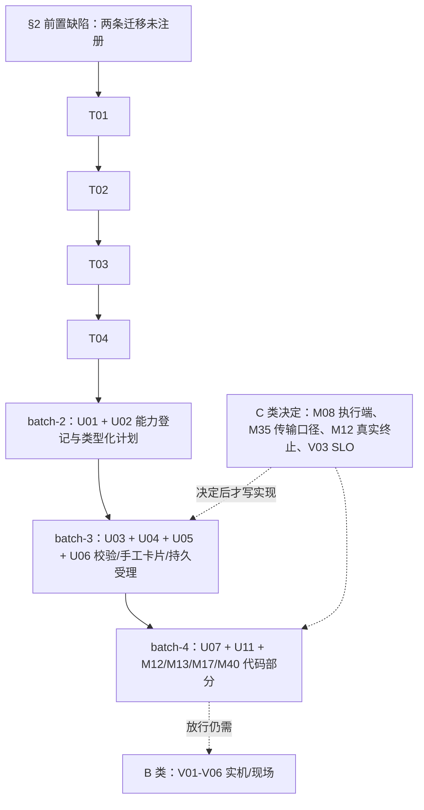

# 实施计划（2026-10-20）：可交付性分类、分批与 batch-1 详细设计

本文件只做设计与分批，**不改任何代码**。上游是[详细待开发清单](pending-development-backlog.md)（59 个工作包）、
[已知问题台账](../known-issues.md)（56 项，17 项未修）与[对齐计划](alignment-plan.md) §1.10（10-20 第三回合）。

## 0. 证据边界与判读口径

- 本文所有代码引用均按**当前工作区**符号读到，行号是 2026-10-20 的读数，会漂移——按符号定位，不按行号。
- 本轮**没有**运行任何测试、真实引擎、Agent、现场部署或 CI。文中"现状"是源码读出的可达路径，不是实测结论。
- 分类只回答一个问题：**这一项能不能在本机以代码+隔离测试收口**。能，才是 A；需要真实引擎/Agent/签名密钥/客户环境，一律 B，
  不因为"代码看起来能写"而降级。需要有人拍板"谁消费/消费什么"才写得对的，一律 C——先写实现等于替产品拍板
  （[已知问题台账](../known-issues.md) §6 的同一条判据）。
- 优先级沿用清单：P0 = 统一内核/正确性/控制权；P0 门槛 = 原为 P1 但某项高风险动作放行前必须先完成（如 M16/M35/M40）。

## 1. 可交付性分类（P0 与 P0 门槛共 25 个工作包；下表 26 行，M12 因“决策/实现”分离多占一行）

“可做子集”列指出该项里**能进 A 批次**的部分；主类列是决定排期的那个约束。

| 工作包 | 主类 | 依据（代码路径或清单条目） | 可做子集 / 缺什么 |
| --- | --- | --- | --- |
| U01 能力注册表 | **A** | `backend/app/services/operations_capabilities.py` 已是成熟度目录；`frontend/src/modules/assistantActions.js` 按页面 key 分派 | 全量可代码完成；需先冻结能力 ID/版本命名（架构决定，本计划给方案，不需产品） |
| U02 类型化计划与依赖合同 | **A** | 清单 U02；无外部依赖 | 全量可代码完成 |
| U03 校验/审批绑定/冻结 | **A** | `backend/app/services/access_control.py` 已有 `action_for_request`/`is_action_allowed`/`resolve_scope` | 全量可代码完成；适配器逐个声明动作权限，可与 U01 并行 |
| U04 无模型手工卡片 | **A** | 清单 U04 明确“先一个巡检样板，再按成熟度接入”；`frontend/src/DiagnosisCenterPage.jsx` 部分卡片仍是 prompt | 全量可代码完成（离线是本项验收前提，不需要模型） |
| U05 巡检样板统一接线 | **A**（附 B） | 六处直调已收口（`backend/app/services/inspection/dispatch.py` 的 `run_collecting_rows`） | A：无模板/连接失败在队列路径下的新语义、模板并发变更、旧 owner 晚到；**B：四引擎与 Oracle profile 现场一致性** |
| U06 持久批次与独立 worker | **A** | 清单 U06；作业表 `backend/app/models/inspection_job.py` 已有 lease/heartbeat/attempt | 全量可代码完成；真实断网/重启矩阵归 V02（B） |
| U07 人工控制与 fencing | **A**（附 B） | ISS-31：epoch 只在 `backend/app/tasks/master_scheduler.py` 的 `run_due_tasks` 派发处校验；`backend/app/models/inspection_job.py` 里根本没有 epoch 字段，`commit_results` 只核 owner token + lease | A：把 epoch/取消核到提交边界、其余域逐个补 ACK 分支；**B：双主/租约丢失/Agent 离线矩阵需两台节点与在线 Agent** |
| U08 统一真值/进度/结果回读 | **A** | 见 §4 全文（现状证据：`backend/app/services/inspection/jobs.py` 的 `job_view`/`cancel`/`reap_interrupted` 零生产引用；列表只从 `DBCheckResult` 聚合） | 全量可代码完成；本批核心 |
| U11 稳定性与自观测 | **A**（附 B/C） | 清单 U11 | A：队列/连接上限、背压、取消传播、指标暴露；**C：负载与候选 SLO 必须先冻结才写得出断言；B：168h/资源曲线归 V03** |
| M06 巡检幂等、申请人、无结果可见性 | **A** | `backend/app/services/inspection/jobs.py`：`job_view`（:88）/`cancel`（:217）/`reap_interrupted`（:231）零生产引用 | 全量可代码完成；本批核心 |
| M12 会话/锁细项与受控终止 | **A**（附 C/B） | `backend/app/services/generic_db_ops.py` 的 `SELECT pg_terminate_backend(<pid>)`、`KILL <session_id>` 仍是占位符 | A：动作声明支持范围、plan_only 绑定目标身份、拒绝不受支持的引擎；**C：是否批准平台内真实会话终止；B：逐引擎实测** |
| M13 空间/对象/日志与参数写边界 | **A**（附 B） | `backend/app/services/config_governance.py` 四引擎参数 apply 已存在；旧 SSH 路径 `run=false` 仍写远端文件 | A：方案零副作用、读/改分卡、声明不支持；**B：真实写动作与旧 SSH 路径审计核验** |
| M17 抢救身份/输入证据/外置控制 | **A**（附 B） | 子项①已修（`backend/app/modules/recovery/actor.py`） | A：②平台侧镜像与输入强绑 + ③原子领取/attempt/lease/取消 ACK/迟到结果拒绝 + ④上传 UI；**B：执行端实际挂载/软链/同盘校验、外置 worker 是否交付（ISS-48 未核实）** |
| M40 建单幂等/未知回执/回调身份 | **A**（附 B） | 清单 M40；`backend/app/services/itsm` 侧 | A：幂等摘要冲突、pending/accepted/unknown/created 分离、回调 provider+config 绑定与去重；**B：真实 ITSM 契约测试** |
| M08 告警执行与规则消费 | **C**（附 A/B） | [已知问题台账](../known-issues.md) ISS-24 明确“明确执行端归属”，`backend/app/services/alert_lifecycle.py` `retry_due_actions` 只翻转状态 | **C：谁领 pending、平台内还是外置 worker；决定后代码是 A，真实渠道是 B** |
| M35 归档对象传输/hold/删除消费者 | **C**（附 B） | 清单 M35 原文“明确独立上传复用现有导出还是外置合同” | **C：口径决定**；B：对象存储/provider Object Lock/最小权限 |
| M12 真实终止决策 | **C** | 同上 | 与 M12 的 A 部分配套：执行前必须有人批准“平台是否持有真实 kill 能力” |
| V03 负载与 168h 长稳 | **C**→B | 蓝图要求“先冻结硬件/规模/并发/SLO”；`docs/blueprint/software-quality-contract.md` 自陈预算是草案 | **C：冻结分项预算；之后才是 B 实测** |
| M04 专用 HA 桥接 | **B** | `backend/app/cmdb/ha_diagnostics.py` 全 `read_only_plan` | 缺独立 HA 引擎、隔离集群、双人批准凭据 |
| M16 独立目标恢复/PITR | **B** | `backend/app/services/backup_center.py` 六处 `blocked` 是**正确拒绝** | 缺独立恢复目标实例、备份制品与日志链 |
| M39 Jira 关闭真值 | **B** | 关闭已改“提交转换→回读状态”（`backend/app/itsm/adapters/jira.py`） | 缺真实 Jira 项目与转换配置（V05） |
| V01 四引擎核心链与权限矩阵 | **B** | 需授权独立目标、最低权限账号、TLS/证书、禁用实例 | 缺引擎与账号 |
| V02 任务控制与恢复验收 | **B** | 需隔离环境 + 在线 Agent + 双节点 | 缺 Agent/双主 |
| V04 Agent/现场/内核真实采集 | **B** | 需 Linux/Windows 目标机、BTF、权限 | 缺主机 |
| V05 本地模型与真实外部合同 | **B** | 需用户批准的本地模型端点、LDAP/OIDC、SMTP/SMS、对象存储 | 缺外部系统 |
| V06 制品/升级/回退/恢复演练 | **B** | 需干净机、断电、外置平台库 | 缺环境与授权 |

**计数（以主类计，逐行相加）**：A = 14（U01/U02/U03/U04/U05/U06/U07/U08/U11/M06/M12/M13/M17/M40），
B = 8（M04/M16/M39/V01/V02/V04/V05/V06），C = 4（M08/M35/M12 的真实终止决策/V03），合计 26 行。
A 类中有 7 项（U05/U07/U11/M12/M13/M17/M40）代码可完成但**放行仍需 B 类实测**——这不改变它们的分类，只改变放行结论。

## 2. 前置缺陷：两条已写好的迁移从未被注册（必须先修，否则 A 批全部跑在假通过上）

`backend/app/migrations/runner.py` 的 `MIGRATIONS`（:18）只注册到 `v20260911_01`。而 `backend/app/migrations/versions/`
下另有 `v20261019_01_data_quality_schedule.py`（ISS-22）与 `v20261019_02_capacity_anti_flap.py`（ISS-25）**从未被 import、也从未被应用**。

后果不是“没生效”这么轻：

- 模型已声明这些列（`backend/app/models/observability.py` 的 `evaluate_interval_seconds`/`retention_auto_execute`/`last_retention_at`；
  `backend/app/models/capacity_policy.py` 的 `sustained_minutes`/`recovery_margin_pct`）。
- `backend/app/migrations/initialization.py` 的 `initialize_schema` 在应用完 `runner.MIGRATIONS` 后调用
  `schema_contract.validate_schema`，后者对**模型与实库逐列比对**，缺列即抛 `SchemaUpgradeRequired`（`backend/app/migrations/schema_contract.py:139`）。
- 于是：全新库（`metadata.create_all`）正常；**老库升级到本代码会在启动时被拒绝**，报“Registered schema objects are missing”。
- 测试全绿是因为每个用例都 `Base.metadata.create_all`（例如 `backend/tests/test_inspection_manual_dispatch.py` 的 `setUp`），
  走的正是“全新库”分支。这条链路测试结构上抓不到。

处置（并入 batch-1 T01）：把两个 revision 按时间序补进 `MIGRATIONS`，并新增一条护栏断言——
`versions/` 目录下每个模块都必须出现在 `MIGRATIONS` 里（按模块集合比对，不按数量，数量比对看不见“换掉一个”）。

## 3. 分批计划（4 批，按依赖排序）

依赖方向：真值/回读（B1）→ 登记与计划（B2）→ 校验/受理（B3）→ 控制与放行（B4）。
B1 不依赖任何外部环境，且 B2-B4 的状态语义都建立在 B1 的词表上，所以 B1 先行。

### 3.1 batch-1：运行真值、结果回读与巡检控制面（U08 + M06 剩余 + 前置修复）

**范围**：U08 全部（以巡检为首个接入域）；M06 剩余三项（可信 `requested_by`/幂等、job 列表详情取消重试与回收消费者、零结果失败 job 可见性）；§2 前置缺陷。

- 改：`backend/app/services/inspection/jobs.py`、`dispatch.py`、`result_writer.py`、`report_builder.py`
- 改：`backend/app/api/v1/inspection.py`、`backend/app/api/v1/report.py`
- 改：`backend/app/models/inspection_job.py`、`backend/app/migrations/runner.py`
- 改：`backend/app/tasks/inspection_scheduler.py`、`backend/app/tasks/master_scheduler.py`
- 改：`backend/app/services/request_scope.py`
- 新：`app/services/run_status.py`、`app/services/inspection/run_readback.py`、`app/migrations/versions/v20261020_01_inspection_job_control.py`（相对 `backend/`）
- 新（前端）：`src/modules/inspectionJobsApi.js`；改 `src/InspectionPages.jsx`、`src/InspectionExecutionState.js`、`src/modules/assistantActions.js`（相对 `frontend/`）
- 契约：`contracts/baselines/openapi-v1.json`（手术式新增 4 个 operation）、`contracts/baselines/database-schema-v1.json`（+2 列 +1 索引）

**迁移**：`db_inspection_job` 增 `cancel_requested_at DATETIME NULL`、`cancel_requested_by INTEGER NULL`；`created_at` 建索引；补注册两个 20261019 版本。**不新增**"运行结果表"，也不新增 `outcome` 列（见 §4.2 的单一真值决定）。

**关键设计决策**：见 §4。

**验收断言**：见 §5.1-§5.8（可写成测试的具体命题，不是“功能正常”）。

### 3.2 batch-2：能力登记与类型化计划（U01 + U02）

- 文件：`backend/app/services/operations_capabilities.py`（扩成版本化注册表，保留派生成熟度）、新 `app/services/capability_registry.py`、
  新 `app/models/capability_definition.py`、`backend/app/api/v1/operations.py`（在既有 router 上加能力可见性端点）、`frontend/src/modules/assistantActions.js`（改由注册表分派）
- 迁移：能力定义表（id/version/supported_engines/risk/action_key/timeout/budget/stop_safe_point/verification）。
- 计划表：`plan`/`plan_revision`/`plan_step`（U02），与 batch-1 的 `plan_contract=v0_snapshot` 对齐升级到 `v1_typed`。
- 决策：能力 ID 稳定命名（菜单改名不改 ID）、处理器只按登记 ID 解析、禁止由请求导入任意函数路径。
- 断言要点：未登记/停用/不支持引擎/伪造版本被拒；同请求防重；显式“重新运行”建新运行而非复用旧结果；环与无界循环被拒。

### 3.3 batch-3：计划级校验、手工卡片与持久受理（U03 + U04 + U05 剩余 + U06）

- 文件：`backend/app/services/access_control.py`、新 `app/services/plan_validation.py`、`frontend/src/DiagnosisCenterPage.jsx`、
  `backend/app/services/inspection/dispatch.py`（批次入口）、新 `app/tasks/inspection_worker.py`（相对 `backend/`）
- 迁移：批次表 + 子任务表 + worker 心跳/领取索引。
- 决策：停止受理 ≠ 实际停止；写动作结果不明禁止自动重跑；接收响应与完成时间分别记录。
- 断言要点：撤权/过期/目标替换/重复批准/批准后扩范围全部拒绝且零副作用；关页不丢批次；同批次不重复投递；孤儿任务可识别。

### 3.4 batch-4：控制链与各域 ACK 收口（U07 + U11 基础 + M12/M13/M17/M40 的 A 部分）

- 文件：`backend/app/tasks/master_scheduler.py`（fencing 传到提交边界）、`backend/app/services/generic_db_ops.py`、
  `backend/app/services/config_governance.py`、`backend/app/modules/recovery/*`、`backend/app/itsm/*`、新 `app/services/control_epoch.py`
- 迁移：各域 attempt/owner/epoch 列（按域逐一，不一次性全表改造）。
- 断言要点：旧 owner 晚到提交被拒（不是“覆盖”也不是“静默丢弃”）；“已发取消”不显示“已停止”；不可中断步骤显式 `unknown`；双 worker 只允许一次外发。

## 4. batch-1 详细设计

### 4.1 实体关系与查询口径

batch-1 不新建“运行表”，因为运行身份**已经存在且已经被三条链共用**：

```
DBInstance 1 ──── n DBInspectionJob            运行（含冻结快照、owner/lease/attempt、progress 事件流）
     │                    │ id
     │                    ├──────── 1 ──── n DBCheckResult       结果/证据行（task_id == job.id）
     │                    └──────── 0..1 ── ReportArtifact       报告索引（source_type='inspection', source_id == job.id）
     │
     └── n DBInspectionPolicy（当前模板）──1 快照──> job.policy_snapshot_json（冻结计划, policy_revision=hash）
```

| 关系 | 事实依据 | 查询口径 |
| --- | --- | --- |
| 运行 = `DBInspectionJob.id` | `backend/app/services/inspection/jobs.py` 的 `enqueue` 生成 `uuid4().hex[:30]` | 运行 ID 一律用 job id |
| 结果行 = `DBCheckResult.task_id` | `backend/app/services/inspection/result_writer.py` 的 `save_findings(db, target, job_id, ...)` 由 `jobs.commit_results` 传入 job id | `task_id == job_id`，**不再有第二套 ID** |
| 报告 = `ReportArtifact` | `backend/app/services/report_center.py` 的 `sync_source_artifacts` 用 `source:{report_type}:{source_id}`；inspection 的来源在 `backend/app/api/v1/report.py` 的 `_collect_unified_reports` 生成，`source_id = task_id` | `source_key = "source:inspection:{run_id}"`，**可能尚未同步**（只在 `POST /reports/catalog/sync` 时建） |
| 计划 = 冻结快照 | `jobs.frozen_policy`（:60）从 `policy_snapshot_json` 还原，`policy_revision` 是整份快照的 sha256 | `plan.plan_source="frozen_policy_snapshot"`，`plan_contract="v0_snapshot"` |
| 步骤 = `progress_json` 事件流 | `jobs._event`（:84）写 `{stage,time,...}`，`heartbeat` 追加并保留最后 30 条 | 按事件序还原阶段时间线 |

**口径必须对外一致的三件事**（否则 U08 的“同一运行 ID 一致”无从谈起）：

1. **行数**：列表项的 `result_count` 必须等于详情 `findings` 长度、等于报告 `task.total_count`。列表用**一次**分组计数查询取本页所有 `task_id` 的计数
   （`result_writer` 新增 `count_by_task_ids(db, task_ids)`），不逐条查（N+1）。
2. **健康结论归源模块**：`execution_summary`（`result_writer.py:255`）与 `_task_dict`（`report_builder.py:46`）仍是唯一计算处，读模型**只引用不重算**。
   读模型里出现的 `counts`/`task_status` 必须标注 `derived_from="result_writer.execution_summary"`。
3. **零结果运行合法**：`row_count == 0` 不是“不存在”。旧口径把它折成 404/hidden，本批改成显式 `evidence.state="missing"` + `outcome_reason`。

### 4.2 状态落到字段（单一真值）

**决定 1：`outcome` 是派生值，不落库。** 库里只保留 `status`（跑出来的事实）与 `failure_reason`（当天写的解释）。
派生集中在 `app/services/run_status.py` 的纯函数里，任何调用方（API/前端/报告/AI 上下文）都调用它，不各自 if/else。
落两列会立刻产生两个真值，而[对齐计划](alignment-plan.md) §1.10 的教训正是“冻结快照存了不等于用了”。

**决定 2：无法识别的状态一律 `unknown`，永不 `success`。** 这是 U08 的根需求：现状 `frontend/src/modules/assistantActions.js:452`
的 `outcome === "partial" ? ... : "success"` 把“没有 status 字段”“status 是 queued”“status 是我没见过的词”全部变成成功。

字段清单（`run_readback` 输出，`schema="run_read/v1"`）：

| 字段 | 类型 | 语义 |
| --- | --- | --- |
| `status` | str | 库里 `DBInspectionJob.status` 原值，**权威**，不改写（键名就是 `status`；`job_status` 是本设计稿早期的误名，实现从未使用） |
| `stage` | str | 库里原值（queued/validating/saving/终态同名） |
| `terminal` | bool | `status ∈ TERMINAL`（含本批新增 `expired`） |
| `outcome` | str \| null | 终态才有值：`success/partial/failed/cancelled/expired/unknown`（其余 4 个见下） |
| `outcome_kind` | str \| null | 细分：`collector_error/timeout/lease_lost/cancelled_before_run/cancelled_during_run/expired_in_queue/unrecognized_status/unclassified_legacy`，或校验类分类码 `actor_inactive/permission_revoked/scope_revoked/instance_disabled/target_changed/template_missing/snapshot_invalid`（见决定 3） |
| `outcome_reason` | str \| null | 取自 `failure_reason`，未脱敏前不输出（`redact_database_error` 已在写侧做，读侧再断言一次） |
| `results_published` | bool | `stage=="completed" and row_count>0`；与 `dispatch.PUBLISHED`（:20）**不是同一个概念**，后者是“值得建报告”，本批不改后者语义 |
| `requires_attention` | bool | `outcome ∈ {unknown, expired}` 或 `outcome_kind ∈ {cancelled_during_run}` |
| `percent` | int \| null | 运行中按阶段权重 `queued=10/validating=30/saving=90`；**终态恒 null** |
| `percent_basis` | str | `stage_weights_v1` 或 `terminal_no_percentage`（永不为空，说明依据） |

**映射表（batch-1 实际可达的 6 个终态 + 2 个在途）**

| 业务情形 | `status` | `outcome` | `outcome_kind` | `results_published` | `can_retry` | `requires_attention` |
| --- | --- | --- | --- | --- | --- | --- |
| 全部检查项采集成功 | success | success | null | true | false | false |
| 部分采集失败但有结果 | partial | partial | collector_error | true | true | false |
| 采集失败（`_degraded` 行入库） | failed | failed | collector_error | true | true | false |
| 前置校验失败（撤权/模板停用/目标变更/快照 hash 不符）：**零结果** | failed | failed | 取 `failure_code`（见决定 3） | false | true | false |
| 提交结果时超过总超时 | timed_out | **unknown** | timeout | false | true | true |
| 心跳中断、主人不明 | interrupted | **unknown** | lease_lost | false | true | true |
| 排队超时从未领取（本批新增） | expired | expired | expired_in_queue | false | true | true |
| 执行前取消 | cancelled | cancelled | cancelled_before_run | false | true | false |
| 执行中被取消（本批新增终态路径） | cancelled | cancelled | cancelled_during_run | false | true | true |
| 在途 | queued / running | null | null | false | false | false |
| 库里出现未登记状态 | 任意 | unknown | unrecognized_status | false | false | true |

为什么 `timed_out`/`interrupted` 映射成 `unknown` 而不是 `failed`：这两种情形**我们不知道目标端到底跑了什么**——
超时是“结果未发布”，失主是“执行节点失联”。写 `failed` 会让人以为“确定没采集到”；写 `unknown` 才是可被后续核对的真值，
这也正是[对齐计划](alignment-plan.md) §1.10 第三条教训（ACK 与业务完成之间那段路）要求的表达方式。

**决定 3：`outcome_kind` 来自执行侧显式分类码，不靠解析中文报错。**
`jobs.JobError` 现在只有消息（“巡检模板已删除或停用”之类），用它做正则分类会在下次改文案时静默退化。
本批给 `JobError` 加可选 `code` 参数（保持它仍是 `ValueError` 子类，既有 `raise JobError("...")` 全部继续可用），
在 `validate_actor`/`validate_job_target` 抛出处标注
`actor_inactive/permission_revoked/scope_revoked/instance_disabled/target_changed/template_missing/snapshot_invalid`；
`jobs.finish_error` 把它写进终态 progress 事件的 `failure_code` 字段（**不新增数据库列**），读模型从最后一个事件取。
没有 `failure_code` 的旧 job（本批之前失败的行）一律 `outcome_kind="unclassified_legacy"`，不猜是哪一类。

**四个没有生产者的状态**：`plan_only / blocked / unsupported / needs_input` 在 batch-1 里**不可由巡检运行推出**。
`run_status.py` 支持这 4 个值，但只接受**显式声明**（`declare(...)` 必须传入 `outcome` 与 `declared_by`），
测试断言 `normalize()` 不会把任何 job 状态隐式映射到它们——否则“仅方案”会被当成“已执行”（M13 的老问题）。

### 4.3 结果回读接口与既有 `dispatch`/`report_builder`/`result_writer` 的衔接

新增 `app/services/inspection/run_readback.py`：

```text
build_run_read(db, job_id, *, instance_id=None) -> dict | None      # 完整信封（详情）
run_summary(db, row, *, result_counts: dict[str,int]) -> dict        # 列表项（无 findings 明细）
plan_snapshot_block(row) -> dict                                     # 冻结计划段（不连库）
steps_from_progress(row) -> list[dict]                               # 事件流→步骤
```

衔接方式（**不复制逻辑**）：

| 读模型段 | 来源 | 说明 |
| --- | --- | --- |
| `run` | `jobs.job_view`（:88）现有字段 + 新派生态 | `job_view` 加 `cancel_requested_at/by`、`outcome` 段委托 `run_status`，其余不动 |
| `plan` | `jobs.frozen_policy` 的快照键（不改快照格式） | 另查 `template_versions` 的当前 revision 只用于**提示**“模板已变更”（`plan.template_changed_since_freeze: bool`），绝不影响执行 |
| `steps` | `progress_json` + `finish_error`/`cancel` 新增的终态事件 | 无事件时返回单步 `queued`，不编造步骤 |
| `results` | `result_writer.get_task_rows`（:194）+ `execution_summary`（:255）+ `_counts` | 只引用 |
| `evidence` | 每行 `raw_data["inspection_target_snapshot"]` 经 `result_writer.normalize_target_snapshot`（:24） | `state ∈ recorded / historical_context_missing / missing`（零行时 `missing`） |
| `reports` | `ReportArtifact` 按 `source_key="source:inspection:{id}"` 查 | `state="not_synced"` 是合法状态，不是错误 |
| 明细 payload | `report_builder.build_report_payload`（:14） | 有行才调用；`build_report_payload` 增可选参数 `include_job=False` 保持既有返回结构不变 |

`dispatch.run_through_queue`（:23）在返回体里增加一段 `run`（= `build_run_read`），**保留**现有 `job`/`task`/`findings`/`report` 键，
因此现有前端与既有测试（`backend/tests/test_inspection_manual_dispatch.py` 断言 `payload["job"]["id"]`）不会被破坏。

### 4.4 job 列表/详情/取消/重试的接线点

现状（全部零生产引用，只有测试引用——这是 M06 剩余项的本质）：

| 已有函数 | 位置 | 现状 | 本批处置 |
| --- | --- | --- | --- |
| `jobs.job_view` | jobs.py:88 | 仅 `backend/tests/test_inspection_job_target_snapshot.py:77` | 变成 `run_readback.run_summary` 的底座，由 API 调用 |
| `jobs.cancel` | jobs.py:217 | 仅测试 | 加 `cancel_requested_at/by`；补“运行中被取消”的终态路径；由 `POST .../cancel` 调用 |
| `jobs.reap_interrupted` | jobs.py:231 | 仅测试 | 由新增 `reap_stale_inspection_jobs()` 在每个调度周期调用 |
| `jobs.enqueue` 的 `parent_job` 分支 | jobs.py:180-187 | 生产零调用 | 由新增 `jobs.retry` 使用 |
| `jobs.submit` | jobs.py:305 | 被 `dispatch` 调用 | 不变（它是“入队+跑完”的兼容入口） |
| `result_writer.list_tasks` | result_writer.py:120 | `/inspection/tasks` 与统一报告都在用 | **保持**（历史结果口径），另建 job 列表 |
| `report_builder.build_report_payload` | report_builder.py:14 | `/inspection/tasks/{id}` 与 `/inspection/report/{id}` 在用 | 保持；零行时仍返回 `None` |

新增后端函数（`app/services/inspection/jobs.py`）：

```text
list_jobs(db, *, instance_ids=None, instance_id=None, db_type=None, statuses=None,
          outcomes=None, trigger_type=None, since=None, page=1, page_size=50) -> (list[DBInspectionJob], int)
retry(db, row, *, requested_by=None) -> DBInspectionJob        # 复用 enqueue(parent_job=row) + claim + execute
finish_cancelled(db, job_id, token, kind) -> bool              # 仅在“running + cancel_requested=1 + owner 匹配”时成立
reap_expired(db, *, now=None, limit=200) -> int                # queued 且 created_at + timeout < now
```

新增 HTTP 接口（batch-1 已交付，见 `backend/app/api/v1/inspection.py`）：

| 方法与路径 | 语义 | 错误码 |
| --- | --- | --- |
| `GET /api/v1/inspection/jobs` | 运行列表：job 表为源，含零结果运行 | 400 参数非法 |
| `GET /api/v1/inspection/jobs/{job_id}` | 完整信封 | 404 不存在 / 403 越范围 |
| `POST /api/v1/inspection/jobs/{job_id}/cancel` | 请求取消；`queued`→`cancelled`；`running`→记 `cancel_requested` 并**如实显示“采集可能仍在进行”** | 409 已终态 |
| `POST /api/v1/inspection/jobs/{job_id}/retry` | 建 `attempt+1` 的子运行，继承冻结快照，同父只建一个 | 409 不可重试/超三次 |

既有接口的**最小**改动：

- `POST /api/v1/inspection/{db_type}/{instance_id}/run`（`backend/app/api/v1/inspection.py:178`）：把 `request.state.auth` 里的
  `user_id` 作为可信 `requested_by` 传入（现在传 `None`，等于让 `jobs.validate_actor` 整段跳过）；接受可选 `Idempotency-Key` 头；
  捕获 `jobs.JobError` → 409（现在是未捕获的 500）。
- `GET /api/v1/inspection/tasks`（:229）与 `GET /api/v1/inspection/tasks/{task_id}`（:242）：**契约不动**。前者继续是“历史结果视图”，
  后者对零结果 job 仍 404（避免把 404 改成 200 的隐性契约变更）；前端改用 job 接口。
- `backend/app/api/v1/report.py` 的 `_collect_unified_reports`（:89）inspection 段：来源从 `result_writer.list_tasks` 换成共享的
  `run_sources(db, limit)`（列表项字段不变，`status` 改为真实 `outcome`，`score` 对非 success 为 `None`），使报告目录第一次能收录
  “失败/取消但零结果”的运行——这是“报告与运行一致”的结构性前提。

### 4.5 迁移与向后兼容

**迁移** `app/migrations/versions/v20261020_01_inspection_job_control.py`（相对 `backend/`）：

- `db_inspection_job`：`cancel_requested_at DATETIME NULL`、`cancel_requested_by INTEGER NULL`；`created_at` 单列索引。
- 幂等：全部按 `inspect(connection).has_table/get_columns` 判断后 `ALTER TABLE ... ADD COLUMN ... NULL`（照 `v20261019_02_capacity_anti_flap.py` 的写法）。
- `downgrade` 返回 `None` 并写明理由：旧二进制忽略这两列；删列会丢掉“谁在何时请求取消”的审计事实。
- 同时在 `backend/app/migrations/runner.py` 的 `MIGRATIONS` 末尾按序补 `20261019_01`、`20261019_02`、`20261020_01`。

**向后兼容降级（旧记录无新关联）**

| 情形 | 判定 | 对外表现 |
| --- | --- | --- |
| 旧 `DBCheckResult.task_id` 是时间戳（`runner.run_inspection` 生成，形如 `20261019120000123456`），无 job 行 | `db.get(DBInspectionJob, task_id) is None` | job 接口 404；`/inspection/tasks/{id}` 照旧可用；读模型字段 `linkage="legacy_result_only"`、`outcome_reason="该运行产生于队列接入之前，没有任务记录"` |
| job 行存在但 `progress_json` 只有 `queued` 一条（10-20 之前的 job） | 事件数 < 2 | `steps` 只出 `queued`，`percent=null`，`percent_basis="missing_stage_events"` |
| job 行 `failed` 但没有任何终态事件（本批之前失败的 job） | 无 `failure_code` | `outcome_kind="unclassified_legacy"`，`outcome_reason` 仍取旧 `failure_reason` |
| job 行存在、`cancel_requested=1` 但新列为 NULL | 升级前取消 | `cancel_requested_at=null`、`cancel_attribution="unknown_pre_upgrade"`（**不猜时间**） |
| `ReportArtifact` 未同步 | 按 `source_key` 查不到 | `reports.state="not_synced"`，不给“报告缺失”错误 |
| `policy_snapshot_json` 缺 `enabled` 键 | `frozen_policy` 已处理（默认 1） | 不改 |

### 4.6 权限：动作白名单与 fail-closed 范围解析（新增路径必须显式登记）

两条独立的门，缺一条就会“受限账号全 403”或“越权可读”：

1. **动作权限**：`/api/v1/inspection/...` 已由 `backend/app/services/access_control.py:199-202` 的前缀规则覆盖
   （读→`inspection.read`，写→`inspection.execute`），所以 4 条新路径**无需改表**；但必须靠
   `backend/tests/test_authorization_boundary.py:182` 的“每条已注册路由都有已知动作”断言来证明，而不是“我觉得覆盖了”。
   `cancel`/`retry` 落在 `inspection.execute` 是刻意的：取消别人的运行等于控制权，不是只读。
2. **资产范围**：`backend/app/services/request_scope.py` 对未登记路径 fail-closed（`_rule()` 返回 `None` → 受限用户 403）。
   因此必须显式补三条：
   - `_FILTERED_COLLECTIONS`（:57）加 `/inspection/jobs`，且 handler 必须真的按 `_allowed_instance_ids` 过滤（该规则会校验 `request.state.auth`
     来源是 `db`/`identity`、非 admin、`user_id` 与解析一致）；
   - `_rule()` 的 path 白名单（:163）加 `/inspection/jobs/{job_id}`；
   - `_Targets.reference` 的 inspection 分支（:360）把 `singular == "task_id"` 扩到 `{"task_id", "job_id"}`，job_id 走 `DBInspectionJob.instance_id` 归属判定
     （**不能**只按 `task_id` 查 `DBCheckResult`：零结果 job 会被判成“资源不存在”，正好是把本批要修的问题搬进权限层）。
   - `POST .../cancel`、`POST .../retry` 属于写操作：新规则要求 `instance_id` 可由 job 反查，锚点用 `job_id`。

### 4.7 前端（batch-1，最小）

- `src/modules/inspectionJobsApi.js`（新建）：`listInspectionJobs/getInspectionJob/cancelInspectionJob/retryInspectionJob`。
- `src/InspectionPages.jsx` 的 `InspectionTaskPage`（:2247）：加“运行队列”视图，数据源换成 job 接口；取消/重试用 `Modal.confirm`
  （`Modal` 已在该文件引入），表格用已引入的 `Table/Tag/Space/Button`；取消后的提示必须区分
  “已停止”（queued 取消）与“取消已受理，采集可能仍在进行”（running 取消）。
- `src/InspectionExecutionState.js`：`INSPECTION_STATUS_TEXT` 补 `expired/blocked/unsupported/needs_input/queued`；
  `inspectionOutcome` 增加“若存在 `run.outcome` 则以它为准”的短路，避免再从 `task_status` 猜。
- `src/modules/assistantActions.js`：`runAssistantActionProgress`（:394）把 `payload?.status` 的取值改为
  `payload?.run?.outcome ?? payload?.job?.status ?? payload?.status`，并把未识别/缺失状态从 `success` 改为 `unknown` + 明确 notice；
  纯只读结果保留现有成功显示（本批只夹住“带运行身份的回包”，不重写 40 个动作的分派，那属 batch-2 的注册表改造）。

## 5. batch-1 验收断言（每条都是可写的测试命题）

测试落点（均在 `backend/tests/` 下新建或追加）：`test_run_status_contract.py`、`test_inspection_run_readback.py`、`test_inspection_job_control.py`、
`test_inspection_job_scope.py`、`test_migration_registration.py`，以及追加到既有 `backend/tests/test_authorization_boundary.py`。

### 5.1 状态契约（`run_status`）

1. `normalize("success"|"partial"|"failed")` 分别得 `success/partial/failed`，`terminal=True`。
2. `normalize("timed_out")["outcome"] == "unknown"` 且 `outcome_kind=="timeout"`、`requires_attention is True`。
3. `normalize("interrupted")["outcome"] == "unknown"` 且 `outcome_kind=="lease_lost"`。
4. `normalize("queued"/"running")["outcome"] is None` 且 `terminal is False`。
5. `normalize("some_new_status")["outcome"] == "unknown"` 且 `outcome_kind=="unrecognized_status"`；**断言它不等于 `success`**（反默认成功）。
6. `plan_only/blocked/unsupported/needs_input` 只能经 `declare(...)` 产生；`normalize()` 对任何输入都不会返回这四个值。
7. `percent` 在终态恒为 `None` 且 `percent_basis=="terminal_no_percentage"`；运行中 `percent_basis=="stage_weights_v1"` 且 `0 < percent < 100`。

### 5.2 同一运行 ID 四处一致（列表/详情/报告/证据）

8. 造一个 `partial` job（两行结果、一行 `execution_status=failed`）：`GET /jobs`、`GET /jobs/{id}`、`GET /tasks/{id}` 报告段、
   `/reports/unified` 里的该项，四处 `total_count` 全部相等且等于 `DBCheckResult` 实际行数。
9. `GET /jobs/{id}["run"]["status"]` 与 `GET /jobs` 中该项 `status` 相等；`outcome` 相等；`outcome_reason` 相等（含脱敏后文本）。
10. 报告 `report.task.task_status` 与 `run.outcome` 一致映射（success↔success、partial↔partial、failed↔failed），
    且读模型返回的 `counts` 与 `result_writer._counts` 逐键相等（证明“不重算”）。

### 5.3 零结果失败的可见性（M06 剩余）

11. 造一个 `queued→claim→validate 抛 JobError` 的 job（模板停用）：`GET /jobs` 的 `items` **包含**它，
    `result_count==0`、`results_published is False`、`outcome=="failed"`、`outcome_kind=="template_missing"`、`evidence.state=="missing"`。
12. 同一条运行在 `GET /jobs/{id}` 返回 200（不是 404），`steps` 末步 `status=="failed"` 且带 `detail`。
13. 该运行被纳入 `/reports/unified?report_type=inspection`（`status=="failed"`、`score is None`），即“报告不存在”与“报告失败”被区分开。
14. `GET /jobs?outcome=failed` 能筛到它；`GET /jobs?status=success` 筛不到它。

### 5.4 取消：受理与停止分离

15. `queued` 取消：`cancel` → `status=="cancelled"`、`cancel_requested_at` 非空、`cancel_requested_by==该用户`、
    `outcome_kind=="cancelled_before_run"`、`can_retry is True`。
16. `running` 取消：只写 `cancel_requested=1` 与时间戳，**`status` 仍是 `running`**；读模型 `outcome is None`，
    且返回体里有“采集可能仍在进行”的 `notice` 键（断言文案不是“已停止”）。
17. 运行线程在取消后调用 `commit_results`：断言它**不写结果**、把 job 终结为 `cancelled`（`outcome_kind=="cancelled_during_run"`），
    且不会让 job 留在 `running` 等 reaper 改写成 `interrupted`（这条正是[对齐计划](alignment-plan.md) §1.10 教训 3 的回归守卫）。
18. 迟到的取消 ACK 不改写已终态：对 `success` job 调 `cancel` → 409，且 `status`/`finished_at` 字节不变。

### 5.5 幂等与可信申请人（M06 剩余）

19. 同一用户、同一 `Idempotency-Key`、同一参数提交两次 → 只有一个 job 行，第二次返回同一个 `run_id`。
20. 同一 key、换模板（阈值不同）→ 409，且 job 数不变（“同键变参冲突”）。
21. 两个不同用户用同一 key → 两行 job（key 已按 `requested_by` 加盐，断言其摘要不同）。
22. `POST /inspection/{db_type}/{id}/run` 后，job 的 `requested_by` 等于令牌里的 `user_id`；
    **断言它不是 `None`**（这是现状：`api_run_inspection` 没传，见 §4.4）。
23. 该用户随后被撤销 `inspection.execute` → 重试被拒（`jobs.validate_actor`），`outcome_kind=="permission_revoked"`，且不产生新结果行；
    用户被停用时同一断言换成 `outcome_kind=="actor_inactive"`。

### 5.6 重试与回收

24. `retry` 建 `attempt=2` 的子 job，`policy_revision` 与父相同（继承冻结快照）；对同一父再 retry 返回同一个子 job（唯一约束）。
25. 父 `attempt==3` 时 retry → 409。
26. `reap_expired(now=created_at+timeout+1s)` 把 `queued` job 置 `expired`、`outcome_kind=="expired_in_queue"`、`can_retry is True`；
    对 `running` 行无影响。
27. `reap_interrupted` 与 `reap_expired` 都被 `backend/app/tasks/master_scheduler.py` 的 `due_job_functions()` 注册（成员断言 + 名称断言），
    即“有消费者”而不是“函数存在”。

### 5.7 权限与范围

28. 受限在 A、无 B 权限的账号：`GET /inspection/jobs` 只返回 A 的 job；`GET /inspection/jobs/{B的job}` → 403（不是空对象）。
29. 同一受限账号：`POST /inspection/jobs/{自己的job}/cancel` → 200；对自己 job 的 `retry` → 200；对 B 的 → 403。
30. `test_every_registered_business_route_has_a_known_permission` 覆盖 4 条新路由（若不覆盖，该测试即红）——
    这是“新增路径必须显式登记”的机器化守卫。
31. 无 `inspection.read` 的账号对 `GET /inspection/jobs` → 403（fail-closed 而非空列表）。

### 5.8 迁移与向后兼容

32. `test_migration_registration`：`versions/` 下每个模块的 `REVISION` 都出现在 `runner.MIGRATIONS`（含 `20261019_01/02`、`20261020_01`）；
    `migration_status()` 里每个 revision 都能被 `run_pending_migrations` 应用一次且第二次为空。
33. 老库升级路径：用不含新列的 SQLite 库跑 `initialize_schema` → 成功，且 `db_inspection_job` 实际存在两列（这条现在会红，因为 §2 的缺陷）。
34. 旧记录降级：手工插一行 `task_id` 为时间戳、无 job 的 `DBCheckResult` → `/inspection/tasks/{id}` 仍 200；
    `GET /inspection/jobs/{该id}` 404；列表在 `include_legacy=true` 时标 `linkage="legacy_result_only"`。

### 5.9 变异验证清单（工程师必须逐条执行并记录“红在哪”）

| 撤销/改坏 | 必须变红的断言 |
| --- | --- |
| `normalize()` 未知状态回落到 `success` | 5 |
| `timed_out` 映射成 `failed` | 2 |
| 列表改回只从 `DBCheckResult` 聚合 | 11、14 |
| `commit_results` 取消时仍返回 `False` 而不终结 | 17 |
| `finish_error` 不追加终态事件 | 12 |
| 手动入口不传 `requested_by` | 22、23 |
| `cancel` 把 `running` 直接置 `cancelled` | 16 |
| `retry` 不带 `parent_job`（新建独立 job） | 24、25 |
| 三条 `request_scope` 规则缺失/只查 `task_id` | 28、29 |
| `MIGRATIONS` 去掉任一 revision | 32、33 |
| `run_readback` 改为自己算 counts | 10 |

## 6. 需要的依赖包

**batch-1 不新增任何第三方依赖。**

- 后端：SQLAlchemy / FastAPI / Pydantic 均为既有；`run_status` 纯标准库；无新包。
- 前端：`antd`（已在依赖内）已提供 `Table/Modal/Button/Tag/Space`，取消确认用 `Modal.confirm`，不引入新组件库。
- 门禁：`scripts/check_all.py --fast` 已有的 20 步，无新增工具链。
- batch-2 起若做能力注册表 UI，仍需复用现有 antd；只有引入图谱可视化时才需要新包，届时单列。

## 7. 共享知识（交给工程师）

- **单一真值**：运行 = `DBInspectionJob`；结果 = `DBCheckResult.task_id`；报告 = `ReportArtifact.source_key="source:inspection:{run_id}"`。
  三者不许出现第四套 ID。`outcome` 是派生值，禁止落库。
- **反“默认成功”**：任何没被显式识别的状态一律 `unknown`。判据是“有没有证据”，不是“HTTP 200”。
- **变异验证**：每条修复必须能指出“撤销后哪几条断言变红”，语法正确的改动（不要制造 `IndentationError`，那证明不了任何事）。
- **权限双门**：动作权限走 `access_control.action_for_request`（前缀规则 + 路由枚举测试）；资产范围走 `request_scope`（fail-closed，新路径必须显式登记）。
  两条都不通 = 403，不是空列表。
- **数据库探测**用 `sa_inspect(db.connection())`，**不用** `db.get_bind()`（后者走 engine，会另开连接并回滚调用方未提交事务——ISS-04 的复现）。
- **迁移**：新列必须同时进模型、`versions/` 新模块与 `runner.MIGRATIONS`；缺任一环，老库升级会在 `validate_schema` 处被拒（见 §2）。
- **契约基线**：`contracts/baselines/openapi-v1.json` 只能手术式替换自己新增的 operation，禁止 `--update`（ISS-50）；
  `database-schema-v1.json` 同样只折叠本次 2 列 + 1 索引，并断言其余零漂移。
- **文档门禁的硬约束**：`scripts/check_doc_routes.py` 会拒绝文档里引用**未注册**的路由。本计划中 4 条新路由原先标了“待实现”标记，已在 batch-1 实现时去掉——否则文档会一边说“待实现”、代码一边已经在跑，这正是双向漂移。
- **前端一致性**：`src/InspectionExecutionState.js` 已是巡检域的规范化器，新 UI 必须复用它，不许再写一套 `status === "success"` 判断。

## 8. 任务分解（batch-1，交给工程师）

| 任务 | 名称 | 涉及文件 | 依赖 | 优先级 |
| --- | --- | --- | --- | --- |
| T01 | 迁移注册修复 + 控制面列与索引 | `backend/app/migrations/runner.py`、新 `app/migrations/versions/v20261020_01_inspection_job_control.py`、`backend/app/models/inspection_job.py`、新 `tests/test_migration_registration.py` | 无 | P0 |
| T02 | 状态词表与读模型 | 新 `app/services/run_status.py`、新 `app/services/inspection/run_readback.py`、`backend/app/services/inspection/jobs.py`（`job_view`/终态事件）、`backend/app/services/inspection/result_writer.py`（批量计数） | T01 | P0 |
| T03 | 控制面接线：列表/详情/取消/重试/回收 + 范围规则 | `backend/app/services/inspection/jobs.py`（`list_jobs`/`retry`/`finish_cancelled`/`reap_expired`）、`backend/app/services/inspection/dispatch.py`、`backend/app/api/v1/inspection.py`、`backend/app/api/v1/report.py`、`backend/app/tasks/inspection_scheduler.py`、`backend/app/tasks/master_scheduler.py`、`backend/app/services/request_scope.py` | T02 | P0 |
| T04 | 前端队列视图与状态文案 + 契约/文档回填 | `src/modules/inspectionJobsApi.js`（新建）、`frontend/src/InspectionPages.jsx`、`frontend/src/InspectionExecutionState.js`、`frontend/src/modules/assistantActions.js`、`contracts/baselines/openapi-v1.json`、`contracts/baselines/database-schema-v1.json`、`docs/known-issues.md`、`docs/blueprint/pending-development-backlog.md` | T03 | P0 |

每个任务内部都要带“变异验证记录”，否则不算完成（[已知问题台账](../known-issues.md) §9 第 3 条）。

## 9. 依赖图



## 10. 不清楚的地方（需要产品或主线拍板，本计划不替其决定）

1. **M08 告警动作的领取者**（ISS-24）：平台内 worker、还是继续由外部系统领取 `pending`？决定前写实现只能又造一个“函数存在但没人调用”。
2. **M35 归档对象传输口径**：复用既有导出通道，还是新开外置合同？两条路的幂等键、hold 语义、删除顺序完全不同。
3. **M12 是否批准平台持有真实会话终止能力**：当前全部 `plan_only`。批了就进入 B 类实机；不批就维持声明式边界并写进能力目录的 `unsupported`。
4. **V03 分项预算**（UI 响应 / 可靠受理 / 控制 ACK / 业务完成各自的 p95）：`docs/blueprint/software-quality-contract.md` 自陈是草案，冻结后才能写断言语义。
5. **M17 外置抢救 worker 是否已交付**（ISS-48）：不在本仓视野。平台侧 ②③④ 可以先做完并验收“任务可下发、证据可回传、结果可复核”，但“抢救已完成”不能由平台单方声称。
6. **能力 ID 冻结**（U01）：我建议“域.动作.版本”三段式并禁止菜单名参与哈希，但这会影响 72 个菜单叶子的映射方式，需要主线确认后再进 batch-2。
7. **`expired` 是否愿意成为对外可见的正式状态**：本计划把它设计成终态之一（否则“排队超时”只能被含糊地说成 `interrupted`）。若产品不希望暴露该状态，需给出等价的替代表达，再改 batch-1 的映射表。
