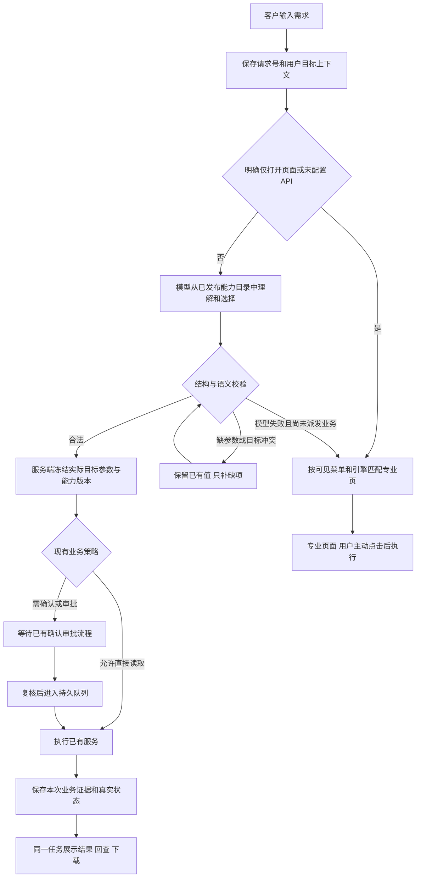

# 客户需求驱动能力执行 开发与测试交付方案

制定日期：2026-10-25。当前结论：功能尚未完整交付。本方案用于安排开发、修复、测试、部署和最终验收；本次生成方案不代表其中任务或测试已经执行。

2026-10-26 接续：已完成真实模型合成需求复验和当前开发 MySQL 的备份、隔离恢复、回执迁移及重启，见[本轮执行记录](../../../reports/requirement-live-20261026/upgrade-record.md)。另已按用户授权对 `192.168.102.200` 执行一次只读锁等待查询，见[真实目标只读验收](../../../reports/requirement-live-20261026/real-target-read.md)。本轮仍不关闭全量业务、自动巡检、客户现场或发布回退验收；下文“当前起点”表保留 10 月 25 日的历史依据。

**交付目标：客户输入需求；有大模型 API 时理解需求并调用系统已有能力完成业务；没有 API 时打开正确的专业页面，让客户自己操作，打开阶段零业务执行。**

## 1 如何使用这套方案

| 文件 | 使用人 | 用途 |
| --- | --- | --- |
| 本文 | 产品、技术负责人、验收人 | 固定需求、范围、关键设计、阶段门槛与追踪关系 |
| [开发任务](development-tasks.md) | 前后端、领域负责人、运维 | D01—D18 的实现步骤、依赖、交付物与关闭条件 |
| [测试案例](test-cases.md) | 测试、开发、验收人 | TC001—TC116 的前置条件、输入、操作、预期和证据 |
| [测试与发布执行手册](acceptance-runbook.md) | 测试、运维、发布负责人 | 环境准备、分层执行、真实模型评测、发布与回退 |
| [追踪清单](traceability.json) | 技术负责人、测试负责人 | 需求到任务和测试编号的机器可读关系，初始均未验收 |
| [验收记录模板](acceptance-record-template.json) | 每次测试执行人 | 固定环境、版本、依赖真实性、实际结果和证据 |
| [缺陷记录模板](defect-record-template.md) | 开发、测试 | 从复现到根因、修复、复测、回归和关闭的记录 |
| [知识库待归档摘要](knowledge-note.md) | 项目维护人 | 向既有 Obsidian 主题补充决策，不覆盖历史状态 |

先按任务总表领任务，再按关联用例执行；测试失败建立缺陷记录。只有验收人核对对应证据后才能关闭任务。测试编号不是已编写自动化脚本的数量，任务编号不是新建的 Codex 会话。

本套方案接续 [2026-10-23 任务计划](../customer-requirement-task-plan-2026-10-23.md)，作为下一轮执行入口。旧文档保留历史状态，不能用旧测试结果直接勾选新方案。现状依据为 [10 月 25 日可用性复核](../../archive/acceptance/2026-10-23-requirement-mysql-execution-gaps.md)。

## 2 需求和验收定义

| 需求 | 用户应得到的行为 | 不通过的情形 |
| --- | --- | --- |
| R01 统一需求入口与操作意图 | “查看”“重新检查”“生成报告”“打开页面”有明确不同语义；入口提交后有可理解的处理状态 | 把查看旧结果当成重新检查，或打开页面时启动业务 |
| R02 可选模型与人工降级 | 有 API 先理解并调度；未配置 API 直接人工导航；模型不可用明确原因并提供人工路径 | 配置 API 后仍只猜关键词；403、存储错误伪装成没有 API |
| R03 能力目录真实可用 | 模型只选择已登记、有权、引擎适配且真实可调用的能力；目录包含手工页面 | 能力只声明 wired 或只有界面，却被承诺可执行 |
| R04 引擎、实例与全部范围 | MySQL 需求只作用于正确 MySQL；全部按授权、启用且兼容的集合执行并展示逐项结果 | Oracle/MySQL 串目标、自动选第一台、全部变一台、漏掉失败目标 |
| R05 参数提取与补充 | 保留已识别参数，只补缺失或冲突信息；危险或含糊参数不猜测 | 再问已回答参数，丢失时间窗口，默认值改变用户意图 |
| R06 真实业务执行 | 调用已有业务服务，返回本次业务结果或明确失败；报告形成可读取、下载的制品 | 建计划即成功、返回旧结果、空采集当正常、生成方案冒充已操作 |
| R07 批量和组合需求 | “所有实例”与已支持的多步需求在同一任务下管理，范围、步骤、依赖和部分失败可见 | 只完成第一步或第一台却整单成功；任意生成未登记执行逻辑 |
| R08 权限与操作策略 | 当前权限在创建、审批、执行、回读、下载时有效；确认/审批遵循已有业务规则 | 模型放宽权限；只读一律被新增审批阻挡；未批准执行写操作 |
| R09 幂等和恢复 | 同请求不重复调度/执行；刷新、断网、重启后回到原任务；未知结果先核对 | 自动重发不确定操作、重复报告/采集、旧会话结果覆盖新目标 |
| R10 客户可理解的结果与手工操作 | 显示需求、目标、进度、业务结果、下一步；无 API 可在正确页面手工完成 | 只显示能力 ID、哈希或“结果未知”；跳转后找不到实际操作入口 |
| R11 当前环境和发布一致 | 前端、后端、worker、数据库迁移、能力版本对应同一交付清单 | 页面新而后端旧；缺表仍声称新功能 ready；未跟踪文件遗漏于制品 |
| R12 完整测试与证据 | 自动化、真实浏览器、真实模型、真实目标库、发布回退各有独立证据 | 用替身模型或 SQLite 结果替代真实模型与 MySQL 验收 |

### 首先跑通的业务样板

| 场景 | 示例输入 | 客户验收结果 |
| --- | --- | --- |
| 单实例查询 | 检查当前 MySQL 实例的锁等待 | 展示本次真实阻塞信息或已核实的无阻塞，附目标和采集时间 |
| 批量查询 | 检查所有 MySQL 数据库的锁等待 | 授权范围内每一台均有成功、失败或明确排除原因，集合可核对 |
| 报告生成 | 生成这个实例最近 7 天的售后分析报告 | 按既有策略确认/审批后，生成对应窗口的实际报告，可下载并在刷新后回读 |
| 问题诊断 | 客户现场出现问题，需要端到端根因分析 | 只补缺失现象、时间和范围；执行已有诊断流程，区分证据结论与未确定项 |
| 人工保底 | 无 API 时输入上述需求 | 打开对应专业页；打开不产生业务任务，用户主动操作后能得到同类业务结果 |

以上是修复顺序的样板，**不把完整需求缩减为五个演示**。D02 必须盘点整个承诺范围，逐卡、逐引擎补齐并验收；未成熟能力保留未完成项，不得从统计分母中删除。

## 3 当前起点与必须先解决的问题

| 事实 | 证据时间与类型 | 开发影响 |
| --- | --- | --- |
| 当前平台库为 MySQL 8.0.40 / mestools | 2026-10-25 只读现场核对 | 开发验证和迁移验收必须包含 MySQL；区分平台存储库与被诊断目标库 |
| 3300 页面、8800 健康接口返回 200，但执行回执表与对应迁移不存在 | 2026-10-25 只读现场核对 | D01、D15 优先；健康检查和新功能可用性必须关联运行版本与所需 schema |
| 真实模型曾返回 invalid_output / ValidationError，尚未完成复验 | 2026-10-23 历史实测记录，本次未重试 | D04 必须用脱敏诊断定位具体合同差异，再做真实模型评测 |
| 需求 MySQL 用例替换模型回答，Oracle 用例还替换采集器 | 当前测试源码核对 | 保留现有测试，但 D17 新增真实依赖验收，不能沿用同一结论 |
| 启停、切换、备份/恢复方案卡只生成方案；部分 execute 声明尚无助手 handler | 当前源码核对 | D02、D08、D09 区分方案能力和真正执行能力，不能用名称调整代替业务接线 |

已做的权限、请求防重、回执、队列和界面工作应复用；每项任务先核对现有实现，只修改确有缺口的部分。当前缺口足以阻止完整交付，但不等于已经找到了用户每一个具体报错的原因。

## 4 实现结构

图中是产品流程，不新增一套与现有计划服务并行的执行器。明确只导航的请求可以直接走本地导航；涉及实际业务的自然语言需求在有 API 时走模型。

### 4.1 目录和执行复用

- 以 `capability_declarations.py`、`capability_registry.py` 为能力合同来源，复用 `capability_handler.py` 后面的已有领域服务。
- 每张卡记录业务名称、操作语义、参数 schema、支持引擎、权限、风险策略、handler、结果证据、专业页入口、部署版本和逐引擎验收状态。
- 已有真实业务执行器但尚无助手适配的能力，D08 补适配与证据；底层执行器本身缺失的，单列领域开发依赖，保持未完成，不能伪造一个成功返回。
- 方案卡保留“生成方案”的语义。用户说“执行备份”而当前只能生成方案时，明确未执行并提供真实可用入口；完整自动执行承诺仍未达到。

### 4.2 模型合同与错误处理

- 模型只返回结构化的意图、能力/流程、目标线索、参数和缺失字段。模型的置信度不替代权限、目标和参数校验。
- D04 对当前 provider 返回格式做可诊断的兼容适配；任何宽容解析必须先有明确测试。不得执行模型生成的 SQL/Shell，也不得为了减少 invalid_output 而取消校验。
- 无配置、不可用、超时、预算耗尽、格式非法、语义不明确分别显示原因。权限失败、目标冲突、数据库失败保持本来语义。
- 派发后断网或服务超时属于“结果待核对”；必须用原请求查回，不再调用另一模型重复派发，也不能导航后自动重做。

### 4.3 目标和范围规则

1. 明确实例名称且唯一、有权、引擎匹配，选择该实例；同名或指代不明时询问。
2. “当前实例”使用提交时固定的页面上下文。文本引擎与当前实例冲突的单实例需求先澄清，不自动换库。
3. 明确“所有 MySQL”时，由后台枚举授权范围中的 MySQL；即使页头当前为 Oracle，也不能缩成该 Oracle 或直接忽略明确批量范围。
4. “全部”没有引擎限定时，不默认缩成当前引擎；按能力支持范围和授权清单给出实际集合，需要澄清的按缺项处理。
5. 不泄露无权限资产存在与名称；停用、不可达、能力不支持的目标在允许披露的范围内给出分类，不能混入健康成功。
6. 执行前再次检查授权与目标身份。权限变化不允许扩大范围；目标、参数或版本实质变化使原批准失效。

### 4.4 状态和结果合同

下表是前端产品状态，D03/D13 需映射现有后端 action、计划、队列、业务 outcome；不要求把每个中文状态新建为数据库枚举。

| 产品状态 | 进入条件 | 客户动作和必须展示的信息 |
| --- | --- | --- |
| 正在理解 | 请求号已保存，正在调用模型 | 显示目标上下文；重复点击不另发业务请求 |
| 待补充 | 缺参、同名实例或冲突 | 只补缺项，保留原需求和合法参数 |
| 待确认 / 待审批 | 对应能力现有策略要求 | 展示将发生的实际动作、目标和影响；未通过不执行 |
| 排队 / 执行中 | 服务端已持久接收 | 显示真实任务、逐步骤/实例状态；关闭页面不等于取消 |
| 已完成 | 本次业务证据验证通过 | 查询内容、诊断结论或报告制品；方案另标“已生成方案，操作未执行” |
| 部分完成 | 部分实例/步骤成功 | 成功、失败、未运行逐项列出，不显示整单全成功 |
| 失败 | 有确定失败证据 | 失败阶段、业务原因、可行下一步；可重试须新请求且先确认原结果 |
| 待核对 | 派发后结果不确定 | 用原标识回查，不补造结果、不自动重做 |
| 手工操作 | 无 API、明确导航或派发前安全降级 | 正确页面、目标与操作指引；打开阶段业务执行数为零 |

主界面展示中文业务信息。技术编号、hash、provider 诊断信息保留在可展开详情，不能作为结果主体。批次总体状态必须由成员真实状态计算。

### 4.5 请求与结果证据

复用现有 request_id、plan_id、batch_id、execution_id 和领域结果 ID。本轮调度读取继续使用现有持久计划与结果回读，不新增无持久引用的轻量直出路径。新需求与补参/重试之间的编号关系由 D03/D12 明确：同一次传输重试沿用请求号；修改输入形成新修订或后续请求，关联原需求但不复用已冻结内容。

任务记录至少可关联原需求、实际目标、冻结参数、能力版本、用户、批准信息、队列状态、本次结果来源和时间。结果回读与制品下载重新鉴权。执行未知不能通过创建一份新结果来“修复”。

## 5 开发顺序和阶段退出条件

| 阶段 | 主要任务 | 交付与退出条件 |
| --- | --- | --- |
| M0 冻结实际起点 | D01、D02、D03；D17 同时准备夹具 | 实际运行差异表、能力全量矩阵、合同与测试预期一致；旧缺陷均能关联任务 |
| M1 跑通 MySQL 最小完整流程 | D04—D08、D11—D14、D15 | 真实模型与真实 MySQL 单实例查询、报告；无 API 手工路径通过；刷新可回读。属于阶段验收，完整范围仍未关闭 |
| M2 覆盖完整承诺范围 | D02 逐卡展开、D09、D10、D16、D17 | 所有承诺能力和引擎均有实际证据；批量、多步、权限、失败和恢复通过；未接执行器不能打勾 |
| M3 独立制品预生产验收 | D15、D17、D18 | 从独立制品安装/升级，真实浏览器、模型和目标库全链通过，升级与回退演练完成 |
| M4 灰度与完整交付 | D18 | 已有发布门禁和本需求门禁共同通过；规定长稳、灰度和回退条件满足；用户场景复验与证据归档 |

前后端可在 D03 冻结合同后并行；D04 的真实模型诊断与 D15 的隔离迁移验证可并行。模型未经授权调用、目标库不可访问或发布窗口未具备时，对应任务保持 blocked，其他不依赖它们的开发继续。

不以累计测试数判断进度。进度用“需求满足数、已验收能力/引擎数、阻塞缺陷数、当前部署版本和仍未执行用例”描述。每项开发任务须经历开发自测、独立复核、测试验收，不能由实现人一句“已修复”直接关闭。

## 6 需求到任务和用例追踪

| 需求 | 开发任务 | 主要测试组 |
| --- | --- | --- |
| R01 | D01、D03、D13 | TC001—TC008、TC087—TC098 |
| R02 | D04、D14 | TC009—TC020、TC087—TC098 |
| R03 | D02、D07、D08、D09 | TC001—TC008、TC041—TC052 |
| R04 | D05、D10 | TC021—TC032、TC053—TC062 |
| R05 | D06、D13 | TC033—TC040 |
| R06 | D07、D08、D09 | TC041—TC052 |
| R07 | D10 | TC053—TC062 |
| R08 | D11 | TC063—TC074 |
| R09 | D12 | TC075—TC086 |
| R10 | D13、D14 | TC041—TC052、TC087—TC098 |
| R11 | D01、D15、D18 | TC099—TC110 |
| R12 | D16、D17、D18 | TC009—TC020、TC099—TC116；全部组的证据要求 |

TC001—TC116 是共性基线。D02 形成的“能力 × 支持引擎 × 有/无 API”矩阵还必须按适用用例展开，测试执行记录另加 variant_id，保留 base_case_id；不能声称 116 条用例自动覆盖所有能力。

### 与原 RQ01—RQ20 的关系

| 原任务 | 本套方案承接 |
| --- | --- |
| RQ01 范围、RQ03 合同 | D01—D03 |
| RQ02 导航、RQ13 人工 | D05、D14 |
| RQ04 目录 | D02、D07—D09 |
| RQ05 目标、RQ06 参数 | D05、D06 |
| RQ07 请求、RQ10 前端 | D12、D13 |
| RQ08 模型、RQ17 模型评测 | D04、D16、D17 |
| RQ09 执行审批 | D07—D09、D11 |
| RQ11 工作流、RQ12 批量 | D10 |
| RQ14 审计 | D16 |
| RQ15 回归、RQ16 浏览器、RQ18 预生产 | D15、D17、D18 |
| RQ19 制品、RQ20 发布 | D18 |

历史 RQ 的完成标签不自动继承。尤其 RQ16/RQ17/RQ18/RQ20 必须使用对应实际环境的新证据关闭。

## 7 完成标准

### 每个开发任务关闭前

- 所属行为已实现，源代码、合同、配置和迁移进入同一变更清单；旧代码可复用但须说明证据。
- 关联用例经过执行，实际结果、环境、版本和证据齐全；必测用例不得以 skipped / not_run / blocked 代替通过。
- 失败用例先确认根因再修复，覆盖导致失败的边界并复测相关流程；不得只改预期断言消除红灯。
- 权限、错目标、重复执行、数据丢失和假成功等缺陷清零；用户能看到真实业务结果与失败原因。

### 完整功能交付前

- 所有公开承诺能力均有 D02 矩阵记录，并完成对应支持引擎的有 API/无 API 验收；未支持项公开说明且仍在未完成清单，不偷改承诺范围。
- 真实模型完整经过理解与选卡，真实目标库产生可独立核对的结果；模拟模型、预置结果不能进入这一层的通过证据。
- MySQL 平台存储、MySQL 目标库、其他承诺引擎分别验收；平台库换成 MySQL 本身不能证明对 MySQL 目标的业务操作成功。
- 当前实际部署与验收制品一致；迁移、worker、权限和能力版本均核实。HTTP 200 只是一项运行检查。
- 同请求并发、断网、刷新、后台重启、撤权、审批变化、批量部分失败、模型异常均得到正确业务行为。
- 独立构建、安装/升级、备份恢复演练、灰度、回退和项目既有发布门禁全部通过；功能样板通过不能替代上线完成。

## 8 执行边界和知识归档

本次仅生成开发测试方案与模板，没有调用真实模型、访问或修改业务库、启动迁移、重启服务或发布。运行状态引用 2026-10-25 已完成的只读复核。

真实模型外发内容/目的地、实际库备份范围与存放位置、现场写操作和部署窗口应在执行记录中明确。此前真实模型诊断和实际库完整备份曾被自动审批拒绝，相关外部动作必须取得所缺授权后才能进行；这不妨碍本地代码修复、合成数据测试和隔离环境准备。

个人知识库已有“功能卡片与可选 AI 编排”主题，本套方案的决策摘要保存在 [knowledge-note.md](knowledge-note.md)。当前工作区写入范围不包含固定 Obsidian 库，未声称已经写入库中；不修改 Codex 内置记忆。
